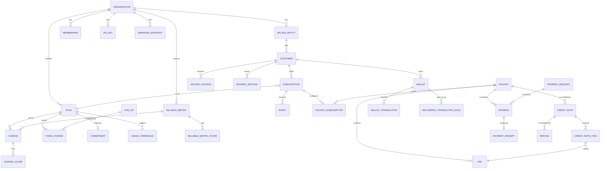
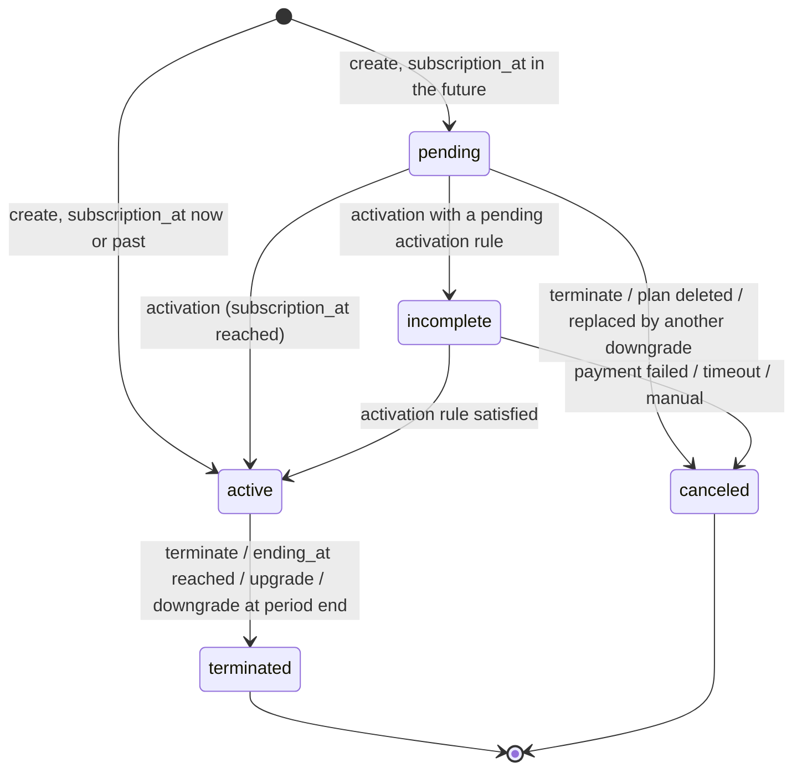
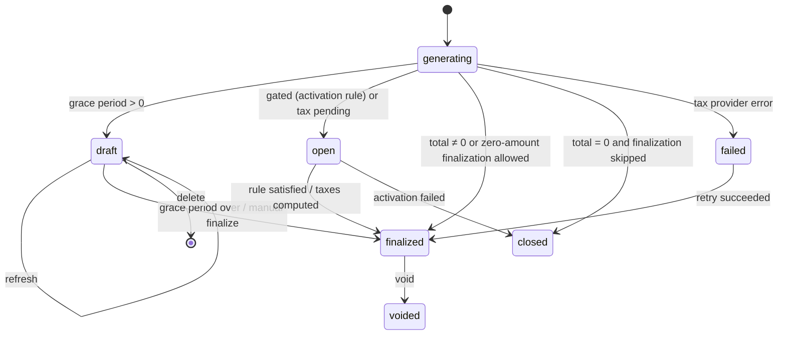
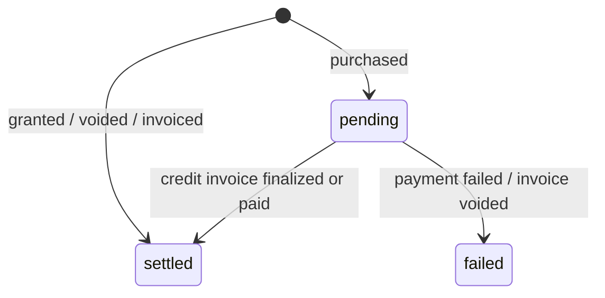
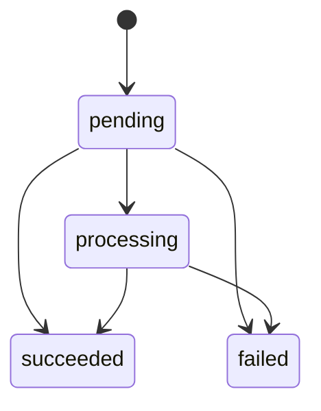

# Tanvo Domain Model

> English | [简体中文](domain.zh-CN.md)

> Related: [Architecture](architecture.md) · [Parity](parity.md) · [Development](development.md) · [Testing](testing.md) · [Roadmap](roadmap.md) · [AGENTS.md](../AGENTS.md)

---

This document defines Tanvo's business entities, their fields, invariants, enumerations and lifecycles, and the billing rules that connect them. `libs/core` (entities and repository ports) and `libs/billing` (the billing engine) are built from it. The behavior follows lago-api unless a rule is marked **[Change]**; legacy variants that Tanvo leaves out are listed with **[Dropped]**. Field types use the notation of §2.2.

## Contents

1. [Overview](#1-overview)
2. [Identifiers and Conventions](#2-identifiers-and-conventions)
3. [Enumerations](#3-enumerations)
4. [Organization and Billing Entity](#4-organization-and-billing-entity)
5. [Access: Users, Memberships, Roles, API Keys](#5-access-users-memberships-roles-api-keys)
6. [Customer](#6-customer)
7. [Catalog](#7-catalog)
8. [Coupons](#8-coupons)
9. [Subscription](#9-subscription)
10. [Events and Usage](#10-events-and-usage)
11. [Invoice](#11-invoice)
12. [Fee](#12-fee)
13. [Credit Note](#13-credit-note)
14. [Wallets](#14-wallets)
15. [Payments](#15-payments)
16. [Dunning](#16-dunning)
17. [Integrations](#17-integrations)
18. [Webhooks](#18-webhooks)
19. [Alerts](#19-alerts)
20. [Data Exports](#20-data-exports)
21. [Quotes, Order Forms, Orders and Contracts](#21-quotes-order-forms-orders-and-contracts)
22. [Billing Rules](#22-billing-rules)
23. [Deliberate Changes from Lago](#23-deliberate-changes-from-lago)
24. [Design Decisions](#24-design-decisions)

---

## 1. Overview



| Aggregate | Root | Owns | Section |
| :--- | :--- | :--- | :--- |
| Organization | `Organization` | settings, authentication methods | §4.1 |
| Billing entity | `BillingEntity` | numbering, invoicing defaults, tax settings | §4.2 |
| Access | `User`, `Membership`, `Role`, `Invite`, `APIKey` | permissions | §5 |
| Customer | `Customer` | addresses, metadata, billing settings | §6 |
| Billable metric | `BillableMetric` | filters | §7.1 |
| Plan | `Plan` | charges, fixed charges, commitment, usage thresholds, entitlements | §7.2–§7.10 |
| Add-on | `AddOn` | taxes | §7.5 |
| Pricing unit | `PricingUnit` | — | §7.6 |
| Tax | `Tax` | — | §7.7 |
| Feature | `Feature` | privileges | §7.10 |
| Coupon | `Coupon` | targets; `AppliedCoupon` per customer | §8 |
| Subscription | `Subscription` | overrides, activation rules, applied thresholds, entitlement overrides | §9 |
| Event | `Event` | — (append-only) | §10 |
| Invoice | `Invoice` | invoice subscriptions, fees, applied taxes, metadata, settlements | §11, §12 |
| Credit note | `CreditNote` | items, applied taxes, refunds | §13 |
| Wallet | `Wallet` | transactions, recurring rules, consumptions | §14 |
| Payment | `Payment` | receipt | §15 |
| Payment request | `PaymentRequest` | invoice links | §15.4 |
| Dunning campaign | `DunningCampaign` | thresholds | §16 |
| Integration | `Integration` | customers, mappings, collection mappings, items | §17 |
| Webhook endpoint | `WebhookEndpoint` | deliveries | §18 |
| Alert | `Alert` | thresholds, triggered alerts | §19 |
| Data export | `DataExport` | parts | §20 |
| Quote, order form, order | `Quote`, `OrderForm`, `Order` | versions | §21 |

Markers used throughout:

* **[Change]** Tanvo deliberately behaves differently from lago-api. Each change is also listed in §23.
* **[Dropped]** A legacy or deprecated Lago variant that Tanvo does not implement.
* **[Fix]** A lago-api bug that Tanvo does not reproduce.

---

## 2. Identifiers and Conventions

### 2.1 Identifiers
* Every row has an `id` (UUIDv7) generated by the server, and an `organization_id`; every query filters by `organization_id` ([architecture §5.4](architecture.md#54-tenancy)). The one cross-tenant unique index is the x402 settlement's payment digest and transaction hash (§24, item 14).
* Customer-facing identifiers are unique per organization: `external_id` for customers, subscriptions and wallets; `code` for metrics, plans, add-ons, coupons, taxes, features, billing entities, pricing units, dunning campaigns, integrations, alerts and wallets.
* The API addresses a resource by `id`, or by a prefixed identifier `external_id:<value>` / `code:<value>` ([architecture §4.2](architecture.md#42-rest-through-vanguard)).
* `code` values are 1–255 characters unless stated otherwise; codes are immutable once a resource is referenced, as stated per entity.
* **[Change]** Uniqueness of `code` and `external_id` holds among live rows only (not terminated, archived or deleted); a code can be reused after its owner is gone, and this is enforced by partial unique indexes rather than application checks.

### 2.2 Types

| Notation | Meaning | Storage |
| :--- | :--- | :--- |
| `ID` | UUIDv7 | `uuid` |
| `string(n)` | UTF-8 text of at most n characters, trimmed | `text` with `CHECK` |
| `Money` | Amount in the currency's minor units | `bigint` |
| `Decimal` | `money.Decimal` (precision 40) | `numeric` |
| `Currency` | ISO 4217 code | `text` |
| `Time` | Instant, UTC | `timestamptz` |
| `Date` | Calendar date, interpreted in a stated time zone | `date` |
| `Zone` | IANA time zone name | `text` |
| `Enum{…}` | Closed set of strings | `text` with `CHECK`, Go string type |
| `Metadata` | Ordered key/value list with limits per entity | child table |
| `T?` | Optional (nullable) | — |

### 2.3 Common Rules
* **Money**: monetary amounts at rest are `Money` (minor units) when final and `Decimal` ("precise") while they are still inputs to later computations (fee amounts before rounding, unit prices, credits). The rounding rules are in §22.9. Never `float64`.
* **Time**: instants are stored in UTC; dates and period boundaries are computed in the applicable time zone (§22.1) and stored as the UTC instants of local midnights.
* **Periods** are half-open `[from, to)`. **[Change]** Lago stores inclusive ends at 23:59:59.999999; Tanvo stores the next local midnight.
* **Deletion**: resources with a lifecycle carry a status (`terminated`, `archived`, `voided`, `deleted`); unreferenced rows are hard-deleted. **[Change]** There is no blanket `deleted_at` soft delete.
* **Metadata** is replaced as a whole on update (the list sent replaces the stored list).
* **Audit**: every state change named in this document emits a domain event in the same transaction; webhooks (§18) and activity logs are derived from them.
* **Locks**: operations that read and write a customer's balances (coupons, credit notes, prepaid credits, wallets) take the customer's advisory lock named in each section; billing runs lock the subscription.

---

## 3. Enumerations

| Enumeration | Values | Used by |
| :--- | :--- | :--- |
| `AuthenticationMethod` | `email_password`, `google_oauth`, `okta`, `entra_id`, `oidc` | Organization |
| `DocumentNumbering` | `per_customer`, `per_billing_entity` | BillingEntity |
| `IssuingDateAnchor` | `current_period_end`, `next_period_start` | BillingEntity, Customer |
| `IssuingDateAdjustment` | `keep_anchor`, `align_with_finalization_date` | BillingEntity, Customer |
| `EmailSetting` | `invoice.finalized`, `credit_note.created`, `payment_receipt.created` | BillingEntity |
| `EInvoicingCountry` | `FR`, `DE` | BillingEntity |
| `MembershipStatus` | `active`, `revoked` | Membership |
| `InviteStatus` | `pending`, `accepted`, `revoked` | Invite |
| `PermissionLevel` | `read`, `write` | APIKey |
| `CustomerType` | `company`, `individual` | Customer |
| `AccountType` | `customer`, `partner` | Customer |
| `ZeroAmountFinalization` | `inherit`, `skip`, `finalize` | Customer |
| `PaymentTermType` | `due_on_receipt`, `net`, `end_of_month`, `net_end_of_month`, `days_end_of_month`, `day_of_month` | BillingEntity, Customer, Invoice (§24, item 12) |
| `AggregationType` | `count`, `sum`, `max`, `unique_count`, `weighted_sum`, `latest` | BillableMetric |
| `WeightedInterval` | `seconds` | BillableMetric |
| `RoundingFunction` | `round`, `floor`, `ceil` | BillableMetric |
| `Interval` | `weekly`, `monthly`, `quarterly`, `semiannual`, `yearly` | Plan, RecurringTransactionRule |
| `ChargeModel` | `standard`, `graduated`, `graduated_percentage`, `package`, `percentage`, `volume`, `dynamic` | Charge |
| `FixedChargeModel` | `standard`, `graduated`, `volume` | FixedCharge |
| `RegroupPaidFees` | `invoice` | Charge |
| `CommitmentType` | `minimum_commitment` | Commitment |
| `PrivilegeValueType` | `integer`, `string`, `boolean`, `select` | Privilege |
| `CouponType` | `fixed_amount`, `percentage` | Coupon |
| `CouponFrequency` | `once`, `recurring`, `forever` | Coupon |
| `CouponExpiration` | `no_expiration`, `time_limit` | Coupon |
| `CouponStatus` | `active`, `terminated` | Coupon, AppliedCoupon |
| `BillingTime` | `calendar`, `anniversary` | Subscription, Contract |
| `SubscriptionStatus` | `pending`, `incomplete`, `active`, `terminated`, `canceled` | Subscription |
| `CancellationReason` | `payment_failed`, `timeout`, `manual` | Subscription |
| `TerminationCreditNote` | `credit`, `refund`, `offset`, `skip` | Subscription |
| `TerminationInvoice` | `generate`, `skip` | Subscription |
| `PaymentMethodType` | `provider`, `manual` | Subscription, Wallet, Invoice |
| `ActivationRuleType` | `payment` | SubscriptionActivationRule |
| `ActivationRuleStatus` | `inactive`, `pending`, `satisfied`, `not_applicable`, `declined`, `failed`, `expired` | SubscriptionActivationRule |
| `OperationType` | `add`, `remove` | Event (unique count) |
| `InvoiceType` | `subscription`, `credit`, `one_off`, `advance_charges`, `progressive_billing` | Invoice |
| `InvoiceStatus` | `generating`, `draft`, `open`, `finalized`, `closed`, `voided`, `failed` | Invoice |
| `PaymentStatus` | `pending`, `succeeded`, `failed` | Invoice, PaymentRequest |
| `TaxStatus` | `pending`, `succeeded`, `failed` | Invoice |
| `InvoicingReason` | `subscription_starting`, `subscription_periodic`, `subscription_terminating`, `in_advance_charge`, `in_advance_charge_periodic`, `progressive_billing` | InvoiceSubscription |
| `FeeType` | `subscription`, `charge`, `fixed_charge`, `add_on`, `credit`, `commitment`, `product` | Fee |
| `FeePaymentStatus` | `pending`, `succeeded`, `failed`, `refunded` | Fee |
| `CreditNoteStatus` | `draft`, `finalized` | CreditNote |
| `CreditStatus` | `available`, `consumed`, `voided` | CreditNote |
| `RefundStatus` | `pending`, `succeeded`, `failed` | CreditNote, Refund |
| `CreditNoteReason` | `duplicated_charge`, `product_unsatisfactory`, `order_change`, `order_cancellation`, `fraudulent_charge`, `other` | CreditNote |
| `WalletStatus` | `active`, `terminated` | Wallet |
| `TransactionType` | `inbound`, `outbound` | WalletTransaction |
| `TransactionStatus` | `purchased`, `granted`, `voided`, `invoiced` | WalletTransaction |
| `WalletTransactionStatus` | `pending`, `settled`, `failed` | WalletTransaction |
| `WalletTransactionSource` | `manual`, `interval`, `threshold` | WalletTransaction |
| `RecurringMethod` | `fixed`, `target` | RecurringTransactionRule |
| `RecurringTrigger` | `interval`, `threshold` | RecurringTransactionRule |
| `RuleStatus` | `active`, `terminated` | RecurringTransactionRule |
| `PaymentKind` | `provider`, `manual` | Payment |
| `PaymentState` | `pending`, `processing`, `succeeded`, `failed` | Payment |
| `IntegrationCategory` | `payment`, `accounting`, `tax`, `crm`, `auth` | Integration |
| `IntegrationProvider` | `stripe`, `adyen`, `gocardless`, `cashfree`, `moneyhash`, `flutterwave`, `netsuite`, `xero`, `anrok`, `avalara`, `hubspot`, `salesforce`, `okta`, `entra_id` | Integration |
| `MappableType` | `add_on`, `billable_metric` | IntegrationMapping |
| `CollectionMappingType` | `fallback_item`, `coupon`, `subscription_fee`, `minimum_commitment`, `tax`, `prepaid_credit`, `credit_note`, `account`, `currencies` | IntegrationCollectionMapping |
| `IntegrationResourceType` | `invoice`, `payment`, `credit_note`, `subscription` | IntegrationResource |
| `WebhookStatus` | `pending`, `retrying`, `succeeded`, `failed` | Webhook |
| `AlertType` | see §19 | Alert |
| `AlertDirection` | `increasing`, `decreasing` | Alert |
| `DataExportFormat` | `csv` | DataExport |
| `DataExportStatus` | `pending`, `processing`, `completed`, `failed` | DataExport |
| `DataExportResource` | `invoices`, `invoice_fees`, `credit_notes`, `credit_note_items` | DataExport |

Enumerations specific to one feature (inbound webhook status, quote status, contract status and so on) are defined in their sections.

**[Dropped]** Invoice status `deleted` as a stored status (a deleted draft is removed, §11.7); invoice type `add_on` (replaced by `one_off`); fee type `add_on` invoices outside one-off invoices; the `overriden` alias of overridden plans; `group`/`group_properties` (replaced by charge filters); the `grouped_by` charge property alias (replaced by `pricing_group_keys`); `recurring_count_agg`; integration resource type `sales_order_deprecated`.

---

## 4. Organization and Billing Entity

### 4.1 Organization

The tenant. All other entities belong to exactly one organization.

| Field | Type | Rules |
| :--- | :--- | :--- |
| `name` | `string(255)` | required |
| `slug` | `string(63)` | unique, lowercase, derived from name; used in portal URLs |
| `email` | `string(255)?` | valid email |
| `logo` | blob reference? | |
| `address` | Address | |
| `authentication_methods` | `[]AuthenticationMethod` | at least one |
| `audit_logs_retention_days` | `int` | default 30 |
| `max_wallets_per_customer` | `int` | default 6 |
| `created_at` | `Time` | |

Address (shared value object): `line1`, `line2`, `city`, `state`, `zipcode`, `country` (ISO 3166-1 alpha-2). All optional; `country` is validated.

**[Change]** The organization carries no billing settings. Lago duplicates timezone, currency, grace period, net payment term, document numbering, prefix, invoice footer, document locale, tax ID, EU tax management and email settings on the organization and the billing entity; in Tanvo the billing entity is authoritative and the organization keeps only identity and access settings. Every organization has at least one billing entity, created with it.

**[Change]** There are no premium gates in the core: every feature in this document is available to every organization. Analytics and the assistant live in `ee/` ([architecture §14](architecture.md#14-enterprise-edition-ee)).

**[Dropped]** `organizations.webhook_url`, `api_key`, `hmac_key` (replaced by webhook endpoints and API keys), the organization-level duplicate settings above, and the deprecated public-key endpoint.

### 4.2 Billing Entity

The legal issuer of documents. A customer belongs to exactly one billing entity; a subscription may override it.

| Field | Type | Rules |
| :--- | :--- | :--- |
| `code` | `string(255)` | unique among non-archived entities; immutable |
| `name` | `string(255)` | required |
| `legal_name`, `legal_number`, `tax_id` | `string(255)?` | printed on documents |
| `email`, `phone` | `string?` | |
| `address` | Address | |
| `logo` | blob reference? | |
| `timezone` | `Zone` | default `UTC` |
| `default_currency` | `Currency` | default `USD` |
| `document_locale` | `string` | BCP 47 language; default `en` |
| `document_numbering` | `DocumentNumbering` | default `per_customer` |
| `document_number_prefix` | `string(10)` | 1–10 characters, upper-cased; default first 3 letters of name (upper, A–Z) + `-` + last 4 characters of the id |
| `invoice_footer` | `string(600)?` | |
| `invoice_grace_period_days` | `int` | ≥ 0; default 0 |
| `payment_term` | `PaymentTerm?` | §24, item 12; `null` = `due_on_receipt` |
| `finalize_zero_amount_invoice` | `bool` | default true |
| `issuing_date_anchor` | `IssuingDateAnchor` | default `next_period_start` |
| `issuing_date_adjustment` | `IssuingDateAdjustment` | default `align_with_finalization_date` |
| `email_settings` | `[]EmailSetting` | subset; default empty |
| `eu_tax_management` | `bool` | requires an address `country` in the EU |
| `einvoicing` | `bool` | allowed only when `country` ∈ `EInvoicingCountry` |
| `applied_dunning_campaign_id` | `ID?` | §16 |
| `invoice_sequence`, `invoice_sequence_month` | internal counters | §22.11 |
| `archived_at` | `Time?` | |

Rules:
* A billing entity is never deleted; it is archived. An archived entity cannot receive new customers or subscriptions; existing documents keep referring to it.
* An organization has at most one default billing entity (`is_default`), used when a customer is created without one.
* Changing `document_numbering` takes effect for documents finalized afterwards; existing numbers never change.
* Applied taxes: a billing entity has a list of default taxes (`billing_entity_taxes`), applied as the last fallback in tax resolution (§22.10).
* Invoice custom sections (§11.9) can be selected per billing entity.

---

## 5. Access: Users, Memberships, Roles, API Keys

### 5.1 User
A person who signs in. Fields: `email` (unique, case-insensitive), `password_hash` (argon2id) or none for SSO-only users, `name?`, `created_at`, `last_sign_in_at?`. A user can belong to several organizations.

### 5.2 Membership
Links a user to an organization with a role.

| Field | Type | Rules |
| :--- | :--- | :--- |
| `user_id`, `organization_id` | `ID` | unique pair among active memberships |
| `role_id` | `ID` | built-in or custom role of the organization |
| `status` | `MembershipStatus` | `active` → `revoked` (terminal) |
| `revoked_at` | `Time?` | |

Rules:
* The last active admin of an organization cannot be revoked or demoted.
* A user cannot revoke their own membership.
* Only an admin can grant the `admin` role.

### 5.3 Role and Permissions
* A permission is a string `<resource>:<action>` (`customers:read`, `invoices:void`, …). The full list is defined in `libs/core/permission` and documented in the API reference.
* Built-in roles: `admin` (all permissions), `finance`, `manager`. Built-in roles are immutable.
* Custom roles: `code` (`string(100)`, unique, not one of the built-in names), `name`, `description?`, `permissions []string`. A custom role in use by a membership cannot be deleted.
* SSO (Okta, Entra ID, OIDC) maps an identity to a membership with the role configured on the integration. **[Fix]** Lago assigns a fixed role on Okta/Entra sign-up regardless of configuration.

### 5.4 Invite
`email`, `role_id`, `token` (random, hashed at rest), `status` (`pending` → `accepted` | `revoked`), `expires_at`. Accepting creates (or reuses) the user and an active membership. A pending invite for an email that already has an active membership is refused.

Password reset tokens expire after 30 minutes and are single-use.

### 5.5 API Key

| Field | Type | Rules |
| :--- | :--- | :--- |
| `name` | `string(255)?` | |
| `token_hash` | `bytes` | SHA-256 of the secret; the secret is shown once |
| `prefix` | `string` | first characters of the secret, for display |
| `permissions` | map resource → `PermissionLevel` | empty map = full access |
| `expires_at` | `Time?` | |
| `last_used_at` | `Time?` | |

Rules:
* An organization keeps at least one non-expiring key; the last one cannot be deleted or given an expiry.
* Rotation creates a new key and sets the old key's `expires_at` (immediately or at a chosen instant).

### 5.6 Customer Portal Token
A signed, stateless token scoped to one customer, valid for 12 hours, giving read access to that customer's invoices, usage and wallets and write access to its own billing details.

---

## 6. Customer

The billed party.

| Field | Type | Rules |
| :--- | :--- | :--- |
| `external_id` | `string(255)` | required; unique among non-deleted customers |
| `billing_entity_id` | `ID` | required; default = organization's default entity |
| `customer_type` | `CustomerType?` | |
| `account_type` | `AccountType` | default `customer` |
| `name` | `string(255)?` | |
| `firstname`, `lastname` | `string(255)?` | |
| `legal_name`, `legal_number` | `string(255)?` | |
| `tax_identification_number` | `string(255)?` | |
| `email` | `string?` | comma-separated list of valid emails |
| `phone`, `url`, `logo_url` | `string?` | |
| `billing_address` | Address | |
| `shipping_address` | Address | each empty field falls back to the billing address field when printed |
| `currency` | `Currency?` | default for new billing objects; see rules |
| `timezone` | `Zone?` | |
| `document_locale` | `string?` | |
| `invoice_grace_period_days` | `int?` | ≥ 0 |
| `payment_term` | `PaymentTerm?` | §24, item 12; `null` = inherit |
| `finalize_zero_amount_invoice` | `ZeroAmountFinalization` | default `inherit` |
| `issuing_date_anchor`, `issuing_date_adjustment` | enums? | `null` = inherit |
| `skip_invoice_custom_sections` | `bool` | |
| `applied_dunning_campaign_id` | `ID?` | |
| `exclude_from_dunning_campaign` | `bool` | |
| `dunning_campaign_attempts`, `last_dunning_campaign_attempt_at` | `map<currency, int>`, `Time?` | Attempts are counted per currency |
| `sequential_id` | `int` | assigned on create, per billing entity |
| `slug` | `string` | `<prefix>-<sequential_id %03d>` |
| `payment_receipt_counter` | `int` | §22.11 |
| `metadata` | Metadata | ≤ 5 items; key ≤ 20, value ≤ 100; `display_in_invoice bool` |
| `deleted_at` | `Time?` | customers are archived, not hard-deleted, once they have documents |

Rules:
* Settings resolve customer → billing entity (→ UTC for the time zone). **[Change]** Lago falls back to the organization in some code paths and to the billing entity in others; Tanvo uses the billing entity everywhere.
* `currency` is a default, not a constraint. A wallet or one-off invoice created without a currency takes it; the first billing object created while it is absent sets it (a subscription with its plan's currency, a wallet, a fixed-amount applied coupon or a one-off invoice with its own); an explicit customer update can change it at any time without affecting existing objects.
* Each billing object carries its own currency: a subscription its plan's `currency` (§9.1), a wallet (§14.1), a fixed-amount applied coupon (§8.2) and a one-off invoice (§11.6) their own. A customer can be billed in several currencies: invoices are split per currency (§9.6), credit notes, fixed-amount coupons and wallets apply only to invoices in their currency (§22.7), and dunning counts attempts and checks thresholds per currency (§16.1).
* A customer is **editable** when it has no subscriptions, invoices, applied coupons and wallets. Only an editable customer can change `external_id` or `account_type`.
* `account_type = partner`: invoices issued to the customer are self-billed (§11.1).
* Deleting a customer terminates its subscriptions (with termination invoices), terminates its wallets and applied coupons and archives it; its invoices remain.
* Advisory locks per customer: `coupons`, `credit_notes`, `prepaid_credits`, `billing_schedule`.
* EU tax management: on create and on address or tax ID change, when the billing entity has `eu_tax_management`, a VIES check runs and assigns the customer's EU tax (§22.10); the result is emitted as `customer.vies_check`.
* Payment and integration connections: see §15.5 and §17.2. **[Change]** There is no single `payment_provider` column; a customer can have connections to several providers, one default per category.

---

## 7. Catalog

### 7.1 Billable Metric

What is measured.

| Field | Type | Rules |
| :--- | :--- | :--- |
| `code` | `string(255)` | unique |
| `name` | `string(255)` | required |
| `description` | `string?` | |
| `aggregation_type` | `AggregationType` | required |
| `field_name` | `string?` | the event property aggregated; required unless `count` |
| `weighted_interval` | `WeightedInterval?` | required (= `seconds`) for `weighted_sum`, forbidden otherwise |
| `recurring` | `bool` | forbidden for `count`, `max`, `latest` |
| `expression` | `string?` | lago-expression; its result is written to `field_name` before aggregation |
| `rounding_function` | `RoundingFunction?` | |
| `rounding_precision` | `int?` | default 0 when a rounding function is set; may be negative |
| `filters` | `[]BillableMetricFilter` | |

`BillableMetricFilter`: `key string(255)` (the event property), `values []string` (non-empty, unique). Keys are unique per metric.

Rules:
* Once the metric is used by a charge, `code`, `aggregation_type`, `weighted_interval`, `field_name`, `recurring`, `rounding_function`, `rounding_precision` and `expression` are locked.
* Removing a filter value deletes the charge filter values that use it; removing a filter key deletes the charge filters that reference it. Both are refused (`referenced_by_product_filter`) when a rate card's product filter uses the value or key: a priced rate card is never reshaped by a metric edit.
* Deleting a metric deletes its charges (and their filters) from every plan and recomputes draft invoices; it is refused (`referenced_by_product_filter`) while a rate card's product filter uses the metric. Its events are kept.
* Payable in advance: only `count`, `sum` and `unique_count` metrics can back in-advance charges.

Aggregation semantics (implemented in `libs/metering`):

| Type | Value over a period | Recurring behavior |
| :--- | :--- | :--- |
| `count` | number of events | — |
| `sum` | Σ `field_name` | carries the running total over periods |
| `max` | max `field_name` | — |
| `unique_count` | distinct `field_name` values; `operation_type=remove` removes a value | values persist until removed; prorated by presence days |
| `weighted_sum` | Σ value × seconds held / seconds in period | the last value carries over as the initial value |
| `latest` | `field_name` of the latest event | — |

Rounding applies to the aggregated value (not per event), with the metric's function and precision, before pricing.

**[Dropped]** Legacy metric properties, `recurring_count_agg`, groups.

### 7.2 Plan

A priced offer.

| Field | Type | Rules |
| :--- | :--- | :--- |
| `code` | `string(255)` | unique among plans that are not children |
| `name` | `string(255)` | required |
| `invoice_display_name` | `string?` | |
| `description` | `string?` | |
| `interval` | `Interval` | required |
| `amount` | `Money` | ≥ 0; the subscription (base) fee per period |
| `currency` | `Currency` | required |
| `pay_in_advance` | `bool` | base fee billed at the start (true) or end (false) of the period |
| `trial_period_days` | `int` | ≥ 0 |
| `bill_charges_monthly` | `bool?` | only for `yearly` and `semiannual` plans |
| `bill_fixed_charges_monthly` | `bool?` | only for `yearly` and `semiannual` plans |
| `parent_id` | `ID?` | set for an override plan (§7.2.1) |
| `taxes` | `[]Tax` | |
| `metadata` | Metadata | |
| `status` | Enum{`active`, `pending_deletion`} | |

Rules:
* Once the plan has subscriptions, `code`, `interval`, `pay_in_advance`, `currency`, `trial_period_days`, `bill_charges_monthly` and `bill_fixed_charges_monthly` are locked.
* Deleting a plan sets `pending_deletion`, terminates its active subscriptions (with termination invoices), cancels its pending ones, then deletes the plan in a job.
* `yearly_amount` = `amount` × periods per year (52, 12, 4, 2, 1); it decides upgrade versus downgrade (§22.13).
* **[Change]** The trial is a whole number of days (`int`); Lago stores a float.

#### 7.2.1 Override Plans
A subscription can be created with overrides of the plan's amount, name, description, trial, taxes, charges, fixed charges, commitment and usage thresholds. Tanvo materializes them as a child plan (`parent_id` = the original) used only by that subscription.
* Children inherit everything they do not override; `code` is the parent's.
* Editing the parent with `cascade_updates = true` propagates the changed fields to children whose values still equal the parent's previous values.
* Deleting the parent deletes its children.

### 7.3 Charge

Prices a billable metric on a plan.

| Field | Type | Rules |
| :--- | :--- | :--- |
| `code` | `string(255)` | unique per plan; default `<metric code>`, then `<metric code>_2`, `_3`, … |
| `billable_metric_id` | `ID` | |
| `charge_model` | `ChargeModel` | |
| `properties` | `ChargeProperties` | per model, below |
| `filters` | `[]ChargeFilter` | §7.4 |
| `pay_in_advance` | `bool` | |
| `invoiceable` | `bool` | default true |
| `regroup_paid_fees` | `RegroupPaidFees?` | |
| `prorated` | `bool` | |
| `min_amount` | `Money` | ≥ 0; per-period minimum |
| `invoice_display_name` | `string?` | |
| `applied_pricing_unit` | `{pricing_unit_id, conversion_rate Decimal}?` | §7.6 |
| `taxes` | `[]Tax` | |

Validation matrix:

| Rule | Condition |
| :--- | :--- |
| `dynamic` | metric `aggregation_type = sum` |
| `pay_in_advance = true` | model ≠ `volume`; metric payable in advance (§7.1) |
| `invoiceable = false` | `pay_in_advance = true` |
| `regroup_paid_fees = invoice` | `pay_in_advance = true` and `invoiceable = false` |
| `min_amount > 0` | `pay_in_advance = false` |
| `prorated = true` | metric `recurring`; metric ≠ `weighted_sum`; in advance: model = `standard`; in arrears: model ∈ {`standard`, `volume`, `graduated`} |
| `percentage`, `graduated_percentage` | metric ≠ `latest` |

Properties per model (`Decimal` unless stated):

| Model | Properties | Rules |
| :--- | :--- | :--- |
| `standard` | `amount` | ≥ 0 |
| `package` | `amount`, `package_size int`, `free_units int` | size > 0; free ≥ 0 |
| `percentage` | `rate`, `fixed_amount?`, `free_units_per_events int?`, `free_units_per_total_aggregation?`, `per_transaction_min_amount?`, `per_transaction_max_amount?` | rate ≥ 0; free events > 0; min ≤ max |
| `graduated` | `ranges []{to?, per_unit_amount, flat_amount}` | see tiers |
| `volume` | `ranges []{to?, per_unit_amount, flat_amount}` | see tiers |
| `graduated_percentage` | `ranges []{to?, rate, flat_amount}` | see tiers |
| `dynamic` | — | price comes from the events |

Every model also accepts `pricing_group_keys []string` (one fee per distinct combination of these event properties) and `presentation_group_keys []{key, display_in_invoice bool}` (at most 2; break a fee down on the invoice without changing the price).

**Tiers [Change]**: tiers are stored as adjacent half-open ranges. The input is an ordered list of upper bounds; tier *i* covers `(to[i-1], to[i]]` for graduated counting, the first tier starts at 0 and the last tier has no upper bound (`to = null`). Validation: at least one tier; upper bounds strictly increasing; only the last tier is unbounded; amounts and rates ≥ 0. Lago's inclusive `from`/`to` pairs with `+1` gaps are not accepted as input (libs/pricing keeps an adapter for porting test cases).

Charge model math (`u` = units after metric rounding):
* `standard`: `u × amount`.
* `package`: `ceil(max(u − free_units, 0) / package_size) × amount`.
* `graduated`: Σ over tiers of (units falling in the tier × `per_unit_amount` + `flat_amount` if any unit falls in the tier).
* `volume`: the single tier containing `u`: `u × per_unit_amount + flat_amount`; `u = 0` gives 0.
* `percentage`: `max(u − free_units_per_total_aggregation, 0) × rate / 100` + `max(events − free_units_per_events, 0) × fixed_amount`; when per-transaction bounds are set, each event's amount (`value × rate / 100 + fixed_amount`) is clamped to `[min, max]` and the clamped amounts are summed.
* `graduated_percentage`: Σ over tiers of (amount falling in the tier × `rate` / 100 + `flat_amount` if any amount falls in the tier).
* `dynamic`: Σ `precise_total_amount` of the events, in currency units.
* In-advance fees: the fee for an event is `amount(total with the event) − amount(total without it)` over the current period.
* The per-unit price shown on a fee is `amount / units` when units > 0.

### 7.4 Charge Filter

Prices a slice of a charge's events with its own properties.

| Field | Type | Rules |
| :--- | :--- | :--- |
| `charge_id` | `ID` | |
| `values` | map metric filter key → `[]string` | each key is a filter of the metric; values ⊆ the filter's values, or the single sentinel `__ALL_FILTER_VALUES__` |
| `properties` | `ChargeProperties` | same model as the charge |
| `invoice_display_name` | `string?` | |

Rules:
* An event matches a filter when, for every key of the filter, the event's property equals one of the values (any value for the sentinel).
* When several filters match, the most specific wins: more keys first, then fewer allowed values, then the earlier `created_at`.
* Events that match no filter are priced by the charge's own properties (the default bucket).
* Each filter has a stable code: the slug of its key/value pairs plus an 8-hex-character SHA-256 suffix, ≤ 200 characters. Filters are matched when usage is queried or bucketed, never at enrichment (§10.2).

### 7.5 Fixed Charge and Add-on

**Add-on**: a reusable priced item.

| Field | Type | Rules |
| :--- | :--- | :--- |
| `code` | `string(255)` | unique |
| `name` | `string(255)` | |
| `invoice_display_name`, `description` | `string?` | |
| `amount` | `Money` | > 0 |
| `currency` | `Currency` | |
| `taxes` | `[]Tax` | |

Add-ons are used by one-off invoices (§11.6) and by fixed charges.

**Fixed charge**: a recurring, quantity-based charge on a plan, priced from an add-on.

| Field | Type | Rules |
| :--- | :--- | :--- |
| `code` | `string(255)` | unique per plan |
| `add_on_id` | `ID` | |
| `charge_model` | `FixedChargeModel` | |
| `properties` | `ChargeProperties` | `standard`, `graduated` or `volume` |
| `units` | `Decimal` | ≥ 0; default for subscriptions |
| `pay_in_advance` | `bool` | not with `volume` |
| `prorated` | `bool` | not with `graduated` + `pay_in_advance` |
| `invoice_display_name` | `string?` | |
| `taxes` | `[]Tax` | |

Units per subscription: a subscription can override the units of a fixed charge. A unit change is a **fixed charge event** `{subscription_id, fixed_charge_id, units, timestamp}`:
* With `apply_units_immediately = true` it takes effect at the change instant (prorated if the fixed charge is prorated; in advance it bills the difference immediately).
* Otherwise it takes effect at the start of the next billing period.
* At most one event per subscription, fixed charge and day is kept (a later one the same day replaces the earlier one).

The fixed charge's units in a period are the units in force at each instant, weighted by time when prorated, otherwise the units in force at the billing instant.

### 7.6 Pricing Unit

A custom unit in which charges can be priced (for example credits or tokens).

| Field | Type | Rules |
| :--- | :--- | :--- |
| `code` | `string(255)` | unique; immutable |
| `name` | `string(255)` | |
| `short_name` | `string(3)` | |
| `description` | `string(600)?` | |
| `exponent` | `int` | 2 |

A charge priced in a pricing unit carries `conversion_rate > 0` (fiat per pricing unit). Fees record the amount in the pricing unit (`pricing_unit_usage`: amount, unit amount, conversion rate) and in the currency: `fiat = round_half_up(amount × conversion_rate, currency exponent)`. Taxes, coupons and credits apply to the fiat amount.

### 7.7 Tax

| Field | Type | Rules |
| :--- | :--- | :--- |
| `code` | `string(255)` | unique |
| `name` | `string(255)` | |
| `rate` | `Decimal` | 0 ≤ rate ≤ 100 (percent) |
| `description` | `string?` | |
| `auto_generated` | `bool` | created by EU tax management; read-only |

Taxes are attached to billing entities, customers, plans, charges, fixed charges, add-ons and commitments; resolution is in §22.10. Changing a rate refreshes draft invoices that use the tax. Deleting a tax detaches it everywhere; issued documents keep their applied-tax snapshots (code, name, rate, amount).

**[Dropped]** `vat_rate` columns.

### 7.8 Commitment

A minimum spend per billing period.

| Field | Type | Rules |
| :--- | :--- | :--- |
| `plan_id` | `ID` | at most one per plan and type |
| `commitment_type` | `CommitmentType` | `minimum_commitment` |
| `amount` | `Money` | > 0 |
| `invoice_display_name` | `string?` | |
| `taxes` | `[]Tax` | |

The true-up rule is in §22.15.

### 7.9 Usage Threshold

Triggers a progressive-billing invoice when the current-period usage amount reaches an amount.

| Field | Type | Rules |
| :--- | :--- | :--- |
| `plan_id` xor `subscription_id` | `ID` | exactly one |
| `amount` | `Money` | > 0 |
| `recurring` | `bool` | at most one recurring threshold per owner |
| `threshold_display_name` | `string?` | |

Rules:
* Non-recurring amounts are unique per owner; the recurring threshold's amount is the step after the largest non-recurring one.
* A subscription's own thresholds replace the plan's.
* `progressive_billing_disabled` on the subscription disables both.
* Each reached threshold is recorded as an `AppliedUsageThreshold` {threshold, invoice, lifetime_usage_amount}. Progressive billing is in §22.16.

### 7.10 Features and Entitlements

**Feature**: `code string(255)` unique, `name?`, `description?`, `privileges []Privilege`.

**Privilege**: `code string(255)` unique per feature, `name?`, `value_type PrivilegeValueType`, `select_options []string` (required and non-empty for `select`).

**Entitlement**: grants a feature to a plan or a subscription, with `values` map privilege code → value. Values are validated against the privilege type (`integer` as a 64-bit integer, `boolean`, a `select` value in its options).

Effective entitlements of a subscription = the plan's entitlements − the subscription's removals (`subscription_feature_removals`) + the subscription's own entitlements (which override the plan's values privilege by privilege). Deleting a feature removes its entitlements.

---

## 8. Coupons

### 8.1 Coupon

| Field | Type | Rules |
| :--- | :--- | :--- |
| `code` | `string(255)` | unique |
| `name` | `string(255)` | |
| `description` | `string?` | |
| `coupon_type` | `CouponType` | |
| `amount` | `Money?` + `currency` | required for `fixed_amount` |
| `percentage_rate` | `Decimal?` | required for `percentage`; 0 < rate ≤ 100 |
| `frequency` | `CouponFrequency` | |
| `frequency_duration` | `int?` | number of billing periods; required (> 0) for `recurring` |
| `reusable` | `bool` | default true |
| `expiration` | `CouponExpiration` | |
| `expiration_at` | `Time?` | required for `time_limit`; in the future |
| `limited_plans` | `[]PlanID` | |
| `limited_billable_metrics` | `[]MetricID` | targets plans **or** metrics, not both |
| `status` | `CouponStatus` | `active` → `terminated` |

Rules:
* Once applied, only `name`, `description` and the expiration can change.
* A coupon past `expiration_at` is terminated by a periodic job; terminating a coupon does not affect applied coupons.
* Deleting a coupon terminates it and its applied coupons.

### 8.2 Applied Coupon

| Field | Type | Rules |
| :--- | :--- | :--- |
| `coupon_id`, `customer_id` | `ID` | |
| `amount`, `percentage_rate`, `frequency`, `frequency_duration` | as coupon | overrides captured at application |
| `amount_currency` | `Currency?` | the override's, else the coupon's; `null` for `percentage` |
| `frequency_duration_remaining` | `int?` | |
| `remaining_amount` | `Money?` | for `once` + `fixed_amount` |
| `status` | `CouponStatus` | |
| `terminated_at` | `Time?` | |

Rules:
* A non-reusable coupon can be applied to a customer once (error `coupon_is_not_reusable`).
* A plan-limited coupon cannot be applied if an active applied coupon of the customer already targets one of the same plans (error `plan_overlapping`).
* A `fixed_amount` applied coupon carries its own currency, which need not be the customer's; it applies only to invoices in that currency (§22.7). A `percentage` coupon applies to invoices in any currency. A coupon has one currency; applying it in another currency is done with an amount and currency override.
* Application to invoices is in §22.7.

---

## 9. Subscription

### 9.1 Fields

| Field | Type | Rules |
| :--- | :--- | :--- |
| `external_id` | `string(255)` | unique among `pending`, `incomplete` and `active` subscriptions |
| `customer_id` | `ID` | |
| `plan_id` | `ID` | |
| `name` | `string(255)?` | |
| `billing_time` | `BillingTime` | default `calendar` |
| `status` | `SubscriptionStatus` | §9.2 |
| `subscription_at` | `Time` | requested start; default now |
| `started_at` | `Time?` | actual activation |
| `ending_at` | `Time?` | planned automatic termination; > `subscription_at` |
| `terminated_at`, `canceled_at` | `Time?` | |
| `trial_ended_at` | `Time?` | |
| `cancellation_reason` | `CancellationReason?` | |
| `previous_subscription_id` | `ID?` | the subscription this one upgrades or downgrades |
| `on_termination_credit_note` | `TerminationCreditNote?` | only for in-advance plans; default `credit` |
| `on_termination_invoice` | `TerminationInvoice` | default `generate` |
| `payment_method_type` | `PaymentMethodType` | default `provider` |
| `payment_method_id` | `ID?` | |
| `progressive_billing_disabled` | `bool` | |
| `consolidate_invoice` | `bool` | default true; false = this subscription is never grouped with others |
| `purchase_order_number` | `string(255)?` | editable while `pending` or `active` |
| `billing_entity_id` | `ID?` | override of the customer's |
| `skip_invoice_custom_sections` + selected sections | | §11.9 |
| `next_billing_at` | `Time?` | **[Change]** scheduling instant (§22.17) |

A subscription bills in its plan's `currency`; a plan override (§7.2.1) can set another currency for the child plan.

The subscription's own entities: fixed-charge unit overrides (§7.5), usage thresholds (§7.9), entitlements and removals (§7.10), activation rules (§9.3), applied usage thresholds.

### 9.2 Lifecycle



* Creation with `subscription_at` ≤ now activates immediately (`started_at = subscription_at`, which may be in the past); a later date gives `pending`, activated by its scheduled job at `subscription_at`.
* `incomplete` subscriptions receive no events (§10.2) and are not billed periodically.
* `subscription.started`, `subscription.incomplete`, `subscription.canceled`, `subscription.terminated`, `subscription.updated` are emitted on the corresponding transitions.
* 15 and 45 days before `ending_at`, `subscription.termination_alert` is emitted.

### 9.3 Activation Rules

A subscription can require a successful payment of its first invoice before it becomes active.

| Field | Type | Rules |
| :--- | :--- | :--- |
| `rule_type` | `ActivationRuleType` | `payment` |
| `timeout_hours` | `int` | ≥ 0; 0 = no timeout |
| `status` | `ActivationRuleStatus` | |
| `expires_at` | `Time?` | activation + timeout |

* The rule is **applicable** when the activation produces an invoice to pay immediately: the plan is in advance and the subscription is not in trial, or the plan has in-advance fixed charges. Otherwise it becomes `not_applicable` and the subscription activates directly.
* Applicable rule: status `pending`, subscription `incomplete`, the starting invoice is gated (it stays `open` and is not numbered until the rule resolves).
* Payment succeeded → rule `satisfied`, subscription `active`, invoice finalized.
* Payment failed → `failed`, subscription `canceled` (`payment_failed`), the gating invoice is `closed` and what it consumed (coupons, credit notes, wallet credits) is restored.
* Timeout → `expired`, `canceled` (`timeout`); terminating an `incomplete` subscription → `declined`, `canceled` (`manual`). Both close the gating invoice and cancel the provider payment.
* Rules can be changed only while the subscription is `pending`. A `payment` rule requires a provider payment method (explicit or the customer default).

### 9.4 Trials
* The trial starts at the start of the subscription chain (the `started_at` of the first subscription in the upgrade chain), so it survives upgrades and downgrades: trial end = chain start + `trial_period_days` days in the customer's time zone.
* No base fee is charged for trial days (§22.5); usage charges are billed normally.
* At trial end: `trial_ended_at` is set, `subscription.trial_ended` is emitted and, for in-advance plans, the base fee for the rest of the period is invoiced.

### 9.5 Updates
* Editable: `name`, `ending_at`, `subscription_at` (only while `pending`), `purchase_order_number`, `payment_method`, `progressive_billing_disabled`, `consolidate_invoice`, termination options, invoice custom sections and plan overrides (which create or update the child plan).
* Changing the plan is an upgrade or downgrade (§22.13).

### 9.6 Invoice Grouping
Subscriptions of a customer billed at the same instant share an invoice when they have the same payment method, currency, billing entity and purchase order number and all have `consolidate_invoice = true`. A customer with subscriptions in several currencies therefore receives one periodic invoice per currency. The invoice takes the group's currency and `purchase_order_number`.

---

## 10. Events and Usage

### 10.1 Event

| Field | Type | Rules |
| :--- | :--- | :--- |
| `transaction_id` | `string(255)` | required |
| `code` | `string(255)` | billable metric code |
| `external_subscription_id` | `string(255)` | required; `external_contract_id` is accepted as an alias on ingestion and event filters, and `external_subscription_id` wins when both are sent |
| `timestamp` | `Time` | default ingestion time; accepts RFC 3339 or Unix seconds with fraction |
| `properties` | map string → string | numbers are sent as strings or JSON numbers and normalized to decimal strings |
| `precise_total_amount` | `Decimal?` | for `dynamic` charges |
| `ingested_at` | `Time` | |

Rules:
* Batches contain at most 100 events; each event is validated independently.
* **Deduplication [Change]**: the key is (organization, `transaction_id`). Lago uses (organization, external subscription, transaction ID). A re-sent known `transaction_id` is acknowledged as a duplicate and dropped; corrections go through the event replacement API. See §24, item 11.

### 10.2 Enrichment and Validation
* The event's subscription is the one with `external_id = external_subscription_id`, status `active` or `terminated`, and `started_at ≤ timestamp < terminated_at`. `pending`, `incomplete` and `canceled` subscriptions never match. For recurring metrics an event without a matching period falls back to the active subscription.
* If the metric has an `expression`, it is evaluated and its result is stored in `properties[field_name]`.
* Post-validation errors are recorded and reported in the `events.errors` webhook (batched): `invalid_code` (no metric with that code), `missing_aggregation_property` (`field_name` absent), `invalid_filter_values` (a filter property with a value outside the filter's values).
* One enriched row is written per event, carrying the subscription, the metric, the expression result, the aggregated value, the grouping keys and the precise amount. Enrichment looks up the metric's charges only to decide whether an in-advance charge applies; it stores no charge or filter. The matching charge filter (or the default bucket) is resolved from the raw properties when usage is queried or bucketed ([architecture §7.2](architecture.md#72-enrichment)).
* In-advance charges produce a fee per event (§22.4).

**[Dropped]** The deprecated `event.error` webhook.

### 10.3 Usage
* **Current usage**: fees computed for the current period of a subscription up to now, with taxes, not persisted.
* **Projected usage** is derived from each current-usage fee alone (default-filter and grouped fees included), with no event query, so it follows the displayed current usage. The ratio is `days elapsed / days in the charges period` in the customer's time zone, clamped to [0, 1], over the fee's charges period (`charges_from`, `charges_to`), which is shorter than the billing period for yearly and semiannual plans billing charges monthly; it is 1 after the period and the projection is 0 before it. Projected units are `round(units / ratio, 2)` and presentation breakdowns are scaled the same way. Then:
  * `standard`, `graduated`, `package` and `volume`: the projected units are repriced with the charge's properties;
  * every other model (`percentage`, `graduated_percentage`, `dynamic`): the current precise amount (and the pricing-unit amount) is scaled, `max(round(precise_amount / ratio), 0)`.
  * Recurring metrics are not projected: the projection equals the current fee.
* **Usage cache**: each charge's current usage (per filter, and separately for full usage) is cached with the instant of the latest event ingested when it was computed. A read recomputes the entry when a newer event exists; ingestion never deletes entries. Catalog changes, metric deletion and event deduplication delete them, since they change usage without a newer event.
* **Past usage**: fees of invoiced periods, read from invoices.
* **Lifetime usage**: per subscription chain, `historical_usage` (imported) + `invoiced_usage` + `current_usage`; refreshed when events arrive and after invoicing; it drives usage thresholds (§22.16) and lifetime alerts (§19).
* Daily usage time series are an `ee/` analytics feature.

---

## 11. Invoice

### 11.1 Fields

| Field | Type | Rules |
| :--- | :--- | :--- |
| `customer_id`, `billing_entity_id` | `ID` | |
| `invoice_type` | `InvoiceType` | |
| `status` | `InvoiceStatus` | §11.2 |
| `payment_status` | `PaymentStatus` | |
| `tax_status` | `TaxStatus?` | set when a tax provider is used |
| `number` | `string` | §22.11 |
| `sequential_id` | `int?` | per customer, assigned on finalization |
| `billing_entity_sequential_id` | `int?` | per billing entity, assigned on finalization |
| `currency` | `Currency` | |
| `fees_amount` | `Money` | Σ fee amounts |
| `progressive_billing_credit_amount` | `Money` | §22.16 |
| `coupons_amount` | `Money` | |
| `sub_total_excluding_taxes_amount` | `Money` | |
| `taxes_amount` | `Money` | |
| `taxes_rate` | `Decimal` | weighted rate, 5 decimal places |
| `sub_total_including_taxes_amount` | `Money` | |
| `credit_notes_amount` | `Money` | credit-note credits applied |
| `prepaid_credit_amount` | `Money` | wallet credits applied |
| `prepaid_granted_credit_amount`, `prepaid_purchased_credit_amount` | `Money` | split of the above |
| `total_amount` | `Money` | |
| `total_paid_amount` | `Money` | |
| `offsetted_amount` | derived | Σ offset credit notes |
| `total_due_amount` | derived | `total − total_paid − offsetted` |
| `issuing_date` | `Date` | |
| `payment_due_date` | `Date` | from `payment_term` and `issuing_date` (§22.12) |
| `expected_finalization_date` | `Date` | billing date + grace period |
| `applied_grace_period_days` | `int` | |
| `payment_term`, `payment_term_source` | `PaymentTerm`, Enum{`customer`, `billing_entity`, `default`} | snapshot (§24, item 12) |
| `purchase_order_number` | `string(255)?` | from the subscriptions grouped on it (§9.6), the wallet transaction or wallet (`credit`), or the request (`one_off`); kept on regeneration unless replaced |
| `x402_connection_id`, `x402_payment_token` | `ID?`, `string?` | the x402 connection an invoice payment link is bound to (same organization) and its token, unique when set |
| `payment_overdue` | `bool` | |
| `payment_dispute_lost_at` | `Time?` | |
| `self_billed` | `bool` | customer `account_type = partner` |
| `voided_invoice_id` | `ID?` | for a regenerated invoice |
| `skip_automatic_payment` | `bool` | |
| `payment_method_type`, `payment_method_id` | | from the subscription or payable |
| `metadata` | Metadata | ≤ 5 items; key ≤ 20, value ≤ 140; not on drafts |
| `file`, `xml_file` | blob references | §11.8 |
| `ready_for_payment_processing` | `bool` | |
| `finalized_at`, `voided_at` | `Time?` | |

**InvoiceSubscription** links an invoice to each subscription it bills: `invoicing_reason InvoicingReason`, `from_datetime`, `to_datetime` (subscription period), `charges_from_datetime`, `charges_to_datetime`, `fixed_charges_from_datetime`, `fixed_charges_to_datetime`, `timestamp` (billing instant), `recurring bool`. Unique per (subscription, `invoicing_reason`, period start) for periodic reasons, which makes billing idempotent.

### 11.2 Lifecycle



* `generating`: the invoice is being built; it is invisible to the API.
* `draft`: fees are recomputed on each refresh (events received, catalog changes, manual refresh) until the grace period ends; drafts have the number `<prefix>-DRAFT` and no sequential ID.
* `open`: built but awaiting a gate (activation payment, provider taxes or credit invoice payment); not numbered.
* `finalized`: numbered, immutable, PDF rendered, payable.
* Webhooks: `invoice.drafted` when a draft is created (plus `invoice.ready_to_finalize` when its taxes are not pending), `invoice.created` when an invoice is finalized (directly or from a draft or `open`), `invoice.generated` after its document is rendered.
* `closed`: a zero-amount invoice that was not finalized; terminal.
* `voided`: terminal.
* `failed`: tax computation failed; can be retried.
* **[Change]** Lago also has `pending` for one-off invoices awaiting provider taxes; Tanvo uses `open` for this case and has no `pending` status.

### 11.3 Totals
For an invoice with fees `F`:

```text
fees_amount                      = Σ fee.amount
sub_total_excluding_taxes_amount = fees_amount − progressive_billing_credit_amount − coupons_amount
taxes_amount                     = Σ per tax code round_half_up(Σ unrounded fee taxes)
sub_total_including_taxes_amount = sub_total_excluding_taxes_amount + taxes_amount
total_amount                     = sub_total_including_taxes_amount − credit_notes_amount − prepaid_credit_amount
```

The order of deductions and their bases are in §22.7. No total is negative; each deduction is capped at the remaining amount.

### 11.4 Voiding
* An invoice is **voidable** when: `status = finalized`, `payment_status ∈ {pending, failed}`, `total_paid_amount = 0`, it has no non-voided credit notes and no lost dispute.
* Voiding may create a credit note in the same request: `credit_amount + refund_amount ≤ creditable amount`.
* Voiding restores what the invoice consumed: applied coupons get their amounts back (`recurring` coupons get `frequency_duration_remaining + 1`, terminated ones are reactivated if still valid), wallet transactions of type outbound are voided and their credits returned, consumed credit-note credits are restored.
* `invoice.voided` is emitted.
* **Regeneration**: a voided subscription invoice can be regenerated: a new invoice with the same periods is built with current catalog data, `voided_invoice_id` set to the voided one.

### 11.5 Other Operations
* **Refresh** (drafts only): rebuild fees, keep adjusted fees (§12.3).
* **Finalize** (drafts only): manual or at `expected_finalization_date`.
* **Retry taxes** (`failed` invoices).
* **Mark overdue**: a periodic job sets `payment_overdue = true` on finalized invoices with `payment_status ≠ succeeded` past `payment_due_date`; `invoice.payment_overdue` is emitted. A payment clears it.
* **Dispute lost**: sets `payment_dispute_lost_at`; the invoice can no longer be voided; `invoice.payment_dispute_lost`.
* **Settlements**: an invoice is settled by payments and by offset credit notes; `payment_status = succeeded` when `total_due_amount = 0`.
* **Update**: `payment_status` (manual payments only), `metadata`.

### 11.6 Invoice Types
* `subscription`: periodic, starting and terminating invoices (§22.2–§22.14).
* `one_off`: fees for add-ons created on demand. Each line: `add_on_code`, `units` (default 1), `unit_amount` (default the add-on amount), `name?`, `description?`, `from/to` (optional service period), `tax_codes?` (explicit taxes win over the add-on's). The invoice has its own `currency` (default the customer's) and an optional `purchase_order_number`. One-off invoices receive no coupons, credit notes or prepaid credits; they are finalized immediately and emitted as `invoice.one_off_created`.
* `credit`: the purchase of wallet credits (§14.2). One `credit` fee per paid wallet transaction. If the wallet requires a successful payment, the invoice stays `open` until paid and the credits settle on payment; `invoice.paid_credit_added`.
* `advance_charges`: at the period end, in-advance fees with `regroup_paid_fees = invoice` that were paid out of band are regrouped on one invoice with `payment_status = succeeded`.
* `progressive_billing`: §22.16.

**[Dropped]** Invoice type `add_on`, invoice versions (`version_number` gates), `organization_sequential_id` (replaced by `billing_entity_sequential_id`).

### 11.7 Deleting Drafts
A draft invoice can be deleted unless it has been synced to an external system (`invoice_synced_to_external_system`). Its draft credit notes are deleted with it (one that cannot be deleted refuses the whole operation, `credit_note_not_deletable`), its fees are removed, and `invoice.deleted` is emitted. The periods it covered are not billed again: the subscription continues from its next period. **[Change]** Lago keeps a `deleted` status row; Tanvo removes the draft and keeps only the audit event.

### 11.8 Documents
Finalized invoices, credit notes, payment receipts and payment requests are rendered as PDF/A-3b; when the billing entity has `einvoicing`, the e-invoice XML (Factur-X / ZUGFeRD CII for FR and DE) is embedded and also stored separately ([architecture §10](architecture.md#10-documents-libsdocuments)). Documents are rendered in `document_locale` (customer → billing entity).

### 11.9 Invoice Custom Sections
A custom section is a block of text printed on invoices: `code`, `name`, `display_name?`, `details?`, `section_type ∈ {manual, system_generated}`. Selection order for an invoice: subscription selection → customer selection → billing entity defaults; `skip_invoice_custom_sections = true` on the subscription or customer disables them. System-generated sections are attached by features (for example, a self-billing mention).

### 11.10 Metadata
Invoice metadata is added after finalization only; at most 5 items, key ≤ 20, value ≤ 140 characters.

---

## 12. Fee

### 12.1 Fields

| Field | Type | Rules |
| :--- | :--- | :--- |
| `invoice_id` | `ID?` | null for unbilled in-advance fees (`invoiceable = false`) |
| `subscription_id` | `ID?` | |
| `fee_type` | `FeeType` | |
| `charge_id`, `charge_filter_id`, `fixed_charge_id`, `add_on_id`, `commitment_id` | `ID?` | by type |
| `grouped_by` | map string → string | the pricing group values |
| `invoice_display_name`, `description` | `string?` | |
| `amount`, `precise_amount` | `Money`, `Decimal` | rounded and unrounded |
| `unit_amount`, `precise_unit_amount` | `Money`, `Decimal` | |
| `units` | `Decimal` | |
| `total_aggregated_units` | `Decimal` | |
| `events_count` | `int` | |
| `amount_details` | JSON | per-model breakdown (tiers, free units, per-event amounts) |
| `taxes_amount`, `taxes_precise_amount` | `Money`, `Decimal` | |
| `taxes_rate` | `Decimal` | Σ applied tax rates |
| `taxes_base_rate` | `Decimal` | share of the amount that is taxable (1 unless the provider says otherwise) |
| `precise_coupons_amount` | `Decimal` | coupon share allocated to the fee |
| `precise_credit_notes_amount` | `Decimal` | |
| `currency` | `Currency` | |
| `pay_in_advance` | `bool` | |
| `payment_status` | `FeePaymentStatus` | for unbilled in-advance fees |
| `properties` | JSON | `from_datetime`, `to_datetime`, `charges_from_datetime`, `charges_to_datetime`, `timestamp`, `charges_duration` (days) |
| `true_up_parent_fee_id` | `ID?` | for true-up fees |
| `pricing_unit_usage` | object? | §7.6 |
| `applied_taxes` | `[]FeeAppliedTax` | tax snapshot and amount |
| `pay_in_advance_event_id`, `pay_in_advance_event_transaction_id` | | for per-event fees |
| `succeeded_at`, `failed_at`, `refunded_at` | `Time?` | |

### 12.2 Rules
* A fee amount is never negative: a computed negative amount is clamped to 0.
* Zero-amount fees are persisted with their units so that invoices show every charge of the plan; whether a zero fee is printed is a document option.
* **Charge true-up (min_amount)**: when a charge's fee for a full period is below `min_amount`, a true-up fee is added with amount `min_amount × billed days / period days − fee amount` (`true_up_parent_fee_id` = the charge fee). Not applied in trial days.
* `fee.created` is emitted for in-advance fees that are not invoiced (`invoiceable = false`).

### 12.3 Adjusted Fees
On a draft invoice, a fee can be adjusted: display name only, units only (the price is recomputed from the charge model), or units and unit price (amount = units × unit price). Adjustments survive refreshes until the invoice is finalized. A fee created by an adjustment for a charge without usage is allowed.

---

## 13. Credit Note

### 13.1 Fields

| Field | Type | Rules |
| :--- | :--- | :--- |
| `invoice_id`, `customer_id` | `ID` | |
| `number` | `string` | `<invoice number>-CN<sequence %03d>` |
| `sequential_id` | `int` | per invoice |
| `status` | `CreditNoteStatus` | |
| `credit_status` | `CreditStatus?` | when `credit_amount > 0` |
| `refund_status` | `RefundStatus?` | when `refund_amount > 0` |
| `reason` | `CreditNoteReason` | |
| `description` | `string?` | |
| `items` | `[]{fee_id, amount Money}` | |
| `credit_amount`, `refund_amount`, `offset_amount` | `Money` | ≥ 0 |
| `balance_amount` | `Money` | remaining credit |
| `sub_total_excluding_taxes_amount`, `coupons_adjustment_amount`, `taxes_amount`, `taxes_rate`, `total_amount` | | |
| `applied_taxes` | `[]` | grouped by invoice applied tax |
| `issuing_date` | `Date` | |
| `refunded_at`, `voided_at` | `Time?` | |
| `purchase_order_number` | derived | the invoice's; credit note lists filter on it |

### 13.2 Rules
* Each item amount ≤ the fee's creditable amount (fee amount − amounts already credited by non-voided credit notes − its coupon share).
* `total_amount = credit_amount + refund_amount + offset_amount > 0` and equals Σ items − coupon adjustment + taxes.
* `refund_amount` ≤ amount actually paid on the invoice and requires `payment_status = succeeded` (or a partial payment).
* `offset_amount` ≤ min(`total_due_amount`, creditable amount); an offset settles the invoice by that amount.
* Coupon adjustment: items are reduced by the fee's coupon share proportionally (`item × fee.precise_coupons_amount / fee.amount`).
* Taxes: computed per invoice applied tax on the adjusted item amounts; the rounding difference is allocated by the largest remainder method so that taxes and totals never exceed the invoice's; a final ±1 minor unit adjustment makes credit + refund + offset equal the total.
* `balance_amount` starts at `credit_amount` and decreases as the credit is applied to later invoices (§22.7); `credit_status` becomes `consumed` at 0.
* A credit note can be voided when `balance_amount > 0`: `credit_status = voided`, balance set to 0.
* Refunds go through the invoice's payment provider; `refund_status` follows the provider refund. **[Fix]** Lago emits a webhook whose name differs from its declared type; Tanvo emits `credit_note.refund_failure`.
* **Estimate**: given items, returns the computed amounts without creating anything.
* `credit_note.created` and, after the PDF is rendered, `credit_note.generated` are emitted.
* Draft credit notes exist only for automatic credit notes created on draft invoices (progressive billing); they are finalized with the invoice.

### 13.3 Automatic Credit Notes
* **Termination** of an in-advance subscription (§22.14): the unused part of the paid base fee and in-advance fixed charges, split according to `on_termination_credit_note`: `credit` (balance), `refund` (refund up to what was paid, the rest as credit), `offset` (offset against the invoice's due amount, the rest as credit), `skip` (none).
* **Upgrade**: the unused base fee of the old subscription (§22.13).
* **Progressive billing**: when progressive-billing credits exceed the fees of the period invoice, the excess becomes a credit note (§22.16).

---

## 14. Wallets

### 14.1 Wallet

| Field | Type | Rules |
| :--- | :--- | :--- |
| `customer_id` | `ID` | at most `max_wallets_per_customer` active wallets |
| `code` | `string(255)?` | unique per customer |
| `name` | `string(255)?` | |
| `status` | `WalletStatus` | `active` → `terminated` |
| `currency` | `Currency` | given at creation, else the customer's; immutable |
| `rate_amount` | `Decimal` | > 0; currency per credit |
| `priority` | `int` | 1–50; default 50 (lower is consumed first) |
| `expiration_at` | `Time?` | in the future |
| `balance_amount`, `credits_balance` | `Money`, `Decimal` | |
| `ongoing_balance_amount`, `credits_ongoing_balance` | `Money`, `Decimal` | balance − current usage not yet invoiced |
| `ongoing_usage_balance_amount`, `credits_ongoing_usage_balance` | | |
| `consumed_amount`, `consumed_credits` | | lifetime |
| `paid_top_up_min_amount`, `paid_top_up_max_amount` | `Money?` | min ≤ max |
| `invoice_requires_successful_payment` | `bool` | |
| `allowed_fee_types` | `[]FeeType` | empty = all |
| `billable_metric_ids` | `[]ID` | empty = all |
| `traceable` | `bool` | consumption is recorded per inbound transaction |
| `purchase_order_number` | `string(255)?` | default for its transactions and rules |
| `x402_enabled` | `bool` | default false; the wallet can be topped up by an x402 agent |
| `billing_entity_id` | `ID?` | |
| `payment_method_type`, `payment_method_id` | | |
| `last_balance_sync_at`, `last_consumed_credit_at`, `depleted_ongoing_balance` | | |
| `terminated_at` | `Time?` | |

Rules:
* Terminating a wallet (manually or at `expiration_at`) terminates its recurring rules; no further transactions are accepted.
* **Ongoing usage allocation**: the usage not yet invoiced (current usage, plus draft invoice fees after coupons, minus progressive-billing and paid in-advance fees, per fee key and currency) is spread over the customer's active wallets of that currency in the §22.7 order, honoring `allowed_fee_types` and `billable_metric_ids`. Each wallet takes up to its balance before the next is used; the last applicable wallet takes the overflow and may go negative. A wallet with an active threshold rule takes everything it is applicable to, so that its rule fires. Each wallet's ongoing balances are its balance minus its allocation.
* Ongoing balances are refreshed from the usage refresh signals of ingestion, waiting up to 5 seconds for the usage buckets to reach the signal's event watermark, and by a 5-minute sweep that remains authoritative.
* `wallet.depleted_ongoing_balance` is emitted when the ongoing balance reaches 0.
* Balances change only through transactions under the customer's `prepaid_credits` lock.

### 14.2 Wallet Transaction

| Field | Type | Rules |
| :--- | :--- | :--- |
| `wallet_id` | `ID` | |
| `transaction_type` | `TransactionType` | |
| `transaction_status` | `TransactionStatus` | inbound: `purchased` or `granted`; outbound: `invoiced` or `voided` |
| `status` | `WalletTransactionStatus` | |
| `source` | `WalletTransactionSource` | |
| `amount`, `credit_amount` | `Money`, `Decimal` | `amount = round(credit_amount × rate_amount)` |
| `remaining_amount` | `Decimal?` | traceable wallets: credits left in this inbound transaction |
| `priority` | `int?` | inherits the wallet's |
| `name` | `string(255)?` | |
| `invoice_id` | `ID?` | credit invoice (purchased) or consuming invoice (invoiced) |
| `credit_note_id` | `ID?` | voided credits refunded |
| `metadata` | Metadata | ≤ 15 items |
| `settled_at`, `failed_at` | `Time?` | |
| `invoice_requires_successful_payment` | `bool` | |
| `purchase_order_number` | `string(255)?` | the request's, else the rule's, else the wallet's; copied to its `credit` invoice |

Rules:
* Paid credits (`purchased`) create a `credit` invoice; they are `pending` until the invoice is finalized (or paid, when payment is required) and then `settled`.
* Granted credits settle immediately.
* Voided credits are an outbound transaction that removes credits. Without a target, the amount is taken from the pool in consumption order. With `voided_transaction_id`, one settled inbound transaction of a traceable wallet is voided: its whole remaining amount, or the given amount capped at that remainder. Errors: `wallet_not_traceable`, `wallet_transaction_not_found`, `no_remaining_amount`.
* Paid top-ups must respect the wallet's min/max unless `ignore_paid_top_up_limits = true`.
* Consumption records (`wallet_transaction_consumptions`) link outbound to inbound transactions for traceable wallets, consuming inbound transactions by priority then oldest first.



### 14.3 Recurring Transaction Rule

| Field | Type | Rules |
| :--- | :--- | :--- |
| `wallet_id` | `ID` | |
| `trigger` | `RecurringTrigger` | |
| `interval` | `Interval?` | required for `interval` trigger |
| `threshold_credits` | `Decimal?` | required for `threshold` trigger |
| `method` | `RecurringMethod` | |
| `paid_credits`, `granted_credits` | `Decimal` | for `fixed` |
| `target_ongoing_balance` | `Decimal?` | required for `target`; ≥ threshold |
| `grants_target_top_up` | `bool` | target top-ups are granted instead of paid |
| `started_at` | `Time?` | first interval anchor |
| `expiration_at` | `Time?` | |
| `status` | `RuleStatus` | |
| `invoice_requires_successful_payment`, `transaction_metadata`, `transaction_name`, `ignore_paid_top_up_limits`, `purchase_order_number` | | copied to the transactions (`purchase_order_number` falls back to the wallet's) |

Rules:
* Interval rules run at each interval boundary from `started_at` (or the wallet creation), like an anniversary schedule in the customer's time zone.
* Threshold rules run when the ongoing credits balance falls to or below `threshold_credits`:
  * `fixed`: buy `paid_credits` and grant `granted_credits`; if the gap to the threshold is ≥ `paid_credits`, buy `paid_credits × (floor(gap / paid_credits) + 1)`, capped by the wallet's max top-up.
  * `target`: buy (or grant) `target_ongoing_balance − ongoing credits`.
  * After a failed paid top-up, threshold triggers are suppressed for 1 hour.
* A threshold rule does not trigger while a pending purchased transaction from the same rule exists.

---

## 15. Payments

### 15.1 Payment

| Field | Type | Rules |
| :--- | :--- | :--- |
| `payable_type`, `payable_id` | Enum{`invoice`, `payment_request`}, `ID` | |
| `customer_id` | `ID` | |
| `payment_kind` | `PaymentKind` | |
| `status` | `PaymentState` | |
| `provider_status` | `string?` | raw provider status |
| `amount` | `Money` + `currency` | |
| `reference` | `string(40)?` | manual payments |
| `paid_at` | `Time?` | manual payments |
| `integration_id` | `ID?` | provider connection |
| `provider_payment_id`, `provider_payment_method_id` | `string?` | |
| `provider_payment_data` | JSON | |
| `payment_method_id` | `ID?` | |

Rules:
* At most one non-final provider payment per payable at a time.
* Manual payments: `amount ≤ total_due_amount` of the invoice; they set the invoice's `total_paid_amount` and, when it reaches the total due, `payment_status = succeeded`.
* Provider payments charge `total_due_amount`. **[Fix]** Lago charges `total_amount` in some providers; Tanvo always charges the amount due.
* **[Change]** A payment points to its payable only; Lago's legacy `payments.invoice_id` is dropped.
* Provider status maps to `PaymentState` per provider; `payment.succeeded` and `payment.requires_action` (3-D Secure, redirect) are emitted.
* Payment URLs: a hosted checkout link for a payable, valid 24 hours.



### 15.2 Payment Receipt
One receipt per succeeded payment, numbered `<customer slug>-RCPT-<counter %06d>` (§22.11), rendered as a document; `payment_receipt.created`, then `payment_receipt.generated`. Emailed when the billing entity's email settings include `payment_receipt.created`.

### 15.3 Refund
`credit_note_id`, `payment_id`, `amount`, `status` (`RefundStatus`), `provider_refund_id`. Created by a credit note's `refund_amount`; the refund is sent to the provider that collected the payment.

### 15.4 Payment Request
Asks a customer to pay several overdue invoices at once.

| Field | Type | Rules |
| :--- | :--- | :--- |
| `customer_id` | `ID` | |
| `invoices` | `[]ID` | finalized, overdue, unpaid; same currency and billing entity |
| `amount` | `Money` | Σ `total_due_amount` |
| `email` | `string?` | |
| `payment_status` | `PaymentStatus` | |
| `payment_attempts` | `int` | |
| `dunning_campaign_id` | `ID?` | |
| `ready_for_payment_processing` | `bool` | |

Rules: a successful payment of the request settles each invoice; a failed one marks each invoice's payment as failed. If the customer has no payment provider connection, the request is emailed. `payment_request.created`, `payment_request.payment_status_updated`, `payment_request.payment_failure`.

### 15.5 Payment Method and Provider Connections
* **[Change]** Multi-connection is the native model: an organization can have several connections per payment provider, each with a `code` and an `is_default` flag. A customer has a `PaymentProviderCustomer` per connection {integration, provider customer id, `sync_with_provider`}.
* `PaymentMethod`: `customer_id`, `integration_id`, `provider_method_id`, `method_type` (card, sepa_debit, …), `details` (brand, last 4, expiry), `is_default` (at most one per customer).
* The method used for a payable is the first present of: explicit method on the request → subscription's → wallet transaction's → recurring rule's → wallet's → customer default. A `manual` payment method type at any level stops automatic charging.
* Connections per object can be `specific` (a connection), `skip` (no automatic action) or `inherit` (the next level).

### 15.6 Inbound Provider Webhooks
Stored with `status ∈ {pending, processing, succeeded, failed}`, processed by a job with retries every 15 minutes within a 2-hour window, kept 90 days. Each provider adapter verifies the signature and maps the event to payment, refund, payment method or customer updates. **[Fix]** Adyen notifications with several `notificationItems` process every item.

---

## 16. Dunning

### 16.1 Dunning Campaign

| Field | Type | Rules |
| :--- | :--- | :--- |
| `code` | `string(255)` | unique |
| `name` | `string(255)` | |
| `description` | `string?` | |
| `days_between_attempts` | `int` | ≥ 1 |
| `max_attempts` | `int` | ≥ 1 |
| `bcc_emails` | `[]string` | |
| `thresholds` | `[]{currency, amount Money}` | at least one; one per currency |

Rules:
* Applied to a billing entity (default for its customers) or to a customer (override); `exclude_from_dunning_campaign` opts a customer out.
* An hourly job, for each customer with an applicable campaign: if Σ `total_due_amount` of overdue invoices in a threshold's currency ≥ the threshold, the customer's attempts in that currency < `max_attempts`, and `days_between_attempts` have passed since the last attempt, it creates a payment request (§15.4) and increments the counter of that currency.
* After the last attempt, `dunning_campaign.finished` is emitted.
* Changing thresholds resets the counters of customers whose balance no longer matches; deleting a campaign resets the customers and entities that used it.

**[Dropped]** `applied_to_organization` (replaced by billing entity assignment).

---

## 17. Integrations

### 17.1 Integration

| Field | Type | Rules |
| :--- | :--- | :--- |
| `code` | `string(255)` | unique |
| `name` | `string(255)` | |
| `category` | `IntegrationCategory` | |
| `provider` | `IntegrationProvider` | |
| `is_default` | `bool` | at most one per category |
| `settings` | JSON | per provider (account ids, flags) |
| `secrets` | encrypted JSON | credentials, OAuth tokens |
| `sync_invoices`, `sync_credit_notes`, `sync_payments`, `sync_subscriptions` | `bool` | accounting and CRM |

### 17.2 Integration Customer
`integration_id`, `customer_id`, `external_customer_id`, `subsidiary_id?`, `sync_with_provider bool`, `is_default`. A customer has at most one tax integration customer; for other categories several connections are allowed with one default. `customer.<category>_provider_created` / `_error` are emitted.

### 17.3 Mappings
* `IntegrationMapping`: maps an add-on or billable metric to an external item {`external_id`, `external_account_code`, `external_name`}, optionally per billing entity.
* `IntegrationCollectionMapping`: one mapping per `CollectionMappingType` (and per billing entity optionally). NetSuite collection mappings additionally carry `tax_nexus`, `tax_type`, `tax_code`; `currencies` maps currency codes to external codes.
* Resolution: the object's own mapping → the collection mapping for its type → `fallback_item`; a missing mapping fails the sync with `integration.provider_error`.
* `IntegrationItem` caches the external catalog (`item_type ∈ {standard, tax, account}`).
* `IntegrationResource` records each synced object {`resource_type`, `external_id`}, which makes syncs idempotent.

### 17.4 Tax Providers
Anrok and Avalara compute taxes for invoices and credit notes. While pending, the invoice is `open` with `tax_status = pending`; on success the provider's lines become fee applied taxes (with `taxes_base_rate`); on failure the invoice is `failed` with `tax_status = failed` and `customer.tax_provider_error` / `fee.tax_provider_error` are emitted. Special provider codes (`not_collecting`, `juris_not_taxed`, `reverse_charge`, `customer_exempt`, `transaction_exempt`, `juris_has_no_tax`, `unknown_taxation`) create zero-rate applied taxes.

**[Dropped]** NetSuite `legacy_script`.

---

## 18. Webhooks

### 18.1 Webhook Endpoint

| Field | Type | Rules |
| :--- | :--- | :--- |
| `url` | `string` | HTTPS (HTTP only for allowed local targets); unique per organization; SSRF-checked |
| `name` | `string(255)?` | |
| `event_types` | `[]string?` | null = all |
| `secret` | `string` | Standard Webhooks signing secret (`whsec_…`), rotatable |

At most 10 endpoints per organization.

### 18.2 Webhook (Delivery)
`endpoint_id`, `event_type`, `object_type`, `object_id`, `payload` (JSON, stored), `status WebhookStatus`, `attempts`, `last_attempt_at`, `http_status?`, `response?` (truncated). Up to 3 automatic attempts with exponential backoff; manual retry; kept 90 days.

**[Change]** Signatures follow the Standard Webhooks specification (`webhook-id`, `webhook-timestamp`, `webhook-signature`), replacing Lago's JWT and HMAC options. **[Dropped]** The separate `webhooks.payload` column layout and organization-level webhook URL.

### 18.3 Event Types

| Group | Event types |
| :--- | :--- |
| Alerts | `alert.triggered` |
| Billable metrics | `billable_metric.created`, `billable_metric.updated`, `billable_metric.deleted` |
| Plans | `plan.created`, `plan.updated`, `plan.deleted` |
| Features | `feature.created`, `feature.updated`, `feature.deleted` |
| Customers | `customer.created`, `customer.updated`, `customer.vies_check`, `customer.accounting_provider_created`, `customer.accounting_provider_error`, `customer.crm_provider_created`, `customer.crm_provider_error`, `customer.payment_provider_created`, `customer.payment_provider_error`, `customer.checkout_url_generated`, `customer.tax_provider_error` |
| Subscriptions | `subscription.started`, `subscription.incomplete`, `subscription.updated`, `subscription.trial_ended`, `subscription.termination_alert`, `subscription.terminated`, `subscription.canceled`, `subscription.usage_threshold_reached` |
| Events | `events.errors` |
| Fees | `fee.created`, `fee.tax_provider_error` |
| Invoices | `invoice.created`, `invoice.drafted`, `invoice.one_off_created`, `invoice.paid_credit_added`, `invoice.generated`, `invoice.ready_to_finalize`, `invoice.voided`, `invoice.deleted`, `invoice.payment_status_updated`, `invoice.payment_overdue`, `invoice.payment_failure`, `invoice.payment_dispute_lost`, `invoice.resynced` |
| Credit notes | `credit_note.created`, `credit_note.generated`, `credit_note.refund_failure` |
| Payments | `payment.succeeded`, `payment.requires_action`, `payment_provider.error`, `payment_receipt.created`, `payment_receipt.generated` |
| Payment requests | `payment_request.created`, `payment_request.payment_status_updated`, `payment_request.payment_failure` |
| Wallets | `wallet.created`, `wallet.updated`, `wallet.terminated`, `wallet.depleted_ongoing_balance`, `wallet_transaction.created`, `wallet_transaction.updated`, `wallet_transaction.payment_failure` |
| Dunning | `dunning_campaign.finished` |
| Integrations | `integration.provider_error` |
| Quotes and orders | `quote.created`, `quote.approved`, `quote.voided`, `order_form.created`, `order_form.signed`, `order_form.expired`, `order_form.voided`, `order.created`, `order.executed` |

Payloads use the same resource representation as the API.

---

## 19. Alerts

### 19.1 Alert

| Field | Type | Rules |
| :--- | :--- | :--- |
| `code` | `string(255)` | unique per subscription (or wallet) |
| `name` | `string?` | |
| `alert_type` | Enum, below | |
| `subscription_external_id` or `wallet_id` | | by type |
| `billable_metric_id` | `ID?` | required for `billable_metric_*` types |
| `direction` | `AlertDirection` | `increasing` for usage; `decreasing` allowed for wallet types |
| `thresholds` | `[]{code?, value Decimal, recurring bool}` | 1–20; at most one recurring; values unique |
| `previous_value` | `Decimal` | last evaluated value |
| `last_processed_at` | `Time?` | |

Alert types: `current_usage_amount`, `billable_metric_current_usage_amount`, `billable_metric_current_usage_units`, `lifetime_usage_amount`, `billable_metric_lifetime_usage_units`, `wallet_balance_amount`, `wallet_credits_balance`, `wallet_ongoing_balance_amount`, `wallet_credits_ongoing_balance`.

### 19.2 Evaluation
On each usage or wallet refresh, the current value is compared with `previous_value`; every threshold crossed in the alert's direction (and every multiple of the recurring step beyond the last non-recurring threshold) is recorded in a `TriggeredAlert` {alert, current_value, previous_value, crossed_thresholds, triggered_at} and `alert.triggered` is emitted. Usage alerts reset at the start of each period (current usage) or never (lifetime). Evaluation holds a row lock on the alert while it reads the baseline and the thresholds; editing an alert holds the same lock while it rewrites the thresholds.

---

## 20. Data Exports

| Field | Type | Rules |
| :--- | :--- | :--- |
| `membership_id` | `ID` | requester |
| `format` | `DataExportFormat` | `csv` |
| `resource_type` | `DataExportResource` | |
| `resource_query` | JSON | the list filters of the resource |
| `status` | `DataExportStatus` | `pending` → `processing` → `completed` \| `failed` |
| `file` | blob reference? | |
| `started_at`, `completed_at`, `expires_at` | `Time?` | `expires_at = completed_at + 7 days` |

The export is built in parts (batches of rows) in the `exports` queue, concatenated and emailed to the requester as a signed link. Expired files are deleted.

---

## 21. Quotes, Order Forms, Orders and Contracts

These features are beta and premium-gated in Lago. Tanvo places them in the AGPL core and models contracts as subscriptions (§24, items 3–4).

### 21.1 Quote
* `Quote`: `number` (`QT-<YYYY>-<NNNN>`, per organization and year), `customer_id`, `order_type ∈ {subscription_creation, subscription_amendment, one_off}`, `owners []membership`, `subscription_id?` (amendments).
* `QuoteVersion`: `version int`, `status ∈ {draft, approved, voided}`, `void_reason ∈ {manual, superseded, cascade_of_expired, cascade_of_voided}?`, `content` (the proposed plan, overrides, add-ons, dates), `approved_at`, `voided_at`. At most one non-voided version per quote; creating a new version voids the previous one as `superseded`.
* Approving a version creates an order form.

### 21.2 Order Form
`number` (`OF-<YYYY>-<NNNN>`), `quote_version_id`, `status ∈ {generated, signed, expired, voided}`, `void_reason ∈ {manual, expired, invalid}?`, `expires_at`, `signed_at`, `signed_by`. Expiry voids the order form and cascades to the quote version (`cascade_of_expired`). Signing creates an order.

### 21.3 Order
`number` (`OR-<YYYY>-<NNNN>`), `order_form_id`, `status ∈ {created, executed, failed}`, `execution_mode ∈ {execute, order_only}`, `executed_at`. Executing applies the quote content: creates or amends the subscription, or issues a one-off invoice. `order_only` records the order without applying it.

### 21.4 Contracts (Product Catalog)
Lago's billing v2 prices products through rate cards on contracts instead of plans on subscriptions:
* `Product` (metered or fixed, with product filters), `RateCard` (product, currency, `billing_timing ∈ {advance, arrears}`, proration, display, regrouping), rate timeline (`RateCardRate` with `effective_from`, `rate_model`, properties, billing interval `count × unit`), catalog plans with rate cards, `RatePhase` (contiguous positions, cycle counts, only the last unbounded) and `RateOverride`.
* `Contract`: `external_id`, `customer_id`, `status ∈ {pending, active, terminated, canceled}`, `billing_time`, `billing_anchor_date`, `started_at`, `ended_at`, settings as a subscription; at most one pending and one active contract per `external_id`.
* `BillingSegment`: a priced window of a contract rate card's schedule, `status ∈ {pending, processing, done, failed}`, non-overlapping per card, invoiced in groups.
* Fee type `product`.

Contract rules (Lago, September–October 2026) and how Tanvo maps them onto subscriptions priced by rate cards (§24, item 3):
* **Billed on creation**: creating a contract queues its billing once the transaction commits; the scheduled run decides what is due, so an in-advance card is invoiced at once and an arrears card owes nothing yet. Tanvo: creating such a subscription sets `next_billing_at` to its start and enqueues the billing job in the same transaction (§22.17).
* **Terminate or cancel, never delete**: terminating an `active` contract makes it `terminated` (`terminated_at`); terminating a `pending` one makes it `canceled` (`canceled_at`); a finished contract is refused (`cannot_terminate`). Tanvo: the subscription transitions of §9.2; such subscriptions are never deleted.
* **Edit allowlist**: an `active` contract accepts changes to its name, `purchase_order_number`, end date, billing entity, `consolidate_invoice`, payment method and invoice custom sections only; plan, `billing_time`, start date and billing anchor are refused with `contract_locked`. A field missing from the list is locked, and a locked field sent with its current value is accepted without a write. A `pending` contract is fully editable, plan included; a finished one is read-only. Tanvo: the same allowlist and error on subscriptions priced by rate cards; their plan changes only while `pending`.
* **One end date**: the contract's end date is the only end of its cards (cards have no end date of their own); an active contract can set, move or clear it, and billing reads it at billing time. Tanvo: `ending_at` ends every rate card of the subscription.
* **Effective anchor**: `effective_billing_anchor_date` (read-only) is the stored `billing_anchor_date`, else the start day in the customer's time zone. Tanvo: the same field on the subscription.
* **Phases on the card**: materialization copies the plan's rate phases, each with its own rate override, onto each contract card; a card's phases are editable only while the contract is `pending`. Tanvo: the subscription's rate cards receive copies of the plan's phases, as override plans are materialized (§7.2.1).
* **Card updates**: a card's `units` and billing anchor can be changed while the contract is `pending` (a plan with contracts is `plan_locked`, an active contract `contract_locked`); moving a card's anchor reseeds its billing clock. Tanvo: changing a rate card's anchor recomputes its schedule and the subscription's `next_billing_at`.
* **Invoice custom sections**: the contract's selection and skip setting apply to its in-advance and periodic invoices, consolidated ones included. Tanvo: §11.9 as for any subscription.
* **Resumable schedules**: a card's schedule resumes from its latest persisted cycle without walking its history; the last cycle is produced again and the writer deduplicates segments. Tanvo: `libs/period`'s cycle walker resumes from the last billing segment; segments are unique per (card, start).
* **Fee identity**: a retried run reuses the fees already built, identified by (invoice, contract card, period boundaries in UTC with microsecond precision), grouped fees and true-ups included. Tanvo: the same key on fees of rate cards.
* **In-advance metered cards** are priced per event from the segment covering the event's timestamp (§22.4), never on the billing tick.

Tanvo unifies the catalogs and models contracts as subscriptions (§24, items 2–3); `libs/period` adopts the v2 calendar rules (half-open windows, local-midnight boundaries, DST-safe day counting) for both.

---

## 22. Billing Rules

This section is the specification of `libs/period`, `libs/pricing`, `libs/metering` and `libs/billing`. Ported lago-api test cases cite it.

### 22.1 Time Zones
* The **applicable time zone** of a subscription is: customer `timezone` → billing entity `timezone` → `UTC`. **[Change]** Lago resolves the organization's time zone in some paths; Tanvo never does.
* Billing days, period boundaries, trial ends, issuing dates, "today" checks and day counts are computed on the wall clock of the applicable time zone. Boundaries are stored as the UTC instant of the local midnight.
* Days are counted as calendar days on the local wall clock, so a daylight saving change never adds or removes a billing day.
* **Time zone change**: when the applicable time zone changes between two invoices, the next period starts at the previous invoice's `to_datetime` (not at the new zone's midnight), so no instant is billed twice or skipped. **[Change]** Lago's fix leaves a one-second gap because its ends are inclusive; half-open periods remove it.
* Per-billing-entity numbering uses the billing entity's time zone for `YYYYMM` (§22.11).

### 22.2 Billing Periods

The billing instant `t` is the start of a local day. For each interval, the period that ends at `t` (in arrears) or starts at `t` (in advance) is:

| Billing time | Interval | Billing days | Period |
| :--- | :--- | :--- | :--- |
| calendar | weekly | every Monday | ISO week, Monday to the next Monday |
| calendar | monthly | day 1 | calendar month |
| calendar | quarterly | 1 Jan, 1 Apr, 1 Jul, 1 Oct | calendar quarter |
| calendar | semiannual | 1 Jan, 1 Jul | Jan–Jun, Jul–Dec |
| calendar | yearly | 1 Jan | calendar year |
| anniversary | weekly | weekday of `subscription_at` | 7 days from that weekday |
| anniversary | monthly | day of month of `subscription_at`, clamped to the month's last day | to the same day next month (clamped) |
| anniversary | quarterly | that day every 3 months from `subscription_at` | 3 months |
| anniversary | semiannual | that day every 6 months | 6 months |
| anniversary | yearly | that day every year; 29 Feb anniversaries fall on 28 Feb in common years | 1 year |

Rules:
* Anniversary day clamping: an anniversary day of 29–31 falls on the last day of shorter months; the following period returns to the original day when the month allows it (31 Jan → 28 Feb → 31 Mar).
* The **first period** starts at `started_at` (calendar: a partial period up to the next calendar boundary; anniversary: a full period from `started_at`).
* The **last period** ends at `terminated_at` when the subscription is terminated inside a period.
* **Monthly charges on longer plans**: when a `yearly` or `semiannual` plan has `bill_charges_monthly`, usage charges are billed on monthly periods (calendar months, or monthly anniversaries) while the base fee keeps the plan interval; `bill_fixed_charges_monthly` does the same for fixed charges. On the monthly billing days that are not plan billing days, the invoice contains only the monthly-billed fees.
* Each invoice subscription records three periods: the **subscription period** (base fee), the **charges period** (usage charges) and the **fixed charges period**.
* The billing day is skipped for a subscription that was already billed with the same reason for the same day, started on or after the day, or ends that day (termination handles it).

### 22.3 In Advance and In Arrears
* **Base fee**: in advance (`plan.pay_in_advance`) bills the period that starts at `t`; in arrears bills the period that ends at `t`.
* **Usage charges** are billed in arrears for the period that ends at `t`, except in-advance charges, which are billed per event (§22.4) and, for recurring metrics, also at the period start for the carried-over value (`in_advance_charge_periodic`).
* **Fixed charges** follow their own `pay_in_advance` flag.
* On a periodic billing day, one invoice therefore contains the in-advance base fee and fixed charges of the starting period and the in-arrears fees of the ending period.
* **Starting invoice**: a subscription activated with an in-advance base fee (out of trial) or in-advance fixed charges is invoiced at activation (`subscription_starting`), with charges skipped.

### 22.4 In-Advance Charges
* Each event matching an in-advance charge produces a fee at ingestion: `amount(units with the event) − amount(units without it)` over the current charges period, with the charge model of the matching filter.
* With `invoiceable = true` the fee is invoiced at once on an invoice with reason `in_advance_charge` (one invoice per event, idempotent per event and charge). With `invoiceable = false` the fee is created without an invoice, its `payment_status` is managed by the API, and `regroup_paid_fees = invoice` collects such fees into an `advance_charges` invoice at the period end.
* Prorated in-advance charges (`standard` on recurring metrics) bill `amount × remaining days / period days` for an added unit.
* A refund event (`operation_type = remove`) does not create a negative fee.

### 22.5 Proration of the Base Fee
* `day_price = plan.amount / days_in_full_period`, where the full period is the plan period containing the billed period (calendar: the actual calendar period; anniversary: the anniversary period).
* Billed days are counted inclusively on local dates (`[from, to)` in Tanvo's notation; the count is identical).
* The amount is the **full** `plan.amount` when any of these holds:
  1. in advance, anniversary, with no previous subscription;
  2. the period was already billed once (a later invoice for the same period);
  3. the subscription started in the past and the plan is in advance (back-dated creation bills the whole first period);
  4. the subscription started before the previous period start.
* Otherwise (calendar first period, terminated period, upgrade period) the amount is `billed_days × day_price`.
* **Trials**: trial days are removed from the billed days; when the trial covers the period the amount is 0.
* Rounding happens once, when the fee is built (§22.9).

### 22.6 Charge Computation
* **Aggregation** follows §7.1 over the charges period, with events of the subscription chain (an upgraded subscription's events stay with the subscription that received them).
* **Filters**: events are split by the matching charge filter (§7.4); each filter and the default bucket produce their own fee, each with its own properties.
* **Pricing groups**: within each filter, events are grouped by the `pricing_group_keys` values; each group is priced separately.
* **Recurring metrics** carry the value at the end of the previous period into the next period; prorated charges price `Σ value × days present / period days`.
* **Charge minimum**: §12.2.
* **Pricing units**: §7.6.

### 22.7 Deductions

An invoice applies deductions in this order, each capped at the amount left:

| Step | Deduction | Base | Before or after taxes |
| :--- | :--- | :--- | :--- |
| 1 | Progressive billing credits | fees already invoiced in the period by progressive-billing invoices, matched by (charge, filter, group) | before |
| 2 | Coupons | `fees_amount − progressive credits` (or the targeted fees) | before |
| 3 | Taxes | each fee's amount after its share of steps 1–2 | — |
| 4 | Credit notes (available credit) | `sub_total_including_taxes` | after |
| 5 | Prepaid credits (wallets) | the remaining total, by fee buckets | after |

**Coupons** (step 2), under the customer's `coupons` lock, only when the invoice is finalized directly or at draft finalization:
* Order: metric-limited coupons, then plan-limited, then unlimited; within each, oldest application first. Stop when the base reaches 0.
* Base: for a limited coupon, Σ (fee amount − coupons already allocated) over the targeted fees (metric-limited: charge fees of those metrics; plan-limited: fees of subscriptions on those plans or their children); otherwise the invoice subtotal after earlier coupons.
* Amount: `percentage` → `min(base, round_half_up(base × rate / 100))`; `fixed_amount` with `recurring` or `forever` → `min(amount, base)`; `once` → `min(remaining_amount, base)`.
* The coupon amount is distributed over the targeted fees proportionally to their amounts (precise, allocation in `libs/money`) into `precise_coupons_amount`.
* After application: `recurring` decrements `frequency_duration_remaining` and terminates at 0; `once` terminates when it is a percentage or when its remaining amount is used up; `forever` never terminates.
* A fixed-amount coupon applies only to invoices in its currency; a coupon is applied at most once per invoice.

**Taxes** (step 3): §22.10.

**Credit notes** (step 4), under the customer's `credit_notes` lock: the customer's finalized credit notes with available balance, same currency, not issued on this invoice, oldest first; each contributes `min(balance, remaining total)`, distributed over fees proportionally, decrementing its balance.

**Prepaid credits** (step 5), under the customer's `prepaid_credits` lock, not for `one_off` and `credit` invoices:
1. Group fees into buckets by (fee type, billable metric); each bucket's cap is its amount after coupons and progressive credits, plus its taxes, minus its credit-note share. Rounding differences are reconciled on the largest bucket (at most 1 minor unit per bucket).
2. Take the active wallets whose `currency` is the invoice's, ordered by `priority` ascending, then `expiration_at` (none last), then `created_at`. The same order allocates ongoing usage (§14.1).
3. Each wallet takes `min(bucket left, wallet balance left, invoice left)` from the buckets it may pay: all when unrestricted, otherwise those whose fee type is in `allowed_fee_types` or whose metric is in `billable_metric_ids`.
4. Each wallet used creates one outbound `invoiced` transaction (settled); traceable wallets record consumptions per inbound transaction.
5. `prepaid_granted_credit_amount` and `prepaid_purchased_credit_amount` split the total when all the customer's wallets are traceable.

When `total_amount = 0` after deductions, `payment_status = succeeded`.

### 22.8 Draft Invoices and Deductions
While an invoice is a draft, steps 1 and 3 are computed on each refresh; coupons, credit notes and prepaid credits are applied at finalization, so a draft never consumes balances. The wallets' ongoing balances account for draft invoices.

### 22.9 Rounding

| Quantity | Rule |
| :--- | :--- |
| Aggregated units | metric `rounding_function` and `rounding_precision`, if set; otherwise exact |
| Projected units | half up, 2 decimal places |
| Charge, fixed charge and subscription fee amounts | exact (`precise_amount`) until the fee is built, then half up to the currency exponent |
| Unit amount on a fee | `precise_amount / units`, exact; displayed half up to the currency exponent |
| Pricing-unit conversion | `amount × rate`, half up to the currency exponent |
| Tax per fee and tax line | `base × rate / 100`, half up to minor units; the invoice tax per code is the half-up rounding of the sum of unrounded fee taxes |
| Invoice `taxes_rate` | Σ (rate × fee share), 5 decimal places |
| Coupon percentage | half up to minor units |
| Proportional distribution (coupons, credits, credit-note taxes) | largest remainder method, so parts sum to the rounded total |
| Wallet credits | floored to 5 decimal places on input; `amount = credits × rate` half up to minor units; a top-up whose amount rounds to 0 is rejected |
| Commitment coefficient | exact; the true-up amount is rounded half up |

Zero-decimal (JPY, KRW, …) and three-decimal (BHD, KWD, …) currencies use their ISO 4217 exponents.

### 22.10 Taxes
* **Resolution per fee**, first non-empty list wins:
  1. explicit tax codes (one-off invoice lines);
  2. the add-on's taxes (add-on and fixed-charge fees from that add-on);
  3. the charge's taxes (for a charge priced by a rate card, the rate card's taxes);
  4. the fixed charge's taxes;
  5. the commitment's taxes;
  6. the plan's taxes (subscription, charge, fixed-charge and commitment fees);
  7. the customer's taxes;
  8. the billing entity's default taxes.
* `credit` fees (wallet purchases) are not taxed.
* Each tax line on a fee: `round_half_up(taxable base × rate / 100)` with `taxable base = (fee amount − coupons − progressive credits) × taxes_base_rate`.
* Invoice applied taxes are grouped by tax code: `fees_amount` (Σ bases), `amount` = rounded Σ unrounded fee tax amounts, snapshot of code, name, rate and description.
* **EU tax management** (billing entity flag): Tanvo maintains taxes `eu_<country>_standard`, `eu_<country>_exception_<territory>` (postcode-based exceptions), `eu_reverse_charge` (0%) and `eu_tax_exempt` (0%) from a vendored EU VAT rate table. **[Change]** Codes drop Lago's `lago_` prefix. The customer's tax is:
  * valid VIES number, different country from the billing entity → `eu_reverse_charge`;
  * valid VIES number, same country → the country's standard tax, or the exception tax when the postcode matches;
  * no VIES number, EU country → that country's standard (or exception) tax; no country → the billing entity country's standard tax;
  * non-EU country → `eu_tax_exempt`.
  * While a VIES check is pending (retried with backoff up to hourly), the customer's invoices wait in `open` with `tax_status = pending`.
* **Provider taxes**: §17.4.

### 22.11 Numbering
All numbers are assigned in the transaction that finalizes the document, under a per-sequence advisory lock, and never reused.

| Document | Format | Sequence |
| :--- | :--- | :--- |
| Draft invoice | `<prefix>-DRAFT` | none |
| Invoice, `per_customer` (or self-billed) | `<prefix>-<customer sequential_id %03d>-<sequential_id %03d>` | per (customer, billing entity) |
| Invoice, `per_billing_entity` | `<prefix>-<YYYYMM>-<billing_entity_sequential_id %03d>` | per billing entity, over non-self-billed invoices; `YYYYMM` in the billing entity's time zone |
| Credit note | `<invoice number>-CN<sequence %03d>` | per invoice |
| Payment receipt | `<customer slug>-RCPT-<counter %06d>` | per customer |
| Quote, order form, order | `QT-` / `OF-` / `OR-<YYYY>-<NNNN>` | per organization and year |

* `%03d` and similar widths are minimums; numbers grow beyond them.
* The `per_billing_entity` sequence does not reset monthly; `YYYYMM` is informational.
* **[Change]** Payment receipt numbers are assigned in the same transaction as the receipt, under the customer's lock; Lago uses a database trigger.
* Voided invoices keep their numbers; deleted drafts never had one.

### 22.12 Grace Period, Issuing Date and Finalization
* **Grace period** = customer `invoice_grace_period_days` → billing entity. With a grace period > 0, a subscription invoice is created as a draft, `expected_finalization_date = billing date + grace`, and it is finalized at that date (or earlier manually). One-off, credit and in-advance-charge invoices never use a grace period.
* **Issuing date** = billing date (local) + an offset depending on `issuing_date_anchor` and `issuing_date_adjustment` (customer → billing entity):

  | Invoice | Anchor | Adjustment | Offset (days) |
  | :--- | :--- | :--- | :--- |
  | non-recurring (starting, terminating, upgrade) | any | any | `+grace` |
  | recurring | `current_period_end` | `keep_anchor` | `−1` |
  | recurring | `current_period_end` | `align_with_finalization_date` | `+grace`, or `−1` when grace = 0 |
  | recurring | `next_period_start` | `keep_anchor` | `0` |
  | recurring | `next_period_start` | `align_with_finalization_date` | `+grace` |

  Gated and in-advance-charge invoices use the billing date. When a draft is finalized, or a pending tax computation completes, the issuing date is kept for recurring `keep_anchor` invoices and set to today otherwise.
* `payment_due_date` is the due date of the invoice's payment term (§24, item 12) from `issuing_date`. The term resolves customer → billing entity → `due_on_receipt` and is snapshotted on the invoice with its source; the date is recomputed whenever the issuing date changes.
* Changing grace, issuing settings or payment terms on a customer or billing entity updates the dates of its draft invoices and finalizes the drafts that become due.
* **Final status** (after build or refresh-and-finalize):
  * `open` if gated by an activation rule (with total > 0) or taxes are pending;
  * `finalized` if `fees_amount ≠ 0`, or if zero-amount finalization applies (customer `finalize` → true, `skip` → false, `inherit` → billing entity `finalize_zero_amount_invoice`);
  * `closed` otherwise.
* At finalization: number assigned, coupons/credit notes/prepaid credits applied, documents rendered, emails sent per the billing entity's `email_settings`, payment created (unless `skip_automatic_payment` or a manual payment method), integrations synced.

### 22.13 Upgrade and Downgrade
* Changing a subscription's plan compares `yearly_amount`: new ≥ current is an **upgrade**, otherwise a **downgrade**. The same plan is a no-op.
* A `pending` subscription (not yet started) changes plan in place.
* **Upgrade** (immediate):
  1. A new subscription is created with `previous_subscription_id`, the same `external_id`, `subscription_at` and `billing_time`, carrying `ending_at`, `consolidate_invoice`, `purchase_order_number`, billing entity and payment method unless given.
  2. A pending downgrade is canceled.
  3. On activation, the old subscription is terminated without a termination invoice of its own; one invoice bills the old subscription's ended period in arrears (charges and arrears base fee up to the upgrade) together with the new subscription's starting fees (in-advance base fee prorated from the upgrade, in-advance fixed charges).
  4. For an in-advance old plan already billed for the current period, a credit note credits the unused days (`on_termination_credit_note` of the old subscription, default `credit`).
  5. Day accounting: the upgrade day is billed on the new plan. In arrears Lago bills the old plan up to the day before the upgrade ("loses one day"), which matches. In advance Lago credits the old plan only from the day after the upgrade while billing the new plan from the upgrade day, so the upgrade day is paid on both plans. **[Change]** Tanvo credits the old in-advance plan for `[upgrade day, period end)`, so every day is paid once; see §24, item 7.
* **Downgrade** (at period end): a `pending` next subscription is created (replacing any previous pending one); the current one stays active. At its next billing instant the current subscription is terminated (billed in arrears normally) and the next one is activated and billed as a new start. `subscription.updated` is emitted at the request.
* The trial continues across both (§9.4).

### 22.14 Termination
* Triggers: API, `ending_at` reached (local date), plan deletion, customer deletion, upgrade.
* Under the subscription's lock:
  * `incomplete` → canceled (`manual`) as in §9.3;
  * `pending` → `canceled`;
  * `canceled`/`terminated` → error;
  * `active` → `terminated` with `terminated_at` = now (or the `ending_at` instant).
* For an `active` subscription, unless upgrading:
  1. **Credit note**: if the plan is in advance, the current period was already invoiced in advance, and `on_termination_credit_note ≠ skip`: credit the unused part of the base fee (and of in-advance fixed charges) for `[terminated_at day + 1, period end)` with reason `order_cancellation`, split per §13.3. Refused while the last base-fee invoice has taxes pending.
  2. **Termination invoice** when `on_termination_invoice = generate`: in-arrears base fee prorated to the termination, usage charges up to `terminated_at`, arrears fixed charges, the commitment true-up; non-invoiceable fees are always closed out.
  3. A pending next subscription is canceled.
* **Termination on a billing day**: when a subscription terminates on the local day right after a period end, before that period was invoiced, the invoice bills the full previous period (as the periodic run would have) rather than a zero-length period.
* `subscription.terminated` is emitted.

### 22.15 Commitments (Minimum Spend)
* At the end of each commitment period (the plan interval; for yearly plans with monthly charges, the year), when the plan has a minimum commitment:
  `true_up = max(0, round_half_up(commitment.amount × coefficient) − Σ fees of the subscription in the period)`.
* `Σ fees` counts subscription fees, charge fees (in arrears, in advance, recurring in advance) and fixed-charge fees whose periods fall in the commitment period, before taxes and deductions.
* `coefficient = days billed in the commitment period / days in the commitment period` (first period from `started_at`, last period to `terminated_at`).
* In-advance plans reconcile the previous period at each billing day; the first in-advance invoice has no true-up.
* The true-up is a `commitment` fee with the commitment's taxes, at most one per invoice subscription.

### 22.16 Progressive Billing
* Enabled when the subscription (or its plan) has usage thresholds and `progressive_billing_disabled = false`.
* After each usage refresh, `lifetime usage amount` (invoiced in the current period's progressive invoices + current usage) is compared with the thresholds not yet passed in the period; recurring thresholds pass at each `step = recurring amount` beyond the largest fixed threshold (`passed = lifetime − lifetime mod step`).
* Passing one or more thresholds creates one `progressive_billing` invoice for the subscription: charge fees (in arrears, invoiceable) for the period so far minus what earlier progressive invoices of the period billed, then the usual deductions (§22.7) and immediate finalization; `subscription.usage_threshold_reached` is emitted and an `AppliedUsageThreshold` is recorded. It is idempotent per (subscription, period, lifetime amount, threshold).
* The period-end invoice deducts the progressive invoices of the period as step 1 of §22.7, matching fees by (charge, filter, `grouped_by`). If the progressive amount exceeds the period's fees (for example after a charge change), the excess becomes an automatic credit note on the progressive invoices, allocated to their fees by descending amount.

### 22.17 Scheduling
* **[Change]** Each subscription stores `next_billing_at`, the next local midnight at which it has something to bill (periodic billing, trial end, `ending_at`, activation of a pending or next subscription). A job is scheduled for it; an hourly reconciliation enqueues any subscription whose `next_billing_at` has passed without a matching invoice subscription. Lago scans every subscription hourly.
* Billing is idempotent: invoice subscriptions are unique per (subscription, reason, period start) for periodic reasons, so a repeated run is a no-op.
* Periodic jobs: draft finalization (hourly), draft refresh (every 5 minutes for flagged drafts), overdue marking, coupon and wallet expiration, activation-rule timeouts, termination alerts, dunning, lifetime usage refresh, data export cleanup.

### 22.18 Void and Regeneration
§11.4. Voiding a progressive-billing invoice re-opens its thresholds for the period. Regeneration rebuilds the invoice for the same invoice subscriptions and periods with the current plan, events and fees; the new invoice references the voided one.

---

## 23. Deliberate Changes from Lago

| Area | Lago | Tanvo |
| :--- | :--- | :--- |
| Settings | duplicated on organization and billing entity | billing entity is authoritative (§4.1) |
| Time zone fallback | customer → organization or billing entity, by code path | customer → billing entity → UTC everywhere (§22.1) |
| Periods | inclusive ends at 23:59:59.999999 | half-open `[from, to)` ending at local midnight (§2.3) |
| Time zone change | one-second gap | none (§22.1) |
| Tiers | inclusive `from`/`to` with `+1` gaps (v1) | adjacent ranges defined by upper bounds (§7.3) |
| Trial length | float days | integer days (§7.2) |
| Upgrade day (in advance) | paid on both plans | credited on the old plan (§22.13) |
| Premium gates | many features license-gated | none in the core; analytics in `ee/` (§4.1) |
| Payment providers | one `customers.payment_provider` + multi-connection beta | multi-connection native (§15.5) |
| Payments | `payments.invoice_id` + polymorphic payable | polymorphic payable only (§15.1) |
| Payment amount | `total_amount` in some providers | always `total_due_amount` (§15.1) |
| Receipt numbering | database trigger | same transaction, customer lock (§22.11) |
| Event dedup key | (org, external subscription, transaction ID) | (org, transaction ID) (§10.1) |
| Webhook signatures | JWT or HMAC | Standard Webhooks (§18.2) |
| Billing schedule | hourly scans | per-subscription `next_billing_at` + reconciliation (§22.17) |
| Deletion | `deleted_at` soft delete everywhere | lifecycle statuses + hard delete (§2.3) |
| Deleted drafts | `deleted` status row | removed; audit event kept (§11.7) |
| One-off pending taxes | status `pending` | status `open` (§11.2) |
| EU tax codes | `lago_eu_*` | `eu_*` (§22.10) |
| Code uniqueness | application checks + soft-delete scopes | partial unique indexes on live rows (§2.1) |
| Refund failure webhook | name differs from declared type | `credit_note.refund_failure` (§13.2) |
| Adyen notifications | first item only | every item (§15.6) |
| SSO roles | fixed role on Okta/Entra sign-up | configured role (§5.3) |

**Dropped** (not implemented): invoice type `add_on`, groups and group properties, `grouped_by` alias, invoice version gates, `organization_sequential_id`, `vat_rate` columns, `cancelation_reason`/`incompleted_at` legacy columns, the `overriden` alias, the `event.error` webhook, `applied_add_ons`, `organizations.webhook_url`/`api_key`/`hmac_key`, the `webhooks.payload` legacy layout, the deprecated public-key endpoint, dunning `applied_to_organization`, integration resource type `sales_order_deprecated`, NetSuite `legacy_script`, `recurring_count_agg`, legacy billable metric properties, deprecated charge contexts.

---

## 24. Design Decisions

The questions raised while writing this model, and how Tanvo settles them. A later change to one of these is recorded here.

1. **Custom aggregation** is not ported: Lago deprecated it, and per-event computation is covered by expressions (§7). `custom` metrics and the `custom` charge model do not exist.
2. **One catalog.** Plans, charges, fixed charges and overrides form one catalog with effective-dated prices; the v2 product catalog's rate cards and phases are features of it, not a second model. Usage thresholds, commitments and trials stay available everywhere.
3. **Contracts are subscriptions** priced by rate cards, so events route by `external_subscription_id` and every invoice goes through one pipeline (invoice subscriptions); billing segments are kept as a grouping of invoice subscriptions.
4. **Quotes, order forms and orders** are in the AGPL core, like every Lago premium feature; only Lago's private cloud services go to `ee/`.
5. **Usage attribution** is implemented: events carry optional attribution labels in the ingestion contract, and usage queries group by them.
6. **Calendar proration** follows Lago v1's rule (the days of the plan period containing the billed days); `libs/period`'s ported cases define it.
7. **Upgrade day** is paid once (§22.13); ported upgrade cases carry adjusted expectations with a note.
8. **Payment receipt numbers** come from a counter on the customer row, taken under the row lock in the transaction that creates the receipt.
9. **Lifetime usage** is maintained incrementally, from usage buckets for the charges they serve and from events for the others (architecture §7.4), with a periodic recompute as reconciliation.
10. **Trial lengths** are whole days.
11. **Event deduplication**: the key is (organization, `transaction_id`); the first accepted event wins, a re-send is acknowledged as a duplicate and dropped, and corrections go through event replacement on the API with an explicit audit entry. §10's replace-on-same-timestamp rule is superseded by this.
12. **Payment terms** are structured, as Lago is introducing them (columns added in 1d56e730e; the readers are still on its `feat-payment-terms-*` branches). A `PaymentTerm` is a `term_type` (`PaymentTermType`) with only the fields of its type: `days` (int ≥ 0) for `net`, `net_end_of_month` and `days_end_of_month`; `day_of_month` (1–31) and `month_offset` (0–12, default 1) for `day_of_month`; other fields are rejected. Net days are the `net` type, and Lago's `net_payment_term` integer alias is not kept. Due date from the issuing date `d`:
    * `due_on_receipt`: `d`;
    * `net`: `d + days`;
    * `end_of_month`: the last day of `d`'s month;
    * `net_end_of_month`: the last day of `d`'s month, plus `days`;
    * `days_end_of_month`: the last day of the month containing `d + days`;
    * `day_of_month`: `day_of_month` in the month `month_offset` months after `d`, clamped to that month's last day; when that is before `d` (possible only with offset 0), the same day one month later, clamped again.

    Resolution is customer → billing entity → `due_on_receipt`; the invoice stores the term and its source (`customer`, `billing_entity`, `default`).
13. **Alerts**: no resolved or seeded states. Lago is building `alert.resolved` (threshold `notify_on` with a required threshold code, triggered-alert `kind` trigger/recovery/silent, `in_alarm_thresholds`, `fully_resolved`), none of it reachable yet; revisit when Lago enables it.
14. **x402 payments** are implemented as a payment provider (phase 5). The settlement's payment digest and transaction hash are unique across all organizations, the one deliberate exception to tenant-scoped uniqueness: two organizations sharing a payout address must not both be credited for one transfer (Lago 18a741762).
15. **Streaming destinations** get a CRUD API and are a kind of event destination beside webhook endpoints (Kafka, Kinesis, S3).
16. **Tiers**: the API exposes adjacent tiers only.
17. **Mixed upgrade invoice**: each invoice subscription records its own reason (`subscription_terminating`, `subscription_starting`); the invoice is issued on the upgrade date.
18. **Expired activations** refund captured payments with that refund reason.
19. **Payment connections** resolve subscription → wallet → customer → organization default; `skip` stops inheritance per category.
20. **Coupons on drafts** are shown as a preview deduction without being consumed; they are applied at finalization.
