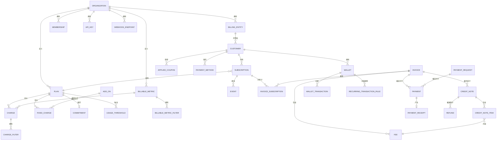
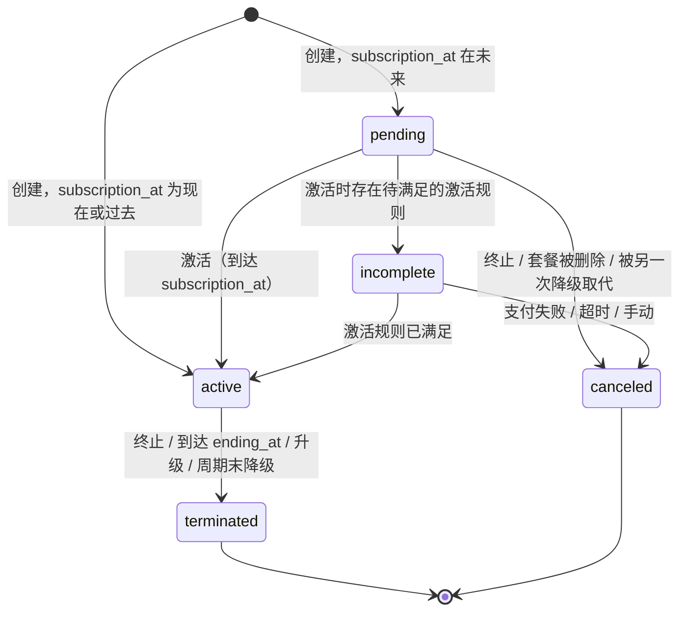
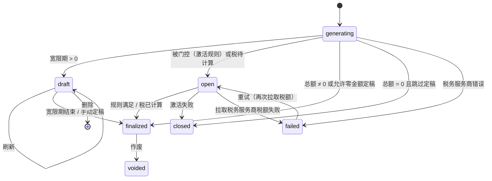
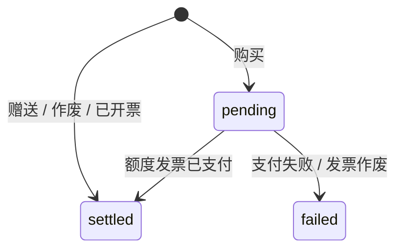
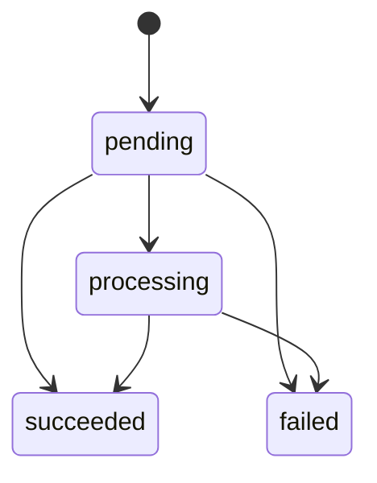

# Tanvo 领域模型

> [English](domain.md) | 简体中文

> 相关文档：[架构](architecture.zh-CN.md) · [功能对齐](parity.zh-CN.md) · [开发指南](development.zh-CN.md) · [测试策略](testing.zh-CN.md) · [路线图](roadmap.zh-CN.md) · [AGENTS.zh-CN.md](../AGENTS.zh-CN.md)

---

本文档定义 Tanvo 的业务实体、字段、不变式、枚举与生命周期，以及把它们串联起来的计费规则。`libs/core`（实体与仓储端口）和 `libs/billing`（计费引擎）依据本文档构建。行为以 lago-api 为准，标注 **[变更]** 的规则除外；Tanvo 不实现的遗留变体以 **[舍弃]** 列出。字段类型使用 §2.2 的记法。

## 目录

1. [概览](#1-概览)
2. [标识符与约定](#2-标识符与约定)
3. [枚举](#3-枚举)
4. [组织与计费主体](#4-组织与计费主体)
5. [访问控制：用户、成员、角色、API 密钥](#5-访问控制用户成员角色api-密钥)
6. [客户](#6-客户)
7. [目录](#7-目录)
8. [优惠券](#8-优惠券)
9. [订阅](#9-订阅)
10. [事件与用量](#10-事件与用量)
11. [发票](#11-发票)
12. [费用](#12-费用)
13. [贷项通知单](#13-贷项通知单)
14. [钱包](#14-钱包)
15. [支付](#15-支付)
16. [催收](#16-催收)
17. [集成](#17-集成)
18. [Webhook](#18-webhook)
19. [告警](#19-告警)
20. [数据导出](#20-数据导出)
21. [报价单、订购单、订单与合同](#21-报价单订购单订单与合同)
22. [计费规则](#22-计费规则)
23. [相对 Lago 的有意变更](#23-相对-lago-的有意变更)
24. [设计决定](#24-设计决定)

---

## 1. 概览



| 聚合 | 根 | 包含 | 章节 |
| :--- | :--- | :--- | :--- |
| 组织 | `Organization` | 设置、认证方式 | §4.1 |
| 计费主体 | `BillingEntity` | 编号、开票默认值、税务设置 | §4.2 |
| 访问控制 | `User`、`Membership`、`Role`、`Invite`、`APIKey` | 权限 | §5 |
| 客户 | `Customer` | 地址、元数据、计费设置 | §6 |
| 计费指标 | `BillableMetric` | 过滤器 | §7.1 |
| 套餐 | `Plan` | 计费项、固定计费项、承诺消费、用量阈值、权益 | §7.2–§7.10 |
| 附加项 | `AddOn` | 税 | §7.5 |
| 定价单位 | `PricingUnit` | — | §7.6 |
| 税 | `Tax` | — | §7.7 |
| 功能 | `Feature` | 特权项 | §7.10 |
| 优惠券 | `Coupon` | 适用对象；每个客户一个 `AppliedCoupon` | §8 |
| 订阅 | `Subscription` | 覆盖、激活规则、已触达阈值、权益覆盖 | §9 |
| 事件 | `Event` | —（只追加） | §10 |
| 发票 | `Invoice` | 发票订阅、费用、已应用税、元数据、结清记录 | §11、§12 |
| 贷项通知单 | `CreditNote` | 明细、已应用税、退款 | §13 |
| 钱包 | `Wallet` | 交易、周期充值规则、消耗记录 | §14 |
| 支付 | `Payment` | 收据 | §15 |
| 付款请求 | `PaymentRequest` | 发票关联 | §15.4 |
| 催收活动 | `DunningCampaign` | 阈值 | §16 |
| 集成 | `Integration` | 客户、映射、集合映射、条目 | §17 |
| Webhook 端点 | `WebhookEndpoint` | 投递记录 | §18 |
| 告警 | `Alert` | 阈值、已触发告警 | §19 |
| 数据导出 | `DataExport` | 分片 | §20 |
| 报价单、订购单、订单 | `Quote`、`OrderForm`、`Order` | 版本 | §21 |

全文使用的标记：

* **[变更]** Tanvo 有意与 lago-api 行为不同。每项变更也列在 §23。
* **[舍弃]** Tanvo 不实现的 Lago 遗留或已弃用变体。
* **[修复]** Tanvo 不复现的 lago-api 缺陷。

---

## 2. 标识符与约定

### 2.1 标识符
* 每一行都有服务端生成的 `id`（UUIDv7）和 `organization_id`；每个查询都按 `organization_id` 过滤（[架构 §5.4](architecture.zh-CN.md#54-租户隔离)）。跨租户的唯一索引有 x402 结算的支付摘要和交易哈希（§24，第 14 条），以及发票的 `x402_payment_token`（lago `db/structure.sql:10561`），v1.55.0 既不设置也不读取这一列。
* 面向客户的标识符在组织内唯一：客户、订阅和钱包使用 `external_id`；计费指标、套餐、附加项、优惠券、税、功能、计费主体、定价单位、催收活动、集成、告警和钱包使用 `code`。
* API 通过 `id` 或带前缀的标识符 `external_id:<value>` / `code:<value>` 定位资源（[架构 §4.2](architecture.zh-CN.md#42-经由-vanguard-的-rest)）。
* 除另有说明外，`code` 长度为 1–255 个字符；资源被引用后 `code` 即不可变，具体见各实体。
* **[变更]** `code` 与 `external_id` 的唯一性只在存活的行（未终止、未归档、未删除）之间成立；资源消失后其 code 可以复用。这由部分唯一索引而非应用层检查保证。

### 2.2 类型

| 记法 | 含义 | 存储 |
| :--- | :--- | :--- |
| `ID` | UUIDv7 | `uuid` |
| `string(n)` | 至多 n 个字符的 UTF-8 文本，去除首尾空白 | 带 `CHECK` 的 `text` |
| `Money` | 以币种最小单位表示的金额 | `bigint` |
| `Decimal` | `money.Decimal`（精度 40） | `numeric` |
| `Currency` | ISO 4217 代码 | `text` |
| `Time` | 时刻，UTC | `timestamptz` |
| `Date` | 日历日期，在指定时区中解释 | `date` |
| `Zone` | IANA 时区名 | `text` |
| `Enum{…}` | 封闭的字符串集合 | 带 `CHECK` 的 `text`，Go 字符串类型 |
| `Metadata` | 有序键值列表，每个实体有各自的限制 | 子表 |
| `T?` | 可选（可为空） | — |

### 2.3 通用规则
* **金额**：最终金额以 `Money`（最小单位）存储；仍作为后续计算输入的值（取整前的费用金额、单价、额度）以 `Decimal`（“精确值”）存储。取整规则见 §22.9。绝不使用 `float64`。
* **时间**：时刻以 UTC 存储；日期和周期边界在适用时区（§22.1）中计算，并以本地午夜对应的 UTC 时刻存储。
* **周期**为左闭右开区间 `[from, to)`。**[变更]** Lago 以 23:59:59.999999 存储闭区间终点；Tanvo 存储下一个本地午夜。
* **删除**：有生命周期的资源带有状态（`terminated`、`archived`、`voided`、`deleted`）；无引用的行直接物理删除。套餐从不移除：已删除的套餐以 `deleted` 状态保留（§7.2），不再出现在按 code 的查找和列表中，其 code 可再次使用。计费项、计费项过滤器、固定计费项、附加项、税、用量阈值、优惠券、功能、特权项、权益以及产品目录（类别、产品、产品过滤器及其取值、费率卡、费率、套餐费率卡与费率阶段，§21.4）采用软删除（`deleted_at`）：被丢弃的行不再能按 code 查到或被列出，其 code 可再次使用，引用它的单据仍可按 ID 读取它。存储层拒绝（`conflict`）物理删除仍被引用的行。**[变更]** 没有全局的 `deleted_at` 软删除。
* **元数据**在更新时整体替换（传入的列表替换已存储的列表）。
* **条目元数据**（套餐、贷项通知单、钱包）最多 50 项，键最长 100 个字符，值最长 255 个字符。除资源自身的更新外，这些资源各有元数据端点：替换、合并（已有键的值被替换，新键追加在后）、全部删除与删除单个键。删除键只改动元数据（不产生 `*.updated` 事件）；对没有元数据的资源删除键返回 `not_found`（`metadata`）。
* **审计**：本文档中提到的每次状态变更都在同一事务中产生领域事件；Webhook（§18）和活动日志由其派生。
* **锁**：读写客户余额的操作（优惠券、贷项通知单、预付额度、钱包）获取各章节指明的客户咨询锁；计费运行锁定订阅。

---

## 3. 枚举

| 枚举 | 取值 | 使用者 |
| :--- | :--- | :--- |
| `AuthenticationMethod` | `email_password`、`google_oauth`、`okta`、`entra_id`、`oidc`（通用，Tanvo 扩展） | Organization |
| `DocumentNumbering` | `per_customer`、`per_billing_entity` | BillingEntity |
| `IssuingDateAnchor` | `current_period_end`、`next_period_start` | BillingEntity、Customer |
| `IssuingDateAdjustment` | `keep_anchor`、`align_with_finalization_date` | BillingEntity、Customer |
| `EmailSetting` | `invoice.finalized`、`credit_note.created`、`payment_receipt.created` | BillingEntity |
| `EInvoicingCountry` | `FR`、`DE` | BillingEntity |
| `MembershipStatus` | `active`、`revoked` | Membership |
| `InviteStatus` | `pending`、`accepted`、`revoked` | Invite |
| `PermissionLevel` | `read`、`write` | APIKey |
| `CustomerType` | `company`、`individual` | Customer |
| `AccountType` | `customer`、`partner` | Customer |
| `ZeroAmountFinalization` | `inherit`、`skip`、`finalize` | Customer |
| `AggregationType` | `count`、`sum`、`max`、`unique_count`、`weighted_sum`、`latest` | BillableMetric |
| `WeightedInterval` | `seconds` | BillableMetric |
| `RoundingFunction` | `round`、`floor`、`ceil` | BillableMetric |
| `Interval` | `weekly`、`monthly`、`quarterly`、`semiannual`、`yearly` | Plan、RecurringTransactionRule |
| `ChargeModel` | `standard`、`graduated`、`graduated_percentage`、`package`、`percentage`、`volume`、`dynamic` | Charge |
| `FixedChargeModel` | `standard`、`graduated`、`volume` | FixedCharge |
| `RegroupPaidFees` | `invoice` | Charge |
| `CommitmentType` | `minimum_commitment` | Commitment |
| `PrivilegeValueType` | `integer`、`string`、`boolean`、`select` | Privilege |
| `CouponType` | `fixed_amount`、`percentage` | Coupon |
| `CouponFrequency` | `once`、`recurring`、`forever` | Coupon |
| `CouponExpiration` | `no_expiration`、`time_limit` | Coupon |
| `CouponStatus` | `active`、`terminated` | Coupon、AppliedCoupon |
| `BillingTime` | `calendar`、`anniversary` | Subscription、Contract |
| `SubscriptionStatus` | `pending`、`incomplete`、`active`、`terminated`、`canceled` | Subscription |
| `CancellationReason` | `payment_failed`、`timeout`、`manual` | Subscription |
| `TerminationCreditNote` | `credit`、`refund`、`offset`、`skip` | Subscription |
| `TerminationInvoice` | `generate`、`skip` | Subscription |
| `PaymentMethodType` | `provider`、`manual` | Subscription、Wallet、Invoice |
| `ActivationRuleType` | `payment` | SubscriptionActivationRule |
| `ActivationRuleStatus` | `inactive`、`pending`、`satisfied`、`not_applicable`、`declined`、`failed`、`expired` | SubscriptionActivationRule |
| `OperationType` | `add`、`remove` | Event（去重计数） |
| `InvoiceType` | `subscription`、`credit`、`one_off`、`advance_charges`、`progressive_billing` | Invoice |
| `InvoiceStatus` | `generating`、`draft`、`open`、`finalized`、`closed`、`voided`、`failed`、`deleted` | Invoice |
| `PaymentStatus` | `pending`、`succeeded`、`failed` | Invoice、PaymentRequest |
| `TaxStatus` | `pending`、`succeeded`、`failed` | Invoice |
| `InvoicingReason` | `subscription_starting`、`subscription_periodic`、`subscription_terminating`、`in_advance_charge`、`in_advance_charge_periodic`、`progressive_billing` | InvoiceSubscription |
| `FeeType` | `subscription`、`charge`、`fixed_charge`、`add_on`、`credit`、`commitment`、`product` | Fee |
| `FeePaymentStatus` | `pending`、`succeeded`、`failed`、`refunded` | Fee |
| `CreditNoteStatus` | `draft`、`finalized`、`deleted` | CreditNote |
| `CreditStatus` | `available`、`consumed`、`voided` | CreditNote |
| `RefundStatus` | `pending`、`succeeded`、`failed` | CreditNote、Refund |
| `CreditNoteReason` | `duplicated_charge`、`product_unsatisfactory`、`order_change`、`order_cancellation`、`fraudulent_charge`、`other` | CreditNote |
| `WalletStatus` | `active`、`terminated` | Wallet |
| `TransactionType` | `inbound`、`outbound` | WalletTransaction |
| `TransactionStatus` | `purchased`、`granted`、`voided`、`invoiced` | WalletTransaction |
| `WalletTransactionStatus` | `pending`、`settled`、`failed` | WalletTransaction |
| `WalletTransactionSource` | `manual`、`interval`、`threshold` | WalletTransaction |
| `RecurringMethod` | `fixed`、`target` | RecurringTransactionRule |
| `RecurringTrigger` | `interval`、`threshold` | RecurringTransactionRule |
| `RuleStatus` | `active`、`terminated` | RecurringTransactionRule |
| `PaymentKind` | `provider`、`manual`、`x402` | Payment |
| `PaymentState` | `pending`、`processing`、`succeeded`、`failed` | Payment |
| `IntegrationCategory` | `payment`、`accounting`、`tax`、`crm`、`auth` | Integration |
| `IntegrationProvider` | `stripe`、`adyen`、`gocardless`、`cashfree`、`moneyhash`、`flutterwave`、`netsuite`、`xero`、`anrok`、`avalara`、`hubspot`、`salesforce`、`okta`、`entra_id`、`oidc` | Integration |
| `MappableType` | `add_on`、`billable_metric` | IntegrationMapping |
| `CollectionMappingType` | `fallback_item`、`coupon`、`subscription_fee`、`minimum_commitment`、`tax`、`prepaid_credit`、`credit_note`、`account`、`currencies` | IntegrationCollectionMapping |
| `IntegrationResourceType` | `invoice`、`payment`、`credit_note`、`subscription` | IntegrationResource |
| `WebhookStatus` | `pending`、`retrying`、`succeeded`、`failed` | Webhook |
| `AlertType` | 见 §19 | Alert |
| `AlertDirection` | `increasing`、`decreasing` | Alert |
| `DataExportFormat` | `csv` | DataExport |
| `DataExportStatus` | `pending`、`processing`、`completed`、`failed` | DataExport |
| `DataExportResource` | `invoices`、`invoice_fees`、`credit_notes`、`credit_note_items` | DataExport |

只属于某一功能的枚举（入站 Webhook 状态、报价单状态、合同状态等）在各自章节中定义。

**[舍弃]** 发票类型 `add_on`（由 `one_off` 取代）；一次性发票之外的 `add_on` 类型费用发票；覆盖套餐的 `overriden` 别名；`group`/`group_properties`（由计费项过滤器取代）；计费项属性别名 `grouped_by`（由 `pricing_group_keys` 取代）；`recurring_count_agg`；集成资源类型 `sales_order_deprecated`。

---

## 4. 组织与计费主体

### 4.1 组织

租户。其他所有实体都恰好属于一个组织。

| 字段 | 类型 | 规则 |
| :--- | :--- | :--- |
| `name` | `string(255)` | 必填 |
| `slug` | `string(63)` | 唯一，小写，由名称派生；用于客户门户 URL |
| `email` | `string(255)?` | 有效邮箱 |
| `logo` | blob 引用? | |
| `address` | Address | |
| `authentication_methods` | `[]AuthenticationMethod` | 至少一个 |
| `from_email_enabled` | `bool` | 默认 false；单据从计费主体的邮箱发出 |
| `audit_logs_retention_days` | `int` | 默认 30 |
| `max_wallets_per_customer` | `int` | 默认 6 |
| `document_number_prefix` | `string(10)` | 1–10 个字符，大写存储；默认取名称的前 3 个字符（大写）+ `-` + id 的后 4 个字符；用作客户 slug 的前缀（§6） |
| `created_at` | `Time` | |

Address（共享值对象）：`line1`、`line2`、`city`、`state`、`zipcode`、`country`（ISO 3166-1 alpha-2）。全部可选；`country` 会被校验。

**[变更]** 组织不承载计费设置。Lago 在组织和计费主体上重复存储时区、币种、宽限期、净付款期限、单据编号方式、前缀、发票页脚、单据语言、税号、欧盟税务管理和邮件设置；在 Tanvo 中计费主体是唯一权威来源，组织只保留身份与访问设置，以及与 lago 一样用作客户 slug 前缀的文档编号前缀。每个组织至少有一个计费主体，随组织一起创建。

**[变更]** 核心中没有高级版门槛：本文档中的每个功能对每个组织都可用。分析与助手位于 `ee/`（[架构 §14](architecture.zh-CN.md#14-企业版ee)）。

**[舍弃]** `organizations.webhook_url`、`api_key`、`hmac_key`（由 Webhook 端点和 API 密钥取代）、上述组织级重复设置，以及已弃用的公钥接口。

### 4.2 计费主体

单据的法定开具方。客户恰好属于一个计费主体；订阅可以覆盖它。

| 字段 | 类型 | 规则 |
| :--- | :--- | :--- |
| `code` | `string(255)` | 在未归档的主体中唯一；不可变 |
| `name` | `string(255)` | 必填 |
| `legal_name`、`legal_number`、`tax_id` | `string(255)?` | 打印在单据上 |
| `email`、`phone` | `string?` | |
| `address` | Address | |
| `logo` | blob 引用? | |
| `timezone` | `Zone` | 默认 `UTC` |
| `default_currency` | `Currency` | 默认 `USD` |
| `document_locale` | `string` | BCP 47 语言；默认 `en` |
| `document_numbering` | `DocumentNumbering` | 默认 `per_customer` |
| `document_number_prefix` | `string(10)` | 1–10 个字符，转为大写；默认取名称前 3 个字母（大写，A–Z）+ `-` + id 的后 4 个字符 |
| `invoice_footer` | `string(600)?` | |
| `invoice_grace_period_days` | `int` | ≥ 0；默认 0 |
| `net_payment_term_days` | `int` | ≥ 0；默认 0（§24，第 12 条） |
| `finalize_zero_amount_invoice` | `bool` | 默认 true |
| `issuing_date_anchor` | `IssuingDateAnchor` | 默认 `next_period_start` |
| `issuing_date_adjustment` | `IssuingDateAdjustment` | 默认 `align_with_finalization_date` |
| `email_settings` | `[]EmailSetting` | 子集；默认为空 |
| `eu_tax_management` | `bool` | 要求地址的 `country` 位于欧盟 |
| `einvoicing` | `bool` | 仅当 `country` ∈ `EInvoicingCountry` 时允许 |
| `applied_dunning_campaign_id` | `ID?` | §16 |
| `invoice_sequence`、`invoice_sequence_month` | 内部计数器 | §22.11 |
| `archived_at` | `Time?` | |

规则：
* 计费主体从不删除，只归档。已归档的主体不能接收新客户或新订阅；已有单据继续引用它。
* 一个组织至多有一个默认计费主体（`is_default`），用于未指定主体时创建的客户。
* 修改 `document_numbering` 对之后定稿的单据生效；已有编号永不改变。
* 已应用税：计费主体有一组默认税（`billing_entity_taxes`），在税的解析中作为最后的兜底（§22.10）。
* 发票自定义区块（§11.9）可按计费主体选择。

---

## 5. 访问控制：用户、成员、角色、API 密钥

### 5.1 用户
登录的人。字段：`email`（唯一，不区分大小写）、`password_hash`（argon2id，仅 SSO 用户没有）、`name?`、`created_at`、`last_sign_in_at?`。一个用户可以属于多个组织。

### 5.2 成员
以一个或多个角色把用户关联到组织。

| 字段 | 类型 | 规则 |
| :--- | :--- | :--- |
| `user_id`、`organization_id` | `ID` | 在有效成员中唯一 |
| `role_ids` | `[]ID` | 有效期间至少一个；每个都是内置角色或组织中未删除的自定义角色（表 `membership_roles`） |
| `status` | `MembershipStatus` | `active` → `revoked`（终态） |
| `revoked_at` | `Time?` | |

规则：
* 成员拥有其所有角色权限的并集；任一角色为 `admin` 时该成员即为管理员。
* 修改角色会替换整个角色集合；组织中不存在的角色 ID 会被忽略，结果为空时返回 `role_not_found`。
* `membership_roles` 行从不修改：移除角色时软删除其行（`deleted_at`），新增角色时插入新行，每个成员与角色最多有一条未删除的行。成员只列出未删除且角色未被删除的行，因此已撤销的成员可能没有角色。
* 组织的最后一个有效管理员不能被撤销，也不能失去 `admin` 角色（`last_admin`）。撤销已撤销的成员会执行相同的检查，保留其 `revoked_at`，并再次记录日志。
* 用户不能撤销自己的成员资格（`cannot_revoke_own_membership`）。
* 只有管理员可以分配 `admin` 角色，即使对方已经拥有该角色（`cannot_grant_admin`）。
* 变更会写入安全日志：`user.role_edited` 记录新增与删除的角色代码，撤销时记录 `user.deleted`。

### 5.3 角色与权限
* 权限是形如 `<resource>:<action>` 的字符串（`customers:read`、`invoices:void` 等）。完整列表定义在 `libs/core/permission`，并记录在 API 参考中。
* 内置角色：`admin`（全部权限）、`finance`、`manager`。内置角色不可修改（`predefined_role`）。
* 自定义角色：`code`（`string(100)`，在未删除的角色中唯一，不得为内置名称）、`name`、`description?`、`permissions []string`、`deleted_at?`。删除自定义角色是软删除，并以其代码记录 `role.deleted`；内置角色不能删除（`predefined_role`），有效成员使用中的自定义角色也不能删除（`role_assigned_to_members`）；已撤销的成员不计入。已删除的角色不再能被查到、列出、被任何成员持有或分配，其代码可以复用。
* SSO（Okta、Entra ID、OIDC）按集成上配置的单个默认角色把身份映射为成员。**[修复]** Lago 创建的 Okta/Entra 成员没有任何角色。

### 5.4 邀请
`email`、`role_ids`（至少一个，且都须存在于组织中，否则在 `roles` 上返回 `invalid_role`；包含 `admin` 时邀请人必须是管理员，否则返回 `cannot_grant_admin`）、`token`（随机生成，存储哈希）、`status`（`pending` → `accepted` | `revoked`）、`expires_at`。接受邀请会创建（或复用）用户，并以邀请中的角色建立有效成员资格；若某个角色在邀请后被删除，接受会以 `role_not_found` 失败。只有待处理的邀请可以修改角色（`cannot_update_accepted_invite`、`cannot_update_revoked_invite`）。若某邮箱已有有效成员资格，则拒绝为其创建待处理邀请。

密码重置令牌 30 分钟后过期，且只能使用一次。

### 5.5 API 密钥

| 字段 | 类型 | 规则 |
| :--- | :--- | :--- |
| `name` | `string(255)?` | |
| `token_hash` | `bytes` | 密钥的 SHA-256；密钥只显示一次 |
| `prefix` | `string` | 密钥的前几个字符，用于展示 |
| `permissions` | 资源 → `PermissionLevel` 的映射 | 空映射 = 完全访问 |
| `expires_at` | `Time?` | |
| `last_used_at` | `Time?` | |

规则：
* 组织至少保留一个不过期的密钥；最后一个不能被删除或设置过期时间。
* 轮换会创建新密钥，并设置旧密钥的 `expires_at`（立即或在选定时刻）。

### 5.6 客户门户令牌
限定于单个客户的无状态签名令牌，有效期 12 小时，可读取该客户的组织概要、资料、发票、订阅、用量、钱包和分析数据，并可修改其自身资料、为钱包付费充值（`CustomerPortalService`）。

### 5.7 会话与登录状态
会话是已登录用户的不透明令牌。它属于用户而非组织：组织按请求选择，不允许该会话 `method` 的组织无法通过它访问。

| 字段 | 类型 | 规则 |
| :--- | :--- | :--- |
| `user_id` | `ID` | |
| `token_hash` | `bytes` | 令牌的 SHA-256，唯一；令牌只显示一次 |
| `method` | `AuthenticationMethod` | 登录方式 |
| `user_agent`、`ip` | `string` | 登录时的客户端 |
| `created_at`、`last_seen_at` | `Time` | `last_seen_at` 至多每分钟刷新一次 |
| `expires_at` | `Time` | 绝对有效期终点（默认 14 天） |
| `revoked_at` | `Time?` | 登出、重置密码或吊销时设置；不会清除 |

会话在未吊销、未过期且在空闲超时（默认 24 小时）内使用过时有效。过期和已吊销的会话会被清理。

OpenID Connect 登录在跳转到服务商与回调之间保存一个一次性状态，以 `state` 参数的 SHA-256 为键：`method`（不能是 `email_password`）、`intent`（`OIDCIntent`：`login`、`sign_up`、`accept_invite`）、`connection_id`、`email`、`invite_token_hash`（`accept_invite` 时必填；不保存邀请令牌本身）、`organization_name`、`nonce`、PKCE `verifier` 和 `expires_at`（10 分钟）。读取状态即删除它；过期的状态视为不存在。

**[变更]** Lago 签发 JWT，并把 OAuth 状态在 Rails 缓存中保存 90 秒；Tanvo 把会话和状态保存在 PostgreSQL 中，因此会话可以吊销，任一副本都能完成登录。

### 5.8 用户设备
用户登录过的客户端，按用户以 `fingerprint`（其 user agent 的 SHA-256 十六进制）标识；每个用户内唯一。字段：`browser?`、`os?`、`device_type?`（由服务端从 user agent 解析）、`last_ip_address?`、`last_logged_at`。每次带 user agent 的登录都会更新或创建设备；从新设备登录时，在用户的每个有效组织中记录 `user.new_device_logged_in`，但注册和通过邀请加入的新用户除外，它们由各自的事件覆盖。

---

## 6. 客户

被开票的一方。

| 字段 | 类型 | 规则 |
| :--- | :--- | :--- |
| `external_id` | `string(255)` | 必填；在未删除的客户中唯一 |
| `billing_entity_id` | `ID` | 必填；默认取组织的默认主体 |
| `customer_type` | `CustomerType?` | |
| `account_type` | `AccountType` | 默认 `customer` |
| `name` | `string(255)?` | |
| `firstname`、`lastname` | `string(255)?` | |
| `legal_name`、`legal_number` | `string(255)?` | |
| `tax_identification_number` | `string(255)?` | |
| `email` | `string?` | 逗号分隔的有效邮箱列表 |
| `phone`、`url`、`logo_url` | `string?` | |
| `billing_address` | Address | |
| `shipping_address` | Address | 打印时每个空字段回退到账单地址的对应字段 |
| `currency` | `Currency?` | 新计费对象的默认币种；见规则 |
| `timezone` | `Zone?` | |
| `document_locale` | `string?` | |
| `invoice_grace_period_days` | `int?` | ≥ 0 |
| `net_payment_term_days` | `int?` | ≥ 0；`null` = 继承（§24，第 12 条） |
| `finalize_zero_amount_invoice` | `ZeroAmountFinalization` | 默认 `inherit` |
| `issuing_date_anchor`、`issuing_date_adjustment` | 枚举? | `null` = 继承 |
| `skip_invoice_custom_sections` | `bool` | |
| `applied_dunning_campaign_id` | `ID?` | |
| `exclude_from_dunning_campaign` | `bool` | |
| `x402_agent_address` | `string?` | x402 代理的 EVM 地址（以 EIP-55 校验和形式存储）或 Solana 地址；在组织内未删除的客户中唯一；在准入检查中标识代理（§24，第 14 条） |
| `dunning_campaign_attempts`、`last_dunning_campaign_attempt_at` | `map<币种, int>`、`Time?` | 按币种分别计数尝试次数 |
| `sequential_id` | `int` | 创建时按组织分配；已删除的客户保留其编号 |
| `slug` | `string` | `<组织 document_number_prefix>-<sequential_id %03d>` |
| `payment_receipt_counter` | `int` | §22.11 |
| `metadata` | Metadata | ≤ 5 项；键 ≤ 20，值 ≤ 100；`display_in_invoice bool` |
| `deleted_at` | `Time?` | 有单据的客户只归档，不物理删除 |

规则：
* 设置按 客户 → 计费主体（时区再 → UTC）解析。**[变更]** Lago 在部分代码路径回退到组织，在另一些路径回退到计费主体；Tanvo 处处使用计费主体。
* `currency` 是默认值，不是约束。未指定币种创建的钱包或一次性发票取该币种；币种为空时，第一个创建的计费对象设置它（订阅取其套餐币种，钱包、固定金额的已应用优惠券或一次性发票取各自的币种）；显式更新客户可以随时修改它，不影响已有对象。
* 每个计费对象都有自己的币种：订阅取其套餐的 `currency`（§9.1），钱包（§14.1）、固定金额的已应用优惠券（§8.2）和一次性发票（§11.6）各有自己的币种。一个客户可以按多种币种计费：发票按币种拆分（§9.6），贷项通知单、固定金额优惠券和钱包只抵扣同币种的发票（§22.7），催收按币种分别计数尝试次数并检查阈值（§16.1）。
* 客户在没有订阅、发票、已应用的固定金额优惠券（包括已终止的；已应用的百分比优惠券不计入）和钱包时是**可编辑**的。只有可编辑的客户才能修改 `external_id` 或 `account_type`。
* `account_type = partner`：开给该客户的发票为自开票（§11.1）。
* 删除客户会终止其订阅（生成终止发票）、终止其钱包和已应用优惠券并将其归档；其发票保留。
* 每个客户的咨询锁：`coupons`、`credit_notes`、`prepaid_credits`、`billing_schedule`。
* 加锁顺序：计费事务按同一固定顺序加锁，因此两个事务不会相互等待：客户的 `billing_schedule` 锁、订阅锁（事务只在持有 `billing_schedule` 锁时获取多个订阅锁，否则按 ID 升序获取）、事件锁、发票锁、贷项通知单锁，然后是客户的 `coupons`、`credit_notes` 和 `prepaid_credits` 锁；序列锁最后获取。需要后三者中多个锁的事务会在获取任何一个之前全部获取。**[Change]** Lago 没有全局顺序，部分场景依赖唯一索引。
* 欧盟税务管理：当计费主体启用 `eu_tax_management` 时，在创建客户以及地址或税号变更时决定客户的欧盟税（§22.10）。有税号且不在自有增值税地区的客户，其欧盟税来自异步的 VIES 校验，结果以 `customer.vies_check` 发出。
* 支付与集成连接：见 §15.5 和 §17.2。**[变更]** 没有单一的 `payment_provider` 列；客户可以连接多个服务商，每个类别一个默认连接。

---

## 7. 目录

### 7.1 计费指标

计量的对象。

| 字段 | 类型 | 规则 |
| :--- | :--- | :--- |
| `code` | `string(255)` | 在存活的指标中唯一 |
| `name` | `string(255)` | 必填 |
| `description` | `string?` | |
| `aggregation_type` | `AggregationType` | 必填 |
| `field_name` | `string?` | 被聚合的事件属性；`count` 以外必填 |
| `weighted_interval` | `WeightedInterval?` | `weighted_sum` 必须为 `seconds`；其他类型上保留且不校验 |
| `recurring` | `bool` | `count`、`max`、`latest` 禁止 |
| `expression` | `string?` | lago-expression；其结果在聚合前写入 `field_name` |
| `rounding_function` | `RoundingFunction?` | |
| `rounding_precision` | `int?` | 设置取整函数时默认 0；可以为负 |
| `filters` | `[]BillableMetricFilter` | |

`BillableMetricFilter`：`key string(255)`（事件属性）、`values []string`（非空；重复值被去除）。每个计费指标内键唯一。

规则：
* 计费指标一旦被计费项使用，`code`、`aggregation_type`、`weighted_interval`、`field_name`、`recurring`、`rounding_function`、`rounding_precision` 和 `expression` 即被锁定。
* 删除过滤器的某个值会删除使用该值的计费项过滤器取值；删除过滤器的键会删除引用该键的计费项过滤器。当费率卡的产品过滤器使用该取值或键时，两者都被拒绝（`referenced_by_product_filter`）：已定价的费率卡绝不会因计费指标的修改而被改变。
* 删除计费指标会将其软删除（`deleted_at`）：读取时不再能找到它，其代码可以重新使用。其计费项（及其过滤器）从所有套餐中被丢弃（软删除），其告警被软删除（阈值保留），草稿发票被重新计算；其过滤器以及指向它的优惠券与钱包目标随软删除的记录保留。当费率卡的产品过滤器使用该计费指标时被拒绝（`referenced_by_product_filter`）。其事件保留。
* 可预付：只有 `count`、`sum` 和 `unique_count` 计费指标可以支撑预付计费项。

聚合语义（在 `libs/metering` 中实现）：

| 类型 | 周期内的值 | 周期性行为 |
| :--- | :--- | :--- |
| `count` | 事件数 | — |
| `sum` | Σ `field_name` | 跨周期累计运行总和 |
| `max` | `field_name` 最大值 | — |
| `unique_count` | `field_name` 不同取值的个数；`operation_type=remove` 移除一个取值 | 取值持续存在直到被移除；按存在天数折算 |
| `weighted_sum` | Σ 值 × 持有秒数 / 周期秒数 | 最后一个值作为下一周期的初始值 |
| `latest` | 最新事件的 `field_name` | — |

取整作用于聚合值（不是单个事件），使用计费指标的函数和精度，在定价之前进行。

**[舍弃]** 遗留的计费指标属性、`recurring_count_agg`、分组（groups）。

### 7.2 套餐

带价格的报价方案。

| 字段 | 类型 | 规则 |
| :--- | :--- | :--- |
| `code` | `string(255)` | 在既非子套餐也非 `deleted` 的套餐中唯一 |
| `name` | `string(255)` | 必填 |
| `invoice_display_name` | `string?` | |
| `description` | `string?` | |
| `interval` | `Interval` | 必填 |
| `amount` | `Money` | ≥ 0；每周期的订阅（基础）费 |
| `currency` | `Currency` | 必填 |
| `pay_in_advance` | `bool` | 基础费在周期开始（true）或结束（false）时计费 |
| `trial_period_days` | `int` | ≥ 0 |
| `bill_charges_monthly` | `bool?` | 仅用于 `yearly` 和 `semiannual` 套餐 |
| `bill_fixed_charges_monthly` | `bool?` | 仅用于 `yearly` 和 `semiannual` 套餐 |
| `parent_id` | `ID?` | 覆盖套餐（§7.2.1）才设置 |
| `taxes` | `[]Tax` | |
| `metadata` | Metadata | 条目元数据（§2.3） |
| `status` | Enum{`active`、`pending_deletion`、`deleted`} | |

规则：
* 套餐一旦有订阅，`code`、`interval`、`pay_in_advance`、`currency`、`trial_period_days`、`bill_charges_monthly` 和 `bill_fixed_charges_monthly` 即被锁定。
* 删除套餐会将其及其子套餐置为 `pending_deletion`，然后由任务依次对每个子套餐和该套餐：终止其有效订阅（生成终止发票），取消其待生效订阅，定稿计费该套餐的草稿发票，并软删除其权益。被规则拒绝的终止或定稿会被跳过；其他失败会中止任务，任务随后重试。之后无论是否被引用，套餐都转为 `deleted`，并保留其计费项、固定计费项、承诺消费和用量阈值，供其发票及发票重新生成读取；它不再出现在按 code 的查找、套餐列表、父套餐的子套餐，以及订阅列表的套餐筛选和套餐搜索中，其 code 可供新套餐使用。每个套餐同一时间只运行一个删除任务；`plan.deleted` 在准备删除时发出。
* 其待生效订阅被取消，不记录 `cancellation_reason`。
* **[变更]** 已删除套餐用 `deleted` 状态表示，而不是 `deleted_at` 时刻。
* `yearly_amount` = `amount` × 每年周期数（52、12、4、2、1）；它决定升级还是降级（§22.13）。
* **[变更]** 试用期为整数天（`int`）；Lago 存储浮点数。

#### 7.2.1 覆盖套餐
创建订阅时可以覆盖套餐的金额、名称、描述、试用期、税、计费项、固定计费项、承诺消费和用量阈值。Tanvo 将其物化为只供该订阅使用的子套餐（`parent_id` = 原套餐）。
* 子套餐继承所有未覆盖的内容；`code` 与父套餐相同。
* 以 `cascade_updates = true` 编辑父套餐时，变更的字段会传播到那些取值仍等于父套餐原值的子套餐。
* 删除父套餐时先删除其子套餐（§7.2）；只要仍有子套餐行引用它，父套餐就保持 `deleted`。

### 7.3 计费项

在套餐上为计费指标定价。

| 字段 | 类型 | 规则 |
| :--- | :--- | :--- |
| `code` | `string(255)` | 套餐内唯一；默认 `<计费指标 code>`，然后是 `<计费指标 code>_2`、`_3`…… |
| `billable_metric_id` | `ID` | |
| `charge_model` | `ChargeModel` | |
| `properties` | `ChargeProperties` | 按计费模型，见下 |
| `filters` | `[]ChargeFilter` | §7.4 |
| `pay_in_advance` | `bool` | |
| `invoiceable` | `bool` | 默认 true |
| `regroup_paid_fees` | `RegroupPaidFees?` | |
| `prorated` | `bool` | |
| `min_amount` | `Money` | ≥ 0；每周期最低金额 |
| `invoice_display_name` | `string?` | |
| `applied_pricing_unit` | `{pricing_unit_id, conversion_rate Decimal}?` | §7.6 |
| `taxes` | `[]Tax` | |

校验矩阵：

| 规则 | 条件 |
| :--- | :--- |
| `dynamic` | 计费指标 `aggregation_type = sum` |
| `pay_in_advance = true` | 计费模型 ≠ `volume`；计费指标可预付（§7.1） |
| `invoiceable = false` | `pay_in_advance = true` |
| `regroup_paid_fees = invoice` | `pay_in_advance = true` 且 `invoiceable = false` |
| `min_amount > 0` | `pay_in_advance = false` |
| `prorated = true` | 计费指标为 `recurring`；计费指标 ≠ `weighted_sum`；预付时计费模型 = `standard`；后付时计费模型 ∈ {`standard`、`volume`、`graduated`} |
| `percentage`、`graduated_percentage` | 计费指标 ≠ `latest` |

各计费模型的属性（除另有说明外为 `Decimal`）：

| 计费模型 | 属性 | 规则 |
| :--- | :--- | :--- |
| `standard` | `amount` | ≥ 0 |
| `package` | `amount`、`package_size int`、`free_units int` | 包大小 > 0；免费量 ≥ 0 |
| `percentage` | `rate`、`fixed_amount?`、`free_units_per_events int?`、`free_units_per_total_aggregation?`、`per_transaction_min_amount?`、`per_transaction_max_amount?` | 费率 ≥ 0；免费事件数 > 0；最小值 ≤ 最大值 |
| `graduated` | `ranges []{to?, per_unit_amount, flat_amount}` | 见阶梯 |
| `volume` | `ranges []{to?, per_unit_amount, flat_amount}` | 见阶梯 |
| `graduated_percentage` | `ranges []{to?, rate, flat_amount}` | 见阶梯 |
| `dynamic` | — | 价格来自事件 |

每个计费模型还接受 `pricing_group_keys []string`（这些事件属性的每种不同组合产生一笔费用）和 `presentation_group_keys []{key, display_in_invoice bool}`（至多 2 个；在发票上拆分展示一笔费用，不改变价格）。

**阶梯 [变更]**：阶梯以相邻的左开右闭区间存储。输入是有序的上界列表；在累进计数中第 *i* 档覆盖 `(to[i-1], to[i]]`，第一档从 0 开始，最后一档没有上界（`to = null`）。校验：至少一档；上界严格递增；只有最后一档无上界；金额和费率 ≥ 0。不接受 Lago 带 `+1` 间隙的闭区间 `from`/`to` 输入（libs/pricing 保留一个适配器用于移植测试用例）。

计费模型计算（`u` = 计费指标取整后的用量）：
* `standard`：`u × amount`。
* `package`：`ceil(max(u − free_units, 0) / package_size) × amount`。
* `graduated`：对各档求和（落在该档的用量 × `per_unit_amount` + 若该档有用量则加 `flat_amount`）。
* `volume`：取包含 `u` 的那一档：`u × per_unit_amount + flat_amount`；`u = 0` 时为 0。
* `percentage`：`max(u − free_units_per_total_aggregation, 0) × rate / 100` + `max(events − free_units_per_events, 0) × fixed_amount`；设置了单笔上下限时，每个事件的金额（`value × rate / 100 + fixed_amount`）先被限制在 `[min, max]` 内，再对限制后的金额求和。
* `graduated_percentage`：对各档求和（落在该档的金额 × `rate` / 100 + 若该档有金额则加 `flat_amount`）。
* `dynamic`：事件 `precise_total_amount` 之和，以币种单位计。
* 预付费用：单个事件的费用为当前周期内 `amount(含该事件的总量) − amount(不含该事件的总量)`。
* 费用上展示的单价在用量 > 0 时为 `amount / units`。

### 7.4 计费项过滤器

以独立属性为计费项的一部分事件定价。

| 字段 | 类型 | 规则 |
| :--- | :--- | :--- |
| `charge_id` | `ID` | |
| `values` | 计费指标过滤器键 → `[]string` 的映射 | 每个键都是该计费指标的过滤器；取值 ⊆ 过滤器的取值，或为唯一的哨兵值 `__ALL_FILTER_VALUES__` |
| `properties` | `ChargeProperties` | 与计费项相同的计费模型 |
| `invoice_display_name` | `string?` | |

规则：
* 当过滤器的每个键上，事件属性都等于其中一个取值（哨兵值则任意取值）时，事件匹配该过滤器。
* 多个过滤器匹配时，最具体的胜出：先比键的数量（多者胜），再比允许的取值数（少者胜），再比 `created_at`（早者胜）。
* 不匹配任何过滤器的事件按计费项自身的属性定价（默认桶）。
* 每个过滤器有稳定的代码：其键值对的 slug 加 8 位十六进制 SHA-256 后缀，≤ 200 个字符。过滤器在查询用量或聚合到用量桶时匹配，绝不在富化时匹配（§10.2）。

### 7.5 固定计费项与附加项

**附加项**：可复用的带价格条目。

| 字段 | 类型 | 规则 |
| :--- | :--- | :--- |
| `code` | `string(255)` | 唯一 |
| `name` | `string(255)` | |
| `invoice_display_name`、`description` | `string?` | |
| `amount` | `Money` | > 0 |
| `currency` | `Currency` | |
| `taxes` | `[]Tax` | |

附加项用于一次性发票（§11.6）和固定计费项。

**固定计费项**：套餐上按数量计费的周期性计费项，以附加项定价。

| 字段 | 类型 | 规则 |
| :--- | :--- | :--- |
| `code` | `string(255)` | 套餐内唯一 |
| `add_on_id` | `ID` | |
| `charge_model` | `FixedChargeModel` | |
| `properties` | `ChargeProperties` | `standard`、`graduated` 或 `volume` |
| `units` | `Decimal` | ≥ 0；订阅的默认数量 |
| `pay_in_advance` | `bool` | 不能与 `volume` 同用 |
| `prorated` | `bool` | 不能与 `graduated` + `pay_in_advance` 同用 |
| `invoice_display_name` | `string?` | |
| `taxes` | `[]Tax` | |

按订阅的数量：订阅可以覆盖固定计费项的数量。数量变更是一个**固定计费项事件** `{subscription_id, fixed_charge_id, units, timestamp}`：
* `apply_units_immediately = true` 时在变更时刻生效（固定计费项可折算时按比例折算；预付时立即对差额计费）。
* 否则在下一个计费周期开始时生效。
* 每个订阅、固定计费项和日期至多保留一个事件（同一天较晚的事件替换较早的）。

固定计费项在一个周期内的数量：可折算时为各时刻生效数量按时间加权，否则为计费时刻生效的数量。

### 7.6 定价单位

计费项可以使用的自定义单位（例如积分或 token）。

| 字段 | 类型 | 规则 |
| :--- | :--- | :--- |
| `code` | `string(255)` | 唯一；不可变 |
| `name` | `string(255)` | |
| `short_name` | `string(3)` | |
| `description` | `string(600)?` | |
| `exponent` | `int` | 2 |

以定价单位定价的计费项带有 `conversion_rate > 0`（每个定价单位对应的法币金额）。费用同时记录定价单位金额（`pricing_unit_usage`：金额、单价、换算率）和币种金额：`fiat = round_half_up(amount × conversion_rate, 币种指数)`。税、优惠券和额度作用于法币金额。

### 7.7 税

| 字段 | 类型 | 规则 |
| :--- | :--- | :--- |
| `code` | `string(255)` | 唯一 |
| `name` | `string(255)` | |
| `rate` | `Decimal` | 0 ≤ rate ≤ 100（百分比） |
| `description` | `string?` | |
| `auto_generated` | `bool` | 由欧盟税务管理创建；只读 |

税挂接在计费主体、客户、套餐、计费项、固定计费项、附加项和承诺消费上；解析规则见 §22.10。修改税率会刷新使用该税的草稿发票。删除税会将其软删除（`deleted_at`）并在各处解除挂接；已开具的单据保留其已应用税快照（代码、名称、税率、金额）。

**[舍弃]** `vat_rate` 列。

### 7.8 承诺消费

每个计费周期的最低消费。

| 字段 | 类型 | 规则 |
| :--- | :--- | :--- |
| `plan_id` | `ID` | 每个套餐每种类型至多一个 |
| `commitment_type` | `CommitmentType` | `minimum_commitment` |
| `amount` | `Money` | > 0 |
| `invoice_display_name` | `string?` | |
| `taxes` | `[]Tax` | |

补差规则见 §22.15。

### 7.9 用量阈值

当当前周期的用量金额达到某个金额时触发一张渐进式计费发票。

| 字段 | 类型 | 规则 |
| :--- | :--- | :--- |
| `plan_id` 或 `subscription_id` 二选一 | `ID` | 恰好一个 |
| `amount` | `Money` | > 0 |
| `recurring` | `bool` | 每个所有者至多一个周期性阈值 |
| `threshold_display_name` | `string?` | |

规则：
* 非周期性阈值的金额在同一所有者内唯一；周期性阈值的金额是最大非周期性阈值之后的步长。
* 订阅自己的阈值取代套餐的阈值。
* 订阅上的 `progressive_billing_disabled` 同时停用两者。
* 每个已触达的阈值记录为 `AppliedUsageThreshold` {threshold, invoice, lifetime_usage_amount}。渐进式计费见 §22.16。

### 7.10 功能与权益

**功能**：`code string(255)` 唯一、`name?`、`description?`、`privileges []Privilege`。

**特权项**：`code string(255)` 在功能内唯一、`name?`、`value_type PrivilegeValueType`、`select_options []string`（`select` 类型必填且非空）。

**权益**：把功能授予套餐或订阅，带有 `values`（特权项代码 → 值的映射）。值按特权项类型校验（`integer` 为 64 位整数、`boolean`、`select` 的值须在选项内）。

订阅的有效权益 = 套餐的权益 − 订阅的移除项（`subscription_feature_removals`）+ 订阅自己的权益（逐个特权项覆盖套餐的值）。功能、特权项和权益采用软删除（`deleted_at`）：被丢弃的记录不再被查到或列出；被丢弃的功能或特权项的代码可再次使用；被丢弃的权益连同其取值一起失效，其功能可再次授予同一所有者。删除功能会丢弃其权益及取值、其特权项和功能本身；订阅的移除项保持不变。更新功能会丢弃其不再列出的特权项，这些特权项的取值从该功能未删除的权益中移除；仍被列出的特权项按代码匹配，保留其身份。

---

## 8. 优惠券

### 8.1 优惠券

| 字段 | 类型 | 规则 |
| :--- | :--- | :--- |
| `code` | `string(255)` | 在未删除的优惠券中唯一 |
| `name` | `string(255)` | |
| `description` | `string?` | |
| `coupon_type` | `CouponType` | |
| `amount` | `Money?` + `currency` | `fixed_amount` 必填 |
| `percentage_rate` | `Decimal?` | `percentage` 必填；0 < rate ≤ 100 |
| `frequency` | `CouponFrequency` | |
| `frequency_duration` | `int?` | 计费周期数；`recurring` 必填（> 0） |
| `reusable` | `bool` | 默认 true |
| `expiration` | `CouponExpiration` | |
| `expiration_at` | `Time?` | `time_limit` 必填；须在未来 |
| `limited_plans` | `[]PlanID` | |
| `limited_billable_metrics` | `[]MetricID` | 适用对象为套餐**或**计费指标，不能同时 |
| `status` | `CouponStatus` | `active` → `terminated` |
| `deleted_at` | `Time?` | 删除时设置 |

规则：
* 一旦被应用，只有 `name`、`description` 和过期设置会被修改；对其他字段（包括适用对象）的修改会被忽略。
* 被应用之前，给出计费指标适用对象会移除套餐适用对象，反之亦然；同时给出两者则失败，错误为 `only_one_limitation_type_per_coupon_allowed`。
* 超过 `expiration_at` 的优惠券由周期任务终止；终止优惠券不影响已应用的优惠券。
* 删除优惠券会设置 `deleted_at` 并保留其状态：它不能再被读取或应用，其代码可再次使用，其生效中的已应用优惠券会被终止。其已应用优惠券仍会被列出。

### 8.2 已应用优惠券

| 字段 | 类型 | 规则 |
| :--- | :--- | :--- |
| `coupon_id`、`customer_id` | `ID` | |
| `amount`、`percentage_rate`、`frequency`、`frequency_duration` | 同优惠券 | 应用时记录的覆盖值 |
| `amount_currency` | `Currency?` | 取覆盖值，否则取优惠券的；`percentage` 时为 `null` |
| `frequency_duration_remaining` | `int?` | |
| `remaining_amount` | `Money?` | 用于 `once` + `fixed_amount` |
| `status` | `CouponStatus` | |
| `terminated_at` | `Time?` | |

规则：
* 只有生效且未删除的优惠券可以应用（错误 `coupon_not_found`），且只能应用于未删除的客户（错误 `customer_not_found`）。
* 不可复用的优惠券对一个客户只能应用一次（`coupon` 上的错误 `coupon_is_not_reusable`）；先检查下文的套餐重叠。
* 若客户已有一个有效的已应用优惠券针对相同套餐，则不能再应用限定套餐的优惠券（错误 `plan_overlapping`）。
* `fixed_amount` 的已应用优惠券有自己的币种，不必等于客户币种；它只用于该币种的发票（§22.7）。`percentage` 优惠券用于任何币种的发票。一张优惠券只有一种币种；以其他币种应用时，通过金额和币种覆盖实现。
* 在发票上的应用见 §22.7。

---

## 9. 订阅

### 9.1 字段

| 字段 | 类型 | 规则 |
| :--- | :--- | :--- |
| `external_id` | `string(255)` | 在 `pending`、`incomplete` 和 `active` 订阅中唯一 |
| `customer_id` | `ID` | |
| `plan_id` | `ID` | |
| `name` | `string(255)?` | |
| `billing_time` | `BillingTime` | 默认 `calendar` |
| `status` | `SubscriptionStatus` | §9.2 |
| `subscription_at` | `Time` | 请求的开始时间；默认为当前时刻 |
| `started_at` | `Time?` | 实际激活时间 |
| `ending_at` | `Time?` | 计划的自动终止时间；> `subscription_at` |
| `terminated_at`、`canceled_at` | `Time?` | |
| `trial_ended_at` | `Time?` | |
| `cancellation_reason` | `CancellationReason?` | 待生效订阅因终止、套餐变更或套餐删除而被取消时为空 |
| `previous_subscription_id` | `ID?` | 本订阅所升级或降级的订阅 |
| `on_termination_credit_note` | `TerminationCreditNote?` | 仅用于预付套餐；默认 `credit` |
| `on_termination_invoice` | `TerminationInvoice` | 默认 `generate` |
| `payment_method_type` | `PaymentMethodType` | 默认 `provider` |
| `payment_method_id` | `ID?` | |
| `progressive_billing_disabled` | `bool` | |
| `consolidate_invoice` | `bool` | 默认 true；false = 本订阅从不与其他订阅合并开票 |
| `purchase_order_number` | `string(255)?` | `pending` 或 `active` 时可编辑 |
| `billing_entity_id` | `ID?` | 覆盖客户的计费主体 |
| `skip_invoice_custom_sections` + 选定的区块 | | §11.9 |
| `next_billing_at` | `Time?` | **[变更]** 调度时刻（§22.17） |

订阅按其套餐的 `currency` 计费；套餐覆盖（§7.2.1）可以为子套餐设置另一种币种。

订阅自有的实体：固定计费项数量覆盖（§7.5）、用量阈值（§7.9）、权益与移除项（§7.10）、激活规则（§9.3）、已触达用量阈值。

### 9.2 生命周期



* `subscription_at` ≤ 当前时刻的创建会立即激活（`started_at = subscription_at`，可以是过去）；更晚的日期得到 `pending`，由其调度任务在 `subscription_at` 激活。
* `incomplete` 订阅不接收事件（§10.2），也不参与周期计费。
* 在相应的状态转换时发出 `subscription.started`、`subscription.incomplete`、`subscription.terminated`、`subscription.updated`；`subscription.canceled` 仅在取消 `incomplete` 订阅时发出（§9.3）。
* 因自身被终止而取消的 `pending` 订阅发出 `subscription.terminated`；若它是计划中的降级，则先为其当前订阅发出 `subscription.updated`。作为终止或套餐变更中待生效的下一个订阅而被取消、或因套餐删除而被取消的 `pending` 订阅不发出任何 webhook。
* 在 `ending_at` 之前 15 天和 45 天发出 `subscription.termination_alert`。

### 9.3 激活规则

订阅可以要求首张发票支付成功后才变为有效。

| 字段 | 类型 | 规则 |
| :--- | :--- | :--- |
| `rule_type` | `ActivationRuleType` | `payment` |
| `timeout_hours` | `int` | ≥ 0；0 = 不超时 |
| `status` | `ActivationRuleStatus` | |
| `expires_at` | `Time?` | 激活时间 + 超时 |

* 当激活会产生需要立即支付的发票时，规则**适用**：套餐为预付且订阅不在试用期，或套餐有预付固定计费项。否则规则变为 `not_applicable`，订阅直接激活。
* 适用的规则：状态 `pending`，订阅 `incomplete`，开始发票被门控（保持 `open`，在规则有结果之前不编号）。
* 支付成功 → 规则 `satisfied`，订阅 `active`，发票定稿。
* 支付失败 → `failed`，订阅 `canceled`（`payment_failed`），门控发票变为 `closed`，其消耗的内容（优惠券、贷项通知单、钱包额度）被恢复。
* 超时 → `expired`，`canceled`（`timeout`）；终止 `incomplete` 订阅 → `declined`，`canceled`（`manual`）。两者都会关闭门控发票并取消服务商侧的支付。
* 规则只能在订阅为 `pending` 时修改。`payment` 规则要求一个服务商支付方式（显式指定或客户默认）。

### 9.4 试用期
* 试用期从该客户具有相同 `external_id` 的订阅中最早的 `started_at` 开始（升级链共用该 ID），因此在升级和降级后延续；以已终止订阅的外部 ID 重新创建的订阅不会获得新的试用期：试用期结束 = 该起点 + `trial_period_days` 天（按客户时区）。
* 试用期内的天数不收基础费（§22.5）；用量计费项照常计费。
* 试用期结束时：设置 `trial_ended_at`，发出 `subscription.trial_ended`；对预付套餐，为该周期剩余部分的基础费开票。

### 9.5 更新
* 可编辑：`name`、`ending_at`、`subscription_at`（仅 `pending` 时）、`purchase_order_number`、`payment_method`、`progressive_billing_disabled`、`consolidate_invoice`、终止选项、发票自定义区块和套餐覆盖（会创建或更新子套餐）。
* 修改套餐即为升级或降级（§22.13）。

### 9.6 发票合并
同一客户在同一时刻计费的订阅，若支付方式、币种、计费主体和采购订单号相同且都为 `consolidate_invoice = true`，则共用一张发票。因此，订阅涉及多种币种的客户每种币种收到一张周期发票。发票取该组的币种和 `purchase_order_number`。周期运行和套餐变更按采购订单号分别计费；单次计费请求中的订阅若带有不同的采购订单号（没有采购订单号也算不同），以 `purchase_order_number: mixed_purchase_order_numbers` 拒绝。

---

## 10. 事件与用量

### 10.1 事件

| 字段 | 类型 | 规则 |
| :--- | :--- | :--- |
| `transaction_id` | `string(255)` | 必填 |
| `code` | `string(255)` | 计费指标代码 |
| `external_subscription_id` | `string(255)` | 必填；摄取和事件过滤接受 `external_contract_id` 作为别名，两者都发送时以 `external_subscription_id` 为准 |
| `timestamp` | `Time` | 默认为接收时刻；接受 RFC 3339 或带小数的 Unix 秒 |
| `properties` | string → string 的映射 | 数字以字符串或 JSON 数字发送，规范化为十进制字符串 |
| `precise_total_amount` | `Decimal?` | 用于 `dynamic` 计费项 |
| `ingested_at` | `Time` | |

规则：
* 每批至多 100 个事件；每个事件独立校验。
* **去重**：键为（组织，`external_subscription_id`，`transaction_id`），与 Lago 事件表的唯一索引相同；同一事务 ID 在两个订阅下是两个事件。重发已知的键会被确认为重复并丢弃，不论其代码与时间戳，所有事件存储均如此。Lago 的 ClickHouse 存储则在查询时按（组织，订阅，代码，事务 ID，时间戳）去重，因此在另一时间戳重发的事件在那里会被计两次；Tanvo 让两种存储保持同一语义。见 §24，第 11 条。

### 10.2 富化与校验
* 事件的订阅是满足 `external_id = external_subscription_id`、状态为 `active` 或 `terminated`、且 `started_at ≤ timestamp < terminated_at` 的订阅。`pending`、`incomplete` 和 `canceled` 订阅永不匹配。对周期性计费指标，没有匹配周期的事件回退到有效订阅。
* 若计费指标有 `expression`，则对其求值并把结果存入 `properties[field_name]`。
* 后置校验错误每小时为每个有 webhook 端点的组织以一个 `events.errors` Webhook 报告，覆盖上一个整点小时内创建的事件（`event.ValidationErrors`）：`invalid_code`（没有该代码的计费指标，无论保留或已弃用）、`missing_aggregation_property`（缺少 `field_name`，或对 `sum`、`max`、`weighted_sum` 与 `latest` 而言不是十进制数 `^-?\d+(\.\d+)?$`）、`invalid_filter_values`（过滤器属性的取值不在过滤器取值内）。代码只对应已弃用指标的事件不做检查。
* 每个事件写入一行富化记录，包含订阅、计费指标、表达式结果、聚合值、分组键和精确金额。富化只为判断是否适用预付计费项而查找计费指标的计费项；不存储任何计费项或过滤器。匹配的计费项过滤器（或默认桶）在查询用量或聚合到用量桶时根据原始属性确定（[架构 §7.2](architecture.zh-CN.md#72-富化)）。
* 预付计费项为每个事件产生一笔费用（§22.4）。

**[舍弃]** 已弃用的 `event.error` Webhook。

### 10.3 用量
* **当前用量**：订阅当前周期截至此刻计算出的费用，含税，不持久化。
* **预测用量**只由每笔当前用量费用推导（包括默认过滤器和分组的费用），不查询事件，因此与展示的当前用量一致。比例为客户时区下的 `已过天数 / 计费项周期天数`，限制在 [0, 1]，基于费用的计费项周期（`charges_from`、`charges_to`）；对按月计收计费项的年付和半年付套餐，该周期短于计费周期；周期结束后比例为 1，周期开始前预测为 0。预测用量为 `round(用量 / 比例, 2)`，展示明细按同样方式缩放。然后：
  * `standard`、`graduated`、`package` 和 `volume`：用计费项的属性对预测用量重新定价；
  * 其他所有模型（`percentage`、`graduated_percentage`、`dynamic`）：缩放当前精确金额（以及计价单位金额），`max(round(precise_amount / 比例), 0)`。
  * 周期性计费指标不做预测：预测值等于当前费用。
* **用量缓存**：每个计费项的当前用量（按过滤器，以及单独的全量用量）连同计算时最新已摄取事件的时刻一起缓存。读取时若存在更新的事件则重新计算该条目；摄取从不删除条目。目录变更、删除计费指标和事件去重会删除条目，因为它们改变用量却不产生更新的事件。
* **缓存聚合**：某外部订阅的某计费项（或计费项过滤器）按定价分组的运行中聚合状态：`timestamp`、`event_transaction_id?`、`grouped_by`、`current_aggregation`、`max_aggregation`、`max_aggregation_with_proration`、`presentation_breakdowns`。每个预付事件保存一条（该事件之后的状态）；后付的循环指标在每个周期末保存一条，每个计费项、分组和时刻至多一条。循环状态只带 `current_aggregation`；聚合未产生的其他值为 null，读取缺失值的聚合会失败，与 Lago 的 `BigDecimal(nil)` 抛错一致。之后的预付事件和下一周期（包括当前用量）从其周期内最新的状态开始；为某事件计价时，排除该事件的状态以及没有事件交易号的状态（SQL 不等比较，`app/services/billable_metrics/aggregations/base_service.rb:223`）。查找仅在设置了计费项过滤器时才按其过滤，因此计费项的默认桶会读取其所有过滤器的状态（`base_service.rb:224`、`weighted_sum_service.rb:143`）；循环状态仅在不存在完全相同过滤器的状态时才创建（`app/services/fees/charge_service.rb:532-539`）。与 Lago 一致，状态引用计费项与过滤器但不设外键。**[变更]** 不保留 Lago 的 `current_amount`（自定义聚合，§24 第 1 项）。
* **历史用量**：已开票周期的费用，从发票读取。
* **生命周期用量**：按订阅链计算，`historical_usage`（导入）+ `invoiced_usage` + `current_usage`；在事件到达和开票后刷新；驱动用量阈值（§22.16）和生命周期告警（§19）。
* **每日用量**：按订阅及客户时区中的日，记录当前周期的用量及其与前一日的差值（`usage`、`usage_diff`、`refreshed_at`、`usage_date`）；由每小时的时钟为进入新一天的组织计算（订阅跳过每日用量时除外），由每张订阅发票为其周期的最后一天回填，也可按需补全历史；它属于核心数据，只有其仪表盘是 `ee/` 中的分析功能。

---

## 11. 发票

### 11.1 字段

| 字段 | 类型 | 规则 |
| :--- | :--- | :--- |
| `customer_id`、`billing_entity_id` | `ID` | |
| `invoice_type` | `InvoiceType` | |
| `status` | `InvoiceStatus` | §11.2 |
| `payment_status` | `PaymentStatus` | |
| `tax_status` | `TaxStatus?` | 使用税务服务商时设置 |
| `number` | `string` | §22.11 |
| `sequential_id` | `int?` | 按客户，定稿时分配 |
| `billing_entity_sequential_id` | `int?` | 按计费主体，定稿时分配 |
| `currency` | `Currency` | |
| `fees_amount` | `Money` | Σ 费用金额 |
| `progressive_billing_credit_amount` | `Money` | §22.16 |
| `coupons_amount` | `Money` | |
| `sub_total_excluding_taxes_amount` | `Money` | |
| `taxes_amount` | `Money` | |
| `taxes_rate` | `Decimal` | 加权税率，5 位小数 |
| `sub_total_including_taxes_amount` | `Money` | |
| `credit_notes_amount` | `Money` | 已抵扣的贷项通知单额度 |
| `prepaid_credit_amount` | `Money` | 已抵扣的钱包额度 |
| `prepaid_granted_credit_amount`、`prepaid_purchased_credit_amount` | `Money` | 上项的拆分 |
| `total_amount` | `Money` | |
| `total_paid_amount` | `Money` | |
| `offsetted_amount` | 派生 | Σ 冲抵型贷项通知单 |
| `total_due_amount` | 派生 | `total − total_paid − offsetted` |
| `issuing_date` | `Date` | |
| `payment_due_date` | `Date` | `issuing_date` + `net_payment_term_days`（§22.12） |
| `expected_finalization_date` | `Date` | 计费日期 + 宽限期 |
| `applied_grace_period_days` | `int` | |
| `net_payment_term_days` | `int` | ≥ 0；客户适用的净付款期限的快照（§24，第 12 条） |
| `purchase_order_number` | `string(255)?` | 取自归并到该发票的订阅（§9.6）、钱包交易或钱包（`credit`），或请求（`one_off`）；重新生成时沿用已作废发票的，除非请求替换（空白即清除） |
| `x402_connection_id`、`x402_payment_token` | `ID?`、`string?` | 一个 x402 连接（同一组织）和一个支付令牌，令牌设置时在所有组织间唯一；与 v1.55.0 一样仅有列，v1.55.0 既不设置也不读取它们 |
| `payment_overdue` | `bool` | |
| `payment_dispute_lost_at` | `Time?` | |
| `self_billed` | `bool` | 客户 `account_type = partner` |
| `voided_invoice_id` | `ID?` | 用于重新生成的发票 |
| `skip_automatic_payment` | `bool` | |
| `payment_method_type`、`payment_method_id` | | 来自订阅或被支付对象 |
| `metadata` | Metadata | ≤ 5 项；键 ≤ 20，值 ≤ 140；草稿上不可用 |
| `file`、`xml_file` | blob 引用 | §11.8 |
| `ready_for_payment_processing` | `bool` | |
| `finalized_at`、`voided_at` | `Time?` | |

**InvoiceSubscription** 把发票关联到它所计费的每个订阅：`invoicing_reason InvoicingReason`、`from_datetime`、`to_datetime`（订阅周期）、`charges_from_datetime`、`charges_to_datetime`、`fixed_charges_from_datetime`、`fixed_charges_to_datetime`、`timestamp`（计费时刻）、`recurring bool`。对周期性原因，它在（订阅，`invoicing_reason`，周期开始）上唯一，从而使计费幂等。

### 11.2 生命周期



* `generating`：发票正在构建；API 不可见。
* `draft`：每次刷新（收到事件、目录变更、手动刷新）都重新计算费用，直到宽限期结束；草稿的编号为 `<prefix>-DRAFT`，没有序号。
* `open`：已构建但在等待门控（激活支付、服务商计税或额度发票的支付）；不编号。
* `finalized`：已编号、不可变、已渲染 PDF、可支付。
* Webhook：创建草稿时发出 `invoice.drafted`（税不处于待计算时还发出 `invoice.ready_to_finalize`），发票定稿时（直接定稿或从草稿、`open` 定稿）发出 `invoice.created`，单据渲染完成后发出 `invoice.generated`。
* `closed`：未定稿的零金额发票；终态。
* `voided`：终态。
* `failed`：计税失败；可以重试。
* **[变更]** Lago 还有 `pending` 状态，用于等待服务商计税的一次性发票；Tanvo 在这种情况下使用 `open`，没有 `pending` 状态。

### 11.3 总额
对于费用集合为 `F` 的发票：

```text
fees_amount                      = Σ fee.amount
sub_total_excluding_taxes_amount = fees_amount − progressive_billing_credit_amount − coupons_amount
taxes_amount                     = Σ 按税码 round_half_up(Σ 未取整的费用税额)
sub_total_including_taxes_amount = sub_total_excluding_taxes_amount + taxes_amount
total_amount                     = sub_total_including_taxes_amount − credit_notes_amount − prepaid_credit_amount
```

抵扣顺序及其基数见 §22.7。任何总额都不为负；每项抵扣都以剩余金额为上限。

### 11.4 作废
* 发票满足以下条件时**可作废**：`status = finalized`、`payment_status ∈ {pending, failed}`、`total_paid_amount = 0`、没有未作废的贷项通知单、没有败诉的争议。
* 作废时可以在同一请求中创建贷项通知单：`credit_amount + refund_amount ≤ 可冲减金额`。
* 作废会恢复发票所消耗的内容：已应用优惠券退回金额（`recurring` 优惠券的 `frequency_duration_remaining + 1`，已终止且仍有效的重新启用），出账类钱包交易被作废并退回额度，已消耗的贷项通知单额度被恢复。
* 发出 `invoice.voided`。
* **重新生成**：已作废的订阅发票可以重新生成：以当前目录数据为相同周期构建一张新发票，`voided_invoice_id` 指向被作废的发票。

### 11.5 其他操作
* **刷新**（仅草稿）：重建费用，保留已调整的费用（§12.3）。
* **定稿**（仅草稿）：手动，或在 `expected_finalization_date` 自动进行。
* **重试计税**（`failed` 发票）。
* **标记逾期**：周期任务对超过 `payment_due_date` 且 `payment_status ≠ succeeded` 的已定稿发票设置 `payment_overdue = true`，并发出 `invoice.payment_overdue`。支付后清除。
* **争议败诉**：设置 `payment_dispute_lost_at`；发票不再可作废；发出 `invoice.payment_dispute_lost`。
* **结清**：发票由支付和冲抵型贷项通知单结清；`total_due_amount = 0` 时 `payment_status = succeeded`。
* **更新**：`payment_status`（仅手动支付）、`metadata`。

### 11.6 发票类型
* `subscription`：周期、开始和终止发票（§22.2–§22.14）。
* `one_off`：按需为附加项创建的费用。每行：`add_on_code`、`units`（默认 1）、`unit_amount`（默认取附加项金额）、`name?`、`description?`、`from/to`（可选的服务期间）、`tax_codes?`（显式指定的税优先于附加项的税）。发票有自己的 `currency`（默认客户币种）和可选的 `purchase_order_number`。一次性发票不抵扣优惠券、贷项通知单或预付额度；立即定稿，并以 `invoice.one_off_created` 发出。
* `credit`：购买钱包额度（§14.2）。每笔付费钱包交易一笔 `credit` 费用。若钱包要求支付成功，发票保持 `open` 直到支付；否则立即定稿。两种情况下额度都只在支付成功后入账；发出 `invoice.paid_credit_added`。
* `advance_charges`：在周期末，把 `regroup_paid_fees = invoice` 且已在系统外支付的预付费用归并到一张 `payment_status = succeeded` 的发票上。
* `progressive_billing`：§22.16。

**[舍弃]** 发票类型 `add_on`、发票版本（`version_number` 门控）、`organization_sequential_id`（由 `billing_entity_sequential_id` 取代）。

### 11.7 删除草稿
草稿发票可以删除，除非它已同步到外部系统（`invoice_synced_to_external_system`）。其草稿贷项通知单一并进入 `deleted` 状态（任何一张无法删除时整个操作被拒绝，`credit_note_not_deletable`），发票进入终态 `deleted`，对所有读取与列表不可见，保留其费用与订阅周期，并发出 `invoice.deleted`。它覆盖的周期不再计费：订阅从下一个周期继续。

### 11.8 单据
已定稿的发票、贷项通知单、付款收据和付款请求渲染为 PDF/A-3b；计费主体启用 `einvoicing` 时，电子发票 XML（FR 和 DE 使用 Factur-X / ZUGFeRD CII）被嵌入并单独存储（[架构 §10](architecture.zh-CN.md#10-文档libsdocuments)）。单据以 `document_locale`（客户 → 计费主体）渲染。

### 11.9 发票自定义区块
自定义区块是打印在发票上的一段文字：`code`、`name`、`display_name?`、`details?`、`section_type ∈ {manual, system_generated}`。发票的选择顺序：订阅的选择 → 客户的选择 → 计费主体的默认值；订阅或客户上的 `skip_invoice_custom_sections = true` 停用自定义区块。系统生成的区块由功能附加（例如自开票声明，或通过银行转账向 Stripe 付款的客户的银行信息，代码为 `funding_instructions_<客户 ID>`，分配时会清除客户的跳过标志）。

### 11.10 元数据
发票元数据只能在定稿后添加；至多 5 项，键 ≤ 20，值 ≤ 140 个字符。

### 11.11 发票抵扣
一条抵扣记录某一来源从发票中扣减的金额：`applied_coupon_id`（优惠券，§22.7）、`credit_note_id`（被消耗的贷项通知单）或 `progressive_billing_invoice_id`（在周期发票上抵扣的渐进计费发票，§22.16）三者恰好设置其一；`amount ≥ 0`，币种为发票币种；`before_taxes` 表示是否在税前抵扣（优惠券和渐进计费抵扣在税前）。抵扣随扣减在发票的事务中写入；重置草稿会删除它们并把金额退还给各自来源。对应 Lago 的 `credits` 表，并增加了恰好一个来源的检查。

---

## 12. 费用

### 12.1 字段

| 字段 | 类型 | 规则 |
| :--- | :--- | :--- |
| `invoice_id` | `ID?` | 未开票的预付费用（`invoiceable = false`）为空 |
| `subscription_id` | `ID?` | |
| `fee_type` | `FeeType` | |
| `charge_id`、`charge_filter_id`、`fixed_charge_id`、`add_on_id`、`commitment_id` | `ID?` | 按类型 |
| `grouped_by` | string → string 的映射 | 定价分组的取值 |
| `invoice_display_name`、`description` | `string?` | |
| `amount`、`precise_amount` | `Money`、`Decimal` | 取整后与未取整 |
| `unit_amount`、`precise_unit_amount` | `Money`、`Decimal` | |
| `units` | `Decimal` | |
| `total_aggregated_units` | `Decimal` | |
| `events_count` | `int` | |
| `amount_details` | JSON | 按计费模型的明细（阶梯、免费量、单个事件金额） |
| `taxes_amount`、`taxes_precise_amount` | `Money`、`Decimal` | |
| `taxes_rate` | `Decimal` | Σ 已应用税率 |
| `taxes_base_rate` | `Decimal` | 金额中应税的比例（除服务商另有说明外为 1） |
| `precise_coupons_amount` | `Decimal` | 分摊到该费用的优惠券份额 |
| `precise_credit_notes_amount` | `Decimal` | |
| `currency` | `Currency` | |
| `pay_in_advance` | `bool` | |
| `payment_status` | `FeePaymentStatus` | 用于未开票的预付费用 |
| `properties` | JSON | `from_datetime`、`to_datetime`、`timestamp`；计费项费用：`charges_from_datetime`、`charges_to_datetime`、`charges_duration`（天数）；固定费用费用：`fixed_charges_from_datetime`、`fixed_charges_to_datetime`、`fixed_charges_duration`（天数），计费项边界留空 |
| `presentation_breakdowns` | `[]{presentation_by: map string → string?, units}` | 计费项费用按展示分组的用量；缺失的值为 null |
| `true_up_parent_fee_id` | `ID?` | 用于补差费用 |
| `pricing_unit_usage` | 对象? | §7.6 |
| `applied_taxes` | `[]FeeAppliedTax` | 税的快照与金额 |
| `pay_in_advance_event_id`、`pay_in_advance_event_transaction_id` | | 用于按事件产生的费用 |
| `succeeded_at`、`failed_at`、`refunded_at` | `Time?` | |

**费用名称**：`invoice_name` 依次取显示名称、计费项的显示名称或指标名称、附加项的发票名称、钱包交易的名称（`credit`）、固定费用的显示名称或其附加项的发票名称，最后取订阅的发票名称（`app/models/fee.rb:168-177`）。承诺费用在构建时以承诺的发票名称（其显示名称，否则为“Minimum commitment”）作为显示名称（`app/services/fees/commitments/minimum/build_fee_base_service.rb:68`）。`item_name`、`item_code` 和 `item_description` 指费用所计费的对象（指标、附加项、`credit`，否则为套餐）；标题再附加定价分组值（按 jsonb 键顺序）和计费项过滤器的显示名称。

对于后付计费的预付计费项费用，或不可开票计费项上的预付费用，文档显示包含其计费时刻的计费周期（后付费用取发票订阅的时间戳，否则取费用自身的时间戳）。与 Lago 一致，该周期在渲染文档时按订阅当时的状态计算，因为之后的终止或时区变更会改变它（`app/models/fee.rb:342-365`、`app/services/subscriptions/dates_service.rb:28-39`）。**[变更]** Lago 将展示分组明细放在单独的表中；Tanvo 将其存储在费用上。

### 12.2 规则
* 费用金额永不为负：计算出的负数金额被截断为 0。
* 零金额费用连同其用量一起持久化，使发票展示套餐的每个计费项；是否打印零金额费用是单据选项。
* **计费项补差（min_amount）**：当计费项在完整周期内的费用低于 `min_amount` 时，追加一笔补差费用，金额为 `min_amount × 计费天数 / 周期天数 − 费用金额`（`true_up_parent_fee_id` = 该计费项费用）。试用期天数不适用。
* 未开票的预付费用（`invoiceable = false`）发出 `fee.created`。

### 12.3 调整费用
在草稿发票上可以调整费用：只改显示名称；只改用量（按计费模型重新计算价格）；或同时改用量和单价（金额 = 用量 × 单价）。调整在刷新后保留，直到发票定稿。允许为没有用量的计费项通过调整创建费用。调整记录其所调整费用的边界（计费项费用为 `charges_from_datetime`、`charges_to_datetime`，固定费用费用为 `fixed_charges_from_datetime`、`fixed_charges_to_datetime`），只作用于边界相同的费用，按毫秒精度比较。

---

## 13. 贷项通知单

### 13.1 字段

| 字段 | 类型 | 规则 |
| :--- | :--- | :--- |
| `invoice_id`、`customer_id` | `ID` | |
| `number` | `string` | `<发票编号>-CN<序号 %03d>` |
| `sequential_id` | `int` | 按发票 |
| `status` | `CreditNoteStatus` | |
| `credit_status` | `CreditStatus?` | `credit_amount > 0` 时 |
| `refund_status` | `RefundStatus?` | `refund_amount > 0` 时 |
| `reason` | `CreditNoteReason` | |
| `description` | `string?` | |
| `items` | `[]{fee_id, amount Money}` | `fee_id` 仅在草稿发票刷新期间为空：其费用被删除并重新生成，条目随后转到其所抵扣订阅的新订阅费用上，并按新费用金额重新缩放 |
| `credit_amount`、`refund_amount`、`offset_amount` | `Money` | ≥ 0 |
| `balance_amount` | `Money` | 剩余额度 |
| `sub_total_excluding_taxes_amount`、`coupons_adjustment_amount`、`taxes_amount`、`taxes_rate`、`total_amount` | | |
| `applied_taxes` | `[]` | 按发票的已应用税分组 |
| `issuing_date` | `Date` | |
| `refunded_at`、`voided_at` | `Time?` | |
| `metadata` | Metadata | 条目元数据（§2.3）；仅限已定稿的贷项通知单 |
| `purchase_order_number` | 派生 | 取发票的；贷项通知单列表可按其过滤 |

### 13.2 规则
* 每个明细金额 ≤ 该费用的可冲减金额（费用金额 − 未作废的贷项通知单已冲减金额 − 其优惠券份额）。
* `total_amount = credit_amount + refund_amount + offset_amount > 0`，且等于 Σ 明细 − 优惠券调整 + 税。
* `refund_amount` ≤ 发票实际已支付金额，并要求 `payment_status = succeeded`（或部分支付）。
* `offset_amount` ≤ min(`total_due_amount`, 可冲减金额)；冲抵按该金额结清发票。
* 优惠券调整：明细按费用的优惠券份额等比例扣减（`item × fee.precise_coupons_amount / fee.amount`）。
* 税：按发票的每个已应用税，对调整后的明细金额计算；取整差额用最大余数法分配，使税和总额永不超过发票的税和总额；最后做 ±1 个最小单位的调整，使 额度 + 退款 + 冲抵 等于总额。
* `balance_amount` 初始为 `credit_amount`，随着额度在后续发票上抵扣而减少（§22.7）；降到 0 时 `credit_status` 变为 `consumed`。
* `balance_amount > 0` 时贷项通知单可以作废：`credit_status = voided`，余额置 0。
* 退款通过发票的支付服务商进行；`refund_status` 跟随服务商侧的退款。**[修复]** Lago 发出的 Webhook 名称与其声明的类型不一致；Tanvo 发出 `credit_note.refund_failure`。
* **估算**：给定明细，返回计算后的金额而不创建任何对象。
* 发出 `credit_note.created`，PDF 渲染完成后发出 `credit_note.generated`。
* 草稿贷项通知单只出现在为草稿发票创建的自动贷项通知单（渐进式计费）中；随发票一起定稿，或在发票删除时进入终态且不可见的 `deleted` 状态。

### 13.3 自动贷项通知单
* 预付订阅的**终止**（§22.14）：已支付的基础费和预付固定计费项中未使用的部分，按 `on_termination_credit_note` 拆分：`credit`（计入余额）、`refund`（在已支付范围内退款，其余计入额度）、`offset`（冲抵发票的应付金额，其余计入额度）、`skip`（不创建）。
* **升级**：旧订阅未使用的基础费（§22.13）。
* **渐进式计费**：当渐进式计费抵扣超过周期发票的费用时，超出部分成为贷项通知单（§22.16）。

---

## 14. 钱包

### 14.1 钱包

| 字段 | 类型 | 规则 |
| :--- | :--- | :--- |
| `customer_id` | `ID` | 至多 `max_wallets_per_customer` 个有效钱包 |
| `code` | `string(255)?` | 客户内唯一 |
| `name` | `string(255)?` | |
| `status` | `WalletStatus` | `active` → `terminated` |
| `currency` | `Currency` | 创建时指定，否则取客户币种；不可修改 |
| `rate_amount` | `Decimal` | > 0；每单位额度对应的币种金额 |
| `priority` | `int` | 1–50；默认 50（数值越小越先消耗） |
| `expiration_at` | `Time?` | 须在未来 |
| `balance_amount`、`credits_balance` | `Money`、`Decimal` | |
| `ongoing_balance_amount`、`credits_ongoing_balance` | `Money`、`Decimal` | 余额 − 尚未开票的当前用量 |
| `ongoing_usage_balance_amount`、`credits_ongoing_usage_balance` | | |
| `consumed_amount`、`consumed_credits` | | 累计 |
| `paid_top_up_min_amount`、`paid_top_up_max_amount` | `Money?` | 最小值 ≤ 最大值 |
| `invoice_requires_successful_payment` | `bool` | |
| `allowed_fee_types` | `[]FeeType` | 空 = 全部 |
| `billable_metric_ids` | `[]ID` | 空 = 全部 |
| `traceable` | `bool` | 按入账交易记录消耗 |
| `purchase_order_number` | `string(255)?` | 其交易和规则的默认值 |
| `x402_enabled` | `bool` | 默认 false；钱包可由 x402 代理充值 |
| `billing_entity_id` | `ID?` | |
| `payment_method_type`、`payment_method_id` | | |
| `skip_invoice_custom_sections`、`invoice_custom_section_ids` | `bool`、`[]ID` | 其 `credit` 发票的自定义区块（§11.9），在交易既未跳过也未选择区块时使用 |
| `last_balance_sync_at`、`last_consumed_credit_at`、`depleted_ongoing_balance` | | |
| `metadata` | Metadata | 条目元数据（§2.3） |
| `terminated_at` | `Time?` | |

规则：
* 终止钱包（手动或在 `expiration_at`）会终止其周期充值规则；之后不再接受交易。
* **进行中用量分配**：尚未开票的用量（当前用量，加上扣除优惠券后的草稿发票费用，减去渐进式计费和已支付的预付费用，按费用键和币种）按 §22.7 的顺序分配到客户该币种的有效钱包上，遵守 `allowed_fee_types` 和 `billable_metric_ids`。每个钱包最多取到其余额，然后才使用下一个；最后一个适用的钱包承担溢出部分，可以变为负数。有有效阈值规则的钱包承担其适用的全部用量，以便其规则触发。每个钱包的进行中余额为其余额减去其分配额。
* 进行中余额由摄取的用量刷新信号刷新，信号在事件及其用量桶存储之后才发出；5 分钟一次的扫描仍是权威来源。摄取、发票刷新和钱包变更在客户有活跃钱包时把它标记为 `awaiting_wallet_refresh`；扫描刷新被标记的客户，刷新只在其运行期间没有新标记时才清除标记（按客户的刷新代数判断）。对已被标记且尚未被刷新认领的客户再次标记不会写入任何内容，与 lago 未变更的 `update!` 相同（`app/models/customer.rb:385-389`）；在刷新认领代数之后发出的标记会把代数增加一次，因此信号不会丢失。
* 进行中余额降到 0 时发出 `wallet.depleted_ongoing_balance`。
* 余额只能在客户的 `prepaid_credits` 锁下通过交易改变。

### 14.2 钱包交易

| 字段 | 类型 | 规则 |
| :--- | :--- | :--- |
| `wallet_id` | `ID` | |
| `transaction_type` | `TransactionType` | |
| `transaction_status` | `TransactionStatus` | 入账：`purchased` 或 `granted`；出账：`invoiced` 或 `voided` |
| `status` | `WalletTransactionStatus` | |
| `source` | `WalletTransactionSource` | |
| `amount`、`credit_amount` | `Money`、`Decimal` | `amount = round(credit_amount × rate_amount)` |
| `remaining_amount` | `Decimal?` | 可追踪钱包：该入账交易剩余的额度 |
| `priority` | `int` | 1–50；默认 50，与钱包的优先级无关（越小越先消耗） |
| `name` | `string(255)?` | |
| `invoice_id` | `ID?` | 额度发票（购买）或消耗它的发票（已开票） |
| `credit_note_id` | `ID?` | 退款的作废额度 |
| `metadata` | Metadata | ≤ 15 项 |
| `settled_at`、`failed_at` | `Time?` | |
| `invoice_requires_successful_payment` | `bool` | |
| `purchase_order_number` | `string(255)?` | 手动交易取请求的；规则执行和初始充值取规则的，否则取钱包的；重新入账取原交易的；其 `credit` 发票取它，否则取钱包的 |
| `voided_invoice_id` | `ID?` | 重新入账：退回其已消耗额度的那张已作废发票 |
| `billing_entity_id` | `ID` | 创建时的快照：钱包的计费主体，否则取客户的；指定目标的作废取其入账交易的。其 `credit` 发票由它开具 |
| `skip_invoice_custom_sections`、`invoice_custom_section_ids` | `bool`、`[]ID` | 手动交易取请求的，规则执行取规则的；初始充值没有 |
| `payment_method_type`、`payment_method_id` | | 取请求的，否则取钱包的 |

规则：
* **`credit` 发票的自定义区块**：交易跳过或选择了有效区块时取交易的选择；否则钱包跳过或选择时取钱包的；再否则取客户和计费主体的默认值（§11.9）。钱包、规则和交易上选择区块遵循同一规则：显式跳过会关闭并清空区块；处于跳过状态时，未带 `skip = false` 的选择被忽略；否则选择替换当前选择（空列表即清空，未知代码被忽略）。已删除的区块仍保持选中但被忽略，规则只把有效区块传给其执行。
* 付费额度（`purchased`）创建一张 `credit` 发票；在其支付成功之前为 `pending`，之后为 `settled`，无论发票是否以 `open` 状态等待支付。由抵扣型贷项通知单结清的发票不算已支付，不会入账任何额度。支付失败时购买标记为 `failed`，之后支付成功仍会入账；作废 credit 发票同样将其标记为 `failed`，且之后的任何支付都不再入账（lago 作废时让购买保持 `pending`，作废发票之后若被支付仍会发放额度，`app/services/invoices/void_service.rb:30-48`、`app/jobs/invoices/prepaid_credit_job.rb:20-25`；Tanvo 将针对已作废发票的支付视为退款事宜）。
* 赠送额度立即入账。
* 作废额度是一笔扣除额度的出账交易。不指定目标时，按消耗顺序从额度池中扣除。指定 `voided_transaction_id` 时，作废可追踪钱包中一笔已入账的入账交易：其全部剩余额度，或给定额度（以该剩余额度为上限）。错误：`wallet_not_traceable`、`wallet_transaction_not_found`、`no_remaining_amount`。
* 付费充值必须遵守钱包的最小/最大限制，除非 `ignore_paid_top_up_limits = true`。
* 对可追踪钱包，消耗记录（`wallet_transaction_consumptions`）把出账交易关联到入账交易，入账交易按优先级、再按最早优先的顺序被消耗。



### 14.3 周期充值规则

| 字段 | 类型 | 规则 |
| :--- | :--- | :--- |
| `wallet_id` | `ID` | |
| `trigger` | `RecurringTrigger` | |
| `interval` | `Interval?` | `interval` 触发方式必填 |
| `threshold_credits` | `Decimal?` | `threshold` 触发方式必填 |
| `method` | `RecurringMethod` | |
| `paid_credits`、`granted_credits` | `Decimal` | 用于 `fixed` |
| `target_ongoing_balance` | `Decimal?` | `target` 必填；≥ 阈值 |
| `grants_target_top_up` | `bool` | 目标充值以赠送而非付费方式进行 |
| `started_at` | `Time?` | 第一个间隔的锚点 |
| `expiration_at` | `Time?` | |
| `status` | `RuleStatus` | |
| `invoice_requires_successful_payment`、`transaction_metadata`、`transaction_name`、`ignore_paid_top_up_limits`、`purchase_order_number` | | 复制到交易上（`purchase_order_number` 回退到钱包的；创建和更新时均可设置，空白即无） |
| `skip_invoice_custom_sections`、`invoice_custom_section_ids` | `bool`、`[]ID` | 复制到其执行产生的交易上 |

规则：
* 间隔规则在从 `started_at`（或钱包创建时间）起的每个间隔边界运行，类似按客户时区的周年计划。
* 阈值规则在进行中额度余额降到 `threshold_credits` 或以下时运行：
  * `fixed`：购买 `paid_credits` 并赠送 `granted_credits`；若与阈值的差额 ≥ `paid_credits`，则购买 `paid_credits × (floor(差额 / paid_credits) + 1)`，以钱包的最大充值额为上限。
  * `target`：购买（或赠送）`target_ongoing_balance − 进行中额度`。
  * 付费充值失败后，阈值触发被抑制 1 小时。
* 同一规则存在待处理的购买交易时，阈值规则不触发。

---

## 15. 支付

### 15.1 支付

| 字段 | 类型 | 规则 |
| :--- | :--- | :--- |
| `payable_type`、`payable_id` | Enum{`invoice`、`payment_request`}、`ID` | |
| `customer_id` | `ID` | |
| `payment_kind` | `PaymentKind` | |
| `status` | `PaymentState` | |
| `provider_status` | `string?` | 服务商原始状态 |
| `amount` | `Money` + `currency` | |
| `reference` | `string(40)?` | 手动支付 |
| `paid_at` | `Time?` | 手动支付 |
| `integration_id` | `ID?` | 服务商连接 |
| `provider_payment_id`、`provider_payment_method_id` | `string?` | |
| `provider_payment_data` | JSON | |
| `payment_method_id` | `ID?` | |

规则：
* 每个被支付对象同一时间至多有一笔未完结的服务商支付。
* 手动支付：`amount ≤` 发票的 `total_due_amount`；它设置发票的 `total_paid_amount`，达到应付总额时 `payment_status = succeeded`。
* 服务商支付收取 `total_due_amount`。**[修复]** Lago 在部分服务商中收取 `total_amount`；Tanvo 始终收取应付金额。
* **[变更]** 支付只指向其被支付对象；舍弃 Lago 遗留的 `payments.invoice_id`。
* 支付的服务商类型不存储：它是 `integration_id` 连接的服务商，手动支付为空（`app/models/payment.rb:86-88`）。
* 服务商状态按服务商映射为 `PaymentState`；发出 `payment.succeeded` 和 `payment.requires_action`（3-D Secure、跳转）。
* 支付链接：被支付对象的托管结账链接，有效期 24 小时。



### 15.2 付款收据
每笔成功的支付一张收据，编号为 `<客户 slug>-RCPT-<计数器 %06d>`（§22.11），渲染为单据；发出 `payment_receipt.created`，然后是 `payment_receipt.generated`。计费主体的邮件设置包含 `payment_receipt.created` 时发送邮件。

### 15.3 退款
`credit_note_id`、`payment_id`、`amount`、`status`（`RefundStatus`）、`provider_refund_id`。由贷项通知单的 `refund_amount` 创建；退款发送给收取该笔支付的服务商。
* 贷项通知单 ID 是提供者侧的幂等键，因此重试的退款不会重复退款。
* **[变更]** 提供者状态映射为 `RefundStatus`：`succeeded`；`pending` 与 `requires_action` → `pending`；`failed` 与 `canceled` → `failed`。Lago 直接复制提供者状态，并拒绝其枚举中没有的值。其他提供者状态视为错误且不持久化，与 Lago 一致。

### 15.4 付款请求
请客户一次性支付多张逾期发票。

| 字段 | 类型 | 规则 |
| :--- | :--- | :--- |
| `customer_id` | `ID` | |
| `invoices` | `[]ID` | 已定稿、逾期、未支付；币种和计费主体相同 |
| `amount` | `Money` | Σ `total_due_amount` |
| `email` | `string?` | |
| `payment_status` | `PaymentStatus` | |
| `payment_attempts` | `int` | |
| `dunning_campaign_id` | `ID?` | |
| `ready_for_payment_processing` | `bool` | |

规则：请求支付成功会结清每张发票；支付失败会把每张发票的支付标记为失败。客户没有支付服务商连接时，以邮件发送请求。发出 `payment_request.created`、`payment_request.payment_status_updated`、`payment_request.payment_failure`。

### 15.5 支付方式与服务商连接
* **[变更]** 多连接是原生模型：组织可以为每个支付服务商建立多个连接，每个连接是一个带 `code` 的集成。客户在每个连接上有一个 `PaymentProviderCustomer` {集成，服务商客户 ID，`sync_with_provider`，服务商支付方式类型，`is_default`}：每个客户可有多个，每个供应商至多一个，且至多一个有效的默认连接（`payment_provider_customers_default_live_key`）。第一个连接为默认；设置 `is_default` 会移动默认；作废连接会作废其支付方式与各计费对象对它的选择，并使客户在重新设置前没有默认连接。
* `PaymentMethod`：`customer_id`、`integration_id`、`payment_provider_customer_id`、`provider_method_id`、`details`（类型如 card 或 sepa_debit、品牌、后 4 位、有效期）、`is_default`（每个客户至多一个）。有效的支付方式按连接与 `provider_method_id` 唯一（`payment_methods_provider_method_live_key`）。支付方式根据服务商事件查找或创建，并发产生的重复会被重新读取；详情更新合并到已存详情中。
* 被支付对象使用的支付方式取以下第一个存在者：请求上显式指定 → 订阅的 → 钱包交易的 → 周期充值规则的 → 钱包的 → 客户默认。任何层级上的 `manual` 支付方式类型都会停止自动扣款。
* 每个对象的连接（`BillingObjectConnection`，每个所有者每个类别一条；所有者为订阅、钱包与周期交易规则）可以是 `specific`（客户在该类别下的某个连接）、`skip`（不使用连接）或 `inherit`（没有记录）。`inherit` 解析为客户在该类别下的连接：唯一的那个，否则为默认连接。选择以集成代码指定连接；选择会对照客户的连接校验，更新时整体替换。

### 15.6 入站服务商 Webhook
以 `status ∈ {pending, processing, succeeded, failed}` 存储，由任务处理，在 2 小时窗口内每 15 分钟重试，保留 90 天。每个服务商适配器校验签名，并把事件映射为支付、退款、支付方式或客户的更新。**[修复]** 含多个 `notificationItems` 的 Adyen 通知会处理每一项。

---

## 16. 催收

### 16.1 催收活动

| 字段 | 类型 | 规则 |
| :--- | :--- | :--- |
| `code` | `string(255)` | 唯一 |
| `name` | `string(255)` | |
| `description` | `string?` | |
| `days_between_attempts` | `int` | ≥ 1 |
| `max_attempts` | `int` | ≥ 1 |
| `bcc_emails` | `[]string` | |
| `thresholds` | `[]{id, currency, amount Money}` | 创建时至少一个；每个币种一个 |

规则：
* 应用于计费主体（作为其客户的默认）或客户（覆盖）；`exclude_from_dunning_campaign` 使客户退出。
* 每小时一次的任务对每个有适用催收活动的客户：若某阈值币种下逾期发票的 Σ `total_due_amount` ≥ 阈值、客户在该币种下的尝试次数 < `max_attempts`，且距上次尝试已过 `days_between_attempts`，则创建付款请求（§15.4）并递增该币种的尝试次数。
* 最后一次尝试之后发出 `dunning_campaign.finished`。
* 删除催收活动会重置使用它的客户和计费主体。
* `applied_to_organization` 读取并设置默认计费主体的催收活动：在创建或更新时设置它会将该活动应用到默认计费主体（更新时为 false 则移除），当这改变了该主体的活动时，重置回退到它的客户的尝试次数。列表可按它筛选。
* 更新阈值时按 ID 匹配：带有该活动某个阈值 ID 的阈值被原地修改，其他阈值被新增，未列出的阈值被移除，因此活动最终可以没有阈值。移除阈值或修改已有阈值会重置余额不再匹配的客户。

---

## 17. 集成

### 17.1 集成

| 字段 | 类型 | 规则 |
| :--- | :--- | :--- |
| `code` | `string(255)` | 唯一 |
| `name` | `string(255)` | |
| `category` | `IntegrationCategory` | |
| `provider` | `IntegrationProvider` | |
| `is_default` | `bool` | 每个类别至多一个 |
| `settings` | JSON | 按服务商（账户 ID、开关） |
| `secrets` | 加密 JSON | 凭据、OAuth 令牌 |
| `sync_invoices`、`sync_credit_notes`、`sync_payments`、`sync_subscriptions` | `bool` | 会计与 CRM |

单点登录集成（类别 `auth`：`okta`、`entra_id`、`oidc`）把连接配置保存在 `settings` 中；客户端密钥在 `secrets` 中。

| 设置 | 规则 |
| :--- | :--- |
| `client_id` | 必填 |
| `domain` | 必填；路由到该连接的主邮箱域名，以小写保存 |
| `additional_domains` | Entra ID 与通用 OIDC；至少两级的主机名，小写、去重 |
| `organization_name` | Okta 必填；默认主机为 `<organization_name>.okta.com` |
| `tenant_id` | Entra ID 必填；字母、数字、`.` 和 `-` |
| `host` | 可选，覆盖服务商主机；字母、数字、`.` 和 `-` |
| `issuer_url` | 仅通用 OIDC，必填；不带查询、片段与用户信息的 http(s) URL，至多 2048 个字符；发现文档报告的 issuer 必须与之完全相同 |
| `token_endpoint_auth_method` | 仅通用 OIDC；`client_secret_basic` 或 `client_secret_post`；为空时遵循发现文档 |
| `scopes` | 仅通用 OIDC；至多 20 个 scope；为空表示 `openid email profile` |
| `email_claim`、`name_claim` | 仅通用 OIDC；声明名；为空表示 `email` 和 `name` |
| `allow_unverified_email` | 仅通用 OIDC；为假（默认）时 `email_verified` 必须为真 |
| `authorization_params` | 仅通用 OIDC；至多 20 个附加授权请求参数；拒绝协议参数（`client_id`、`redirect_uri`、`response_type`、`response_mode`、`scope`、`state`、`nonce`、`code_challenge`、`code_challenge_method`、`login_hint`、`request`、`request_uri`） |
| `default_role_id` | 必填；首次登录时创建的成员的角色（§5.3） |

登录会路由到其方式下、跨组织声明了邮箱域名（不区分大小写）的连接；主域名优先于附加域名，其次取最早的连接。同一方式下一个域名至多被一个连接声明。

### 17.2 集成客户
`integration_id`、`customer_id`、`external_customer_id`、`subsidiary_id?`、`sync_with_provider bool`、`is_default`。客户至多有一个税务集成客户；其他类别允许多个连接，其中一个为默认，每个提供者至多一个（`customer_id` `value_already_exist`）。多个客户可链接同一个外部客户。HubSpot 连接还保存 `targeted_object`（companies 或 contacts）与联系人的 `email`。发出 `customer.<category>_provider_created` / `_error`。

### 17.3 映射
* `IntegrationMapping`：把附加项或计费指标映射到外部条目 {`external_id`、`external_account_code`、`external_name`}，可选按计费主体区分。
* `IntegrationCollectionMapping`：每个 `CollectionMappingType` 一条映射（可选按计费主体区分）。NetSuite 的集合映射另外带有 `tax_nexus`、`tax_type`、`tax_code`；`currencies` 把币种代码映射为外部代码。
* 解析（附加项或计量指标，或集合类型）：文档所属开票主体的映射 → 该主体的 `fallback_item` → 不限开票主体的映射 → 不限开票主体的 `fallback_item`。`tax` 不使用 `fallback_item`。未映射的条目以空值发送，服务商拒绝后同步失败，并发出服务商错误 webhook。
* `IntegrationItem` 缓存外部目录（`item_type ∈ {standard, tax, account}`）。
* `IntegrationResource` 记录每个已同步对象 {`resource_type`、`external_id`}，使同步幂等。

### 17.4 税务服务商
Anrok 和 Avalara 为发票和贷项通知单计税。计税待完成时，发票为 `open` 且 `tax_status = pending`；成功时服务商返回的行成为费用的已应用税（带 `taxes_base_rate`）；失败时发票为 `failed` 且 `tax_status = failed`，并发出 `customer.tax_provider_error` / `fee.tax_provider_error`。服务商的特殊代码（`not_collecting`、`juris_not_taxed`、`reverse_charge`、`customer_exempt`、`transaction_exempt`、`juris_has_no_tax`、`unknown_taxation`）生成零税率的已应用税。

**[舍弃]** NetSuite `legacy_script`。

---

## 18. Webhook

### 18.1 Webhook 端点

| 字段 | 类型 | 规则 |
| :--- | :--- | :--- |
| `url` | `string` | HTTPS（仅允许的本地目标可用 HTTP）；组织内唯一；做 SSRF 检查 |
| `name` | `string(255)?` | |
| `event_types` | `[]string?` | null = 全部 |
| `secret` | `string` | Standard Webhooks 签名密钥（`whsec_…`），可轮换 |

每个组织至多 10 个端点。

### 18.2 Webhook（投递）
`endpoint_id`、`event_type`、`object_type`、`object_id`、`payload`（JSON，持久化）、`status WebhookStatus`、`attempts`、`last_attempt_at`、`http_status?`、`response?`（截断）。至多 3 次自动尝试，指数退避；可手动重试；保留 90 天。

**[变更]** 签名遵循 Standard Webhooks 规范（`webhook-id`、`webhook-timestamp`、`webhook-signature`），取代 Lago 的 JWT 和 HMAC 选项。**[舍弃]** 单独的 `webhooks.payload` 列布局和组织级 Webhook URL。

### 18.3 事件类型

| 分组 | 事件类型 |
| :--- | :--- |
| 告警 | `alert.triggered` |
| 计费指标 | `billable_metric.created`、`billable_metric.updated`、`billable_metric.deleted` |
| 套餐 | `plan.created`、`plan.updated`、`plan.deleted` |
| 功能 | `feature.created`、`feature.updated`、`feature.deleted` |
| 客户 | `customer.created`、`customer.updated`、`customer.vies_check`、`customer.accounting_provider_created`、`customer.accounting_provider_error`、`customer.crm_provider_created`、`customer.crm_provider_error`、`customer.payment_provider_created`、`customer.payment_provider_error`、`customer.checkout_url_generated`、`customer.tax_provider_error` |
| 订阅 | `subscription.started`、`subscription.incomplete`、`subscription.updated`、`subscription.trial_ended`、`subscription.termination_alert`、`subscription.terminated`、`subscription.canceled`、`subscription.usage_threshold_reached` |
| 事件 | `events.errors` |
| 费用 | `fee.created`、`fee.tax_provider_error` |
| 发票 | `invoice.created`、`invoice.drafted`、`invoice.one_off_created`、`invoice.paid_credit_added`、`invoice.generated`、`invoice.ready_to_finalize`、`invoice.voided`、`invoice.deleted`、`invoice.payment_status_updated`、`invoice.payment_overdue`、`invoice.payment_failure`、`invoice.payment_dispute_lost`、`invoice.resynced` |
| 贷项通知单 | `credit_note.created`、`credit_note.generated`、`credit_note.refund_failure` |
| 支付 | `payment.succeeded`、`payment.requires_action`、`payment_provider.error`、`payment_receipt.created`、`payment_receipt.generated` |
| 付款请求 | `payment_request.created`、`payment_request.payment_status_updated`、`payment_request.payment_failure` |
| 钱包 | `wallet.created`、`wallet.updated`、`wallet.terminated`、`wallet.depleted_ongoing_balance`、`wallet_transaction.created`、`wallet_transaction.updated`、`wallet_transaction.payment_failure` |
| 催收 | `dunning_campaign.finished` |
| 集成 | `integration.provider_error` |
| 报价单与订单 | `quote.created`、`quote.approved`、`quote.voided`、`order_form.created`、`order_form.signed`、`order_form.expired`、`order_form.voided`、`order.created`、`order.executed` |

载荷使用与 API 相同的资源表示。

---

## 19. 告警

### 19.1 告警

| 字段 | 类型 | 规则 |
| :--- | :--- | :--- |
| `code` | `string(255)` | 在订阅（或钱包）内、未删除的告警中唯一 |
| `name` | `string?` | |
| `alert_type` | 枚举，见下 | |
| `subscription_external_id` 或 `wallet_id` | | 按类型 |
| `billable_metric_id` | `ID?` | `billable_metric_*` 类型必填 |
| `direction` | `AlertDirection` | 用量类型为 `increasing`；钱包类型允许 `decreasing` |
| `thresholds` | `[]{code?, value Decimal, recurring bool}` | 1–20 个；至多一个周期性阈值；取值唯一 |
| `previous_value` | `Decimal` | 上次评估的值 |
| `last_processed_at` | `Time?` | |
| `deleted_at` | `Time?` | 软删除：删除告警会删除其阈值并软删除告警；已触发的告警保留 |

告警类型：`current_usage_amount`、`billable_metric_current_usage_amount`、`billable_metric_current_usage_units`、`lifetime_usage_amount`、`billable_metric_lifetime_usage_units`、`wallet_balance_amount`、`wallet_credits_balance`、`wallet_ongoing_balance_amount`、`wallet_credits_ongoing_balance`。

### 19.2 评估
每次用量或钱包刷新时，把当前值与 `previous_value` 比较；沿告警方向越过的每个阈值（以及超过最后一个非周期性阈值后周期性步长的每个倍数）都记录到一条 `TriggeredAlert` {alert, current_value, previous_value, crossed_thresholds, triggered_at}，并发出 `alert.triggered`。用量告警在每个周期开始时重置（当前用量），或从不重置（生命周期用量）。评估在读取基线和阈值期间持有告警的行锁；编辑告警在重写阈值期间持有同一把锁。

---

## 20. 数据导出

| 字段 | 类型 | 规则 |
| :--- | :--- | :--- |
| `membership_id` | `ID` | 请求者 |
| `format` | `DataExportFormat` | `csv` |
| `resource_type` | `DataExportResource` | |
| `resource_query` | JSON | 该资源的列表过滤条件 |
| `status` | `DataExportStatus` | `pending` → `processing` → `completed` \| `failed` |
| `file` | blob 引用? | |
| `started_at`、`completed_at`、`expires_at` | `Time?` | `expires_at = completed_at + 7 天` |

导出在 `exports` 队列中分片（按行分批）构建，拼接后以签名链接邮件发送给请求者。过期文件被删除。

---

## 21. 报价单、订购单、订单与合同

这些功能在 Lago 中为 beta 并受高级版门槛限制。Tanvo 将其放在 AGPL 核心，合同建模为订阅（§24，第 3–4 条）。

### 21.1 报价单
* `Quote`：`number`（`QT-<YYYY>-<NNNN>`，按组织和年份）、`customer_id`、`order_type ∈ {subscription_creation, subscription_amendment, one_off}`、`owners []membership`、`subscription_id?`（修订时）。
* `QuoteVersion`：`version int`、`status ∈ {draft, approved, voided}`、`void_reason ∈ {manual, superseded, cascade_of_expired, cascade_of_voided}?`、`content`（拟议的套餐、覆盖、附加项、日期）、`approved_at`、`voided_at`。每个报价单至多一个未作废的版本；创建新版本会以 `superseded` 作废上一个版本。
* 批准一个版本会创建订购单。
* 只有草稿版本可以编辑、批准或克隆为新草稿；任一版本已批准后拒绝克隆。批准时检查计费项是否完整，并快照提及变量。报价单及其版本、订购单和订单的变更在每个报价单的锁下进行（`libs/billing/quotes`）。

### 21.2 订购单
`number`（`OF-<YYYY>-<NNNN>`）、`quote_version_id`、`status ∈ {generated, signed, expired, voided}`、`void_reason ∈ {manual, expired, invalid}?`、`expires_at`、`signed_at`、`signed_by`。过期会作废订购单，并级联到报价单版本（`cascade_of_expired`）。签署会创建订单。签署时可附加签署文件（不超过 10 MB 的 data URI，存于 blob 存储），并设置订单的执行模式与 `execute_at`。`execute_at` 必须在将来，且早于交易过期（`after_deal_expiration`）。

### 21.3 订单
`number`（`OR-<YYYY>-<NNNN>`）、`order_form_id`、`status ∈ {created, executed, failed}`、`execution_mode ∈ {execute, order_only}`、`executed_at`。执行会应用报价内容：创建或修订订阅，或开具一次性发票。`order_only` 只记录订单而不应用。已创建订单的执行模式与 `execute_at` 可以编辑。执行记录（`executed_at`、`execution_mode`、`invoice_id`、`subscription_ids`、`terminated_subscription_ids`、`applied_coupon_ids`、`wallet_ids`、`errors`）列出创建了什么。执行失败时回滚，订单变为 `failed` 并记下错误码；失败的订单可以再次执行。每小时的时钟任务执行 `execute_at` 已到的已创建订单。

### 21.4 合同（产品目录）
Lago 的计费 v2 通过合同上的费率卡为产品定价，而不是通过订阅上的套餐：
* `Product`（计量型或固定型，带产品过滤器）、`RateCard`（产品、币种、`billing_timing ∈ {advance, arrears}`、折算、展示、归并）、费率时间线（`RateCardRate`，带 `effective_from`、`rate_model`、属性、计费间隔 `count × unit`）、带费率卡的目录套餐、`RatePhase`（位置连续、周期数，只有最后一个无界）和 `RateOverride`。
* `Contract`：`external_id`、`customer_id`、`status ∈ {pending, active, terminated, canceled}`、`billing_time`、`billing_anchor_date`、`started_at`、`ended_at`、与订阅相同的设置；每个 `external_id` 至多一个待生效合同和一个有效合同。
* `BillingSegment`：合同费率卡计划中的一个定价窗口，`status ∈ {pending, processing, done, failed}`，同一费率卡内不重叠，按组开票。
* 费用类型 `product`。

合同规则（Lago，2026 年 9–10 月）及 Tanvo 如何把它们映射到由费率卡定价的订阅上（§24，第 3 条）：
* **创建即计费**：创建合同会在事务提交后排队计费；由定时运行判断哪些到期，因此预付费率卡立即开票，后付费率卡尚无应付。Tanvo：创建这样的订阅时把每张费率卡的 `next_billing_at` 设为其开始时间，并在同一事务中入队客户的片段调度；调度运行在有待开票片段时再入队片段开票。
* **终止或取消，绝不删除**：终止 `active` 合同使其变为 `terminated`（`terminated_at`）；终止 `pending` 合同使其变为 `canceled`（`canceled_at`）；已结束的合同被拒绝（`cannot_terminate`）。Tanvo：即 §9.2 的订阅状态转换；这样的订阅从不删除。
* **编辑白名单**：`active` 合同只接受修改名称、`purchase_order_number`、结束日期、计费主体、`consolidate_invoice`、支付方式和发票自定义区块；修改套餐、`billing_time`、开始日期和计费锚点会以 `contract_locked` 拒绝。不在名单中的字段即被锁定，以当前值重发的锁定字段被接受但不写入。`pending` 合同可以完全编辑，包括套餐；已结束的合同只读。Tanvo：由费率卡定价的订阅采用相同的白名单和错误；其套餐只在 `pending` 时可改。
* **唯一结束日期**：合同的结束日期是其费率卡的唯一结束（费率卡没有自己的结束日期）；有效合同可以设置、移动或清除它，计费在计费时读取。Tanvo：`ending_at` 结束订阅的所有费率卡。
* **生效锚点**：`effective_billing_anchor_date`（只读）为已存的 `billing_anchor_date`，否则为客户时区下的开始日。Tanvo：订阅上的同名字段。
* **阶段在费率卡上**：物化时把套餐的费率阶段（每个阶段连同其自己的费率覆盖）复制到每张合同费率卡上；费率卡的阶段只在合同 `pending` 时可编辑。Tanvo：订阅的费率卡获得套餐阶段的副本，与覆盖套餐的物化方式相同（§7.2.1）。
* **费率卡更新**：费率卡的 `units` 和计费锚点可在合同 `pending` 时修改（有合同的套餐为 `plan_locked`，有效合同为 `contract_locked`）；移动费率卡的锚点会重置其计费时钟。Tanvo：修改费率卡的锚点会重新计算其计划和订阅的 `next_billing_at`。
* **发票自定义区块**：合同的选择和跳过设置作用于其预付发票和周期发票，包括合并发票。Tanvo：与任何订阅一样适用 §11.9。
* **可恢复的计划**：费率卡的计划从其最新持久化的周期恢复，无需遍历历史；最后一个周期会再次产生，由写入方对分段去重。Tanvo：`libs/period` 的周期遍历器从最后一个计费分段恢复；分段按（费率卡，开始时间）唯一。
* **费用标识**：重试的运行复用已构建的费用，以（发票、合同费率卡、UTC 微秒精度的周期边界）标识，包括分组费用和补足费用。Tanvo：费率卡的费用使用相同的键。
* **预付计量费率卡**按事件定价，取覆盖事件时间戳的分段（§22.4），绝不在计费时钟触发时定价：按产品与产品过滤器，取在事件本地日期生效且预付的费率卡，以不续建、不存储的待处理分段定价；每张费率卡每笔交易一笔费用，且仅当事件最佳匹配的产品过滤器就是该费率卡的过滤器。在发票上显示的费率卡为其费用单独开票；其他费率卡连同税存储费用。Tanvo：聚合只保留该费率卡的过滤器分组，发票将合同关联为发票订阅。
* **片段开票**：片段的 `billing_at` 在预付时为其开始，在后付时为其（不含的）结束。客户待开票的片段按本地计费日、币种、计费主体、支付方式与采购订单号分组（合同不合并发票时每个片段单独一组）；每组一张发票，在客户的片段锁下各自一个事务中生成，先固定后计量的产品费用、费用的税，无优惠券与抵扣。随后一次运行会完成其已开票片段的生成中发票，因此重试会完成失败运行已生成的内容。Tanvo：发票把它的每个合同关联为覆盖其片段的发票订阅，费用带有该合同（§24 第 3 项）；lago 只通过片段关联合同。

Tanvo 统一两套目录，并把合同建模为订阅（§24，第 2–3 条）；`libs/period` 对两者都采用 v2 的日历规则（左闭右开窗口、本地午夜边界、不受夏令时影响的天数计算）。

---

## 22. 计费规则

本节是 `libs/period`、`libs/pricing`、`libs/metering` 和 `libs/billing` 的规格说明。移植的 lago-api 测试用例引用本节。

### 22.1 时区
* 订阅的**适用时区**为：客户 `timezone` → 计费主体 `timezone` → `UTC`。**[变更]** Lago 在部分路径中解析组织的时区；Tanvo 从不这样做。
* 计费日、周期边界、试用期结束、开票日期、“今天”的判断和天数都在适用时区的本地时钟上计算。边界以本地午夜对应的 UTC 时刻存储；因夏令时切换而跳过的午夜取当天的第一个时刻，即跳变结束处，与 ActiveSupport 的 `beginning_of_day` 一致（America/Santiago 2026-09-06 从 −03 的 01:00 开始）。
* 天数按本地时钟上的日历日计算，因此夏令时切换永远不会增加或减少计费日。
* **时区变更**：当适用时区在两张发票之间发生变化时，下一个周期从上一张发票的 `to_datetime` 开始（而不是新时区的午夜），因此没有任何时刻被重复计费或遗漏。**[变更]** Lago 的修复因其闭区间终点而留下一秒的空隙；左闭右开周期消除了它。
* 按计费主体编号时，`YYYYMM` 使用计费主体的时区（§22.11）。

### 22.2 计费周期

计费时刻 `t` 是某个本地日的开始。对每种间隔，在 `t` 结束（后付）或在 `t` 开始（预付）的周期为：

| 计费方式 | 间隔 | 计费日 | 周期 |
| :--- | :--- | :--- | :--- |
| 自然周期计费 | weekly | 每周一 | ISO 周，从周一到下一个周一 |
| 自然周期计费 | monthly | 每月 1 日 | 自然月 |
| 自然周期计费 | quarterly | 1 月 1 日、4 月 1 日、7 月 1 日、10 月 1 日 | 自然季度 |
| 自然周期计费 | semiannual | 1 月 1 日、7 月 1 日 | 1–6 月、7–12 月 |
| 自然周期计费 | yearly | 1 月 1 日 | 自然年 |
| 周年计费 | weekly | `subscription_at` 的星期几 | 从该星期几起 7 天 |
| 周年计费 | monthly | `subscription_at` 的日期，超出时取当月最后一天 | 到下个月的同一天（同样截断） |
| 周年计费 | quarterly | 从 `subscription_at` 起每 3 个月的该日 | 3 个月 |
| 周年计费 | semiannual | 每 6 个月的该日 | 6 个月 |
| 周年计费 | yearly | 每年的该日；2 月 29 日的周年日在平年落在 2 月 28 日 | 1 年 |

规则：
* 周年日截断：29–31 日的周年日在较短的月份落在当月最后一天；后续月份允许时回到原日期（1 月 31 日 → 2 月 28 日 → 3 月 31 日）。
* **首个周期**从 `started_at` 开始（自然周期计费：到下一个自然边界的部分周期；周年计费：从 `started_at` 起的完整周期）。
* 订阅在周期内终止时，**最后一个周期**在 `terminated_at` 结束。
* **周期左闭右开**：一个周期覆盖 `from ≤ t < to`，因此恰好在 `terminated_at` 的事件不属于已终止订阅的任何周期；变更计划时它属于同一时刻开始的后继订阅。折算天数取真实的 `terminated_at`，而不是这一事件边界，与 Lago 一致。**[差异]** Lago 的边界是闭区间（`dates_service.rb:125` 让计费项周期止于 `terminated_at`；`event.rb:19` 选取 `timestamp <= to`），所以降级或回溯创建订阅时，切换时刻的事件会在两个订阅上都计费；升级时，后继订阅的 `started_at` 与前一订阅更晚的 `terminated_at` 之间的几毫秒会被重复计算。Lago 的测试把事件放在终止时刻，只是因为 `travel_to` 冻结了时钟，并非要断言闭区间。
* **长周期套餐的按月计费项**：`yearly` 或 `semiannual` 套餐设置 `bill_charges_monthly` 时，用量计费项按月周期（自然月或按月周年）计费，基础费保持套餐间隔；`bill_fixed_charges_monthly` 对固定计费项同理。在不是套餐计费日的按月计费日，发票只包含按月计费的费用。
* 每条发票订阅记录三个周期：**订阅周期**（基础费）、**计费项周期**（用量计费项）和**固定计费项周期**。
* 以下订阅在计费日被跳过：同一天已经以相同原因计费过的、在该日或之后才开始的、在该日结束的（由终止流程处理）。

### 22.3 预付与后付
* **基础费**：预付（`plan.pay_in_advance`）对从 `t` 开始的周期计费；后付对在 `t` 结束的周期计费。
* **用量计费项**对在 `t` 结束的周期后付计费；预付计费项除外，它们按事件计费（§22.4），对周期性计费指标还会在周期开始时为结转的值计费（`in_advance_charge_periodic`）。
* **固定计费项**遵循各自的 `pay_in_advance` 标志。
* 因此在周期计费日，一张发票同时包含新周期的预付基础费和固定计费项，以及结束周期的后付费用。
* **开始发票**：带预付基础费（不在试用期）或预付固定计费项的订阅在激活时开票（`subscription_starting`），跳过用量计费项。

### 22.4 预付计费项
* 每个匹配预付计费项的事件在接收时产生一笔费用：在当前计费项周期内 `amount(含该事件的用量) − amount(不含该事件的用量)`，使用匹配过滤器的计费模型。
* `invoiceable = true` 时，费用立即开具在原因为 `in_advance_charge` 的发票上（每个事件一张发票，对每个事件和计费项幂等）。`invoiceable = false` 时只创建费用而不开票，其 `payment_status` 由 API 管理；`regroup_paid_fees = invoice` 会在周期末把这类费用归并到一张 `advance_charges` 发票。
* 可折算的预付计费项（周期性计费指标上的 `standard`）对新增的一个单位计费 `amount × 剩余天数 / 周期天数`。
* 退回事件（`operation_type = remove`）不产生负数费用。

### 22.5 基础费折算
* `day_price = plan.amount / 完整周期天数`，其中完整周期是包含被计费日期的套餐周期（自然周期计费：实际的自然周期；周年计费：周年周期）。
* 计费天数按本地日期计算（在 Tanvo 的记法中为 `[from, to)`；天数与 Lago 的闭区间计数相同）。
* 满足以下任一条件时金额为**完整**的 `plan.amount`：
  1. 预付、周年计费，且没有前序订阅；
  2. 该周期已计费过一次（同一周期的后续发票）；
  3. 订阅在过去开始且套餐为预付（回溯创建会对完整的首个周期计费）；
  4. 订阅在上一个周期开始之前就已开始。
* 否则（自然周期的首个周期、终止周期、升级周期）金额为 `计费天数 × day_price`。
* **试用期**：从计费天数中扣除试用天数；试用期覆盖整个周期时金额为 0。
* 取整只发生一次，即构建费用时（§22.9）。

### 22.6 计费项计算
* **聚合**按 §7.1 在计费项周期内进行，使用订阅链上的事件（升级前订阅的事件留在接收它们的订阅上）。
* **过滤器**：事件按匹配的计费项过滤器拆分（§7.4）；每个过滤器和默认桶各自以自己的属性产生一笔费用。
* **定价分组**：在每个过滤器内，事件按 `pricing_group_keys` 的取值分组；每组单独定价。
* **周期性计费指标**把上一周期结束时的值结转到下一周期；可折算计费项定价为 `Σ 值 × 存在天数 / 周期天数`。
* **计费项最低金额**：§12.2。
* **定价单位**：§7.6。

### 22.7 抵扣

发票按以下顺序进行抵扣，每项都以剩余金额为上限：

| 步骤 | 抵扣 | 基数 | 税前或税后 |
| :--- | :--- | :--- | :--- |
| 1 | 渐进式计费抵扣 | 本周期渐进式计费发票已开具的费用，按（计费项，过滤器，分组）匹配 | 税前 |
| 2 | 优惠券 | `fees_amount − 渐进式抵扣`（或适用对象的费用） | 税前 |
| 3 | 税 | 每笔费用扣除其在步骤 1–2 中份额后的金额 | — |
| 4 | 贷项通知单（可用额度） | `sub_total_including_taxes` | 税后 |
| 5 | 预付额度（钱包） | 剩余总额，按费用桶 | 税后 |

**优惠券**（步骤 2）在客户的 `coupons` 锁下执行，只在发票直接定稿或草稿定稿时进行：
* 顺序：限定计费指标的优惠券，然后是限定套餐的，然后是不限定的；每类内按应用时间从早到晚。基数降到 0 时停止。
* 基数：对限定优惠券，为适用对象费用的 Σ（费用金额 − 已分摊的优惠券）（限定计费指标：这些计费指标的计费项费用；限定套餐：使用这些套餐或其子套餐的订阅的费用）；否则为扣除先前优惠券后的发票小计。
* 金额：`percentage` → `min(基数, round_half_up(基数 × rate / 100))`；`recurring` 或 `forever` 的 `fixed_amount` → `min(amount, 基数)`；`once` → `min(remaining_amount, 基数)`。
* 优惠券金额按适用费用的金额比例分摊（精确值，使用 `libs/money` 的分配）到 `precise_coupons_amount`。
* 应用后：`recurring` 递减 `frequency_duration_remaining`，到 0 时终止；`once` 在为百分比或剩余金额用尽时终止；`forever` 从不终止。
* 固定金额优惠券只用于同币种的发票；每张发票上一张优惠券至多应用一次。

**税**（步骤 3）：§22.10。

**贷项通知单**（步骤 4）在客户的 `credit_notes` 锁下执行：客户已定稿且有可用余额、币种相同、不是在本发票上开具的贷项通知单，按从早到晚；每张贡献 `min(余额, 剩余总额)`，按比例分摊到费用，并递减其余额。

**预付额度**（步骤 5）在客户的 `prepaid_credits` 锁下执行，不用于 `one_off` 和 `credit` 发票：
1. 按（费用类型，计费指标）把费用分桶；每个桶的上限为其扣除优惠券和渐进式抵扣后的金额，加上其税，减去其贷项通知单份额。取整差额在最大的桶上调平（每个桶至多 1 个最小单位）。
2. 取 `currency` 与发票相同的有效钱包，按 `priority` 升序，然后 `expiration_at`（无过期时间的排最后），然后 `created_at` 排序。进行中用量也按此顺序分配（§14.1）。
3. 每个钱包从它可支付的桶中取 `min(桶剩余, 钱包剩余余额, 发票剩余)`：不受限时为全部桶，否则为费用类型在 `allowed_fee_types` 中或计费指标在 `billable_metric_ids` 中的桶。
4. 每个被使用的钱包创建一笔出账、`invoiced`、已入账的交易；可追踪钱包按入账交易记录消耗。
5. 客户的所有钱包都可追踪时，`prepaid_granted_credit_amount` 和 `prepaid_purchased_credit_amount` 拆分总额。

抵扣后 `total_amount = 0` 时，`payment_status = succeeded`。

### 22.8 草稿发票与抵扣
发票为草稿期间，步骤 1 和 3 在每次刷新时计算；优惠券、贷项通知单和预付额度在定稿时应用，因此草稿从不消耗余额。钱包的进行中余额会计入草稿发票。

### 22.9 取整

| 数量 | 规则 |
| :--- | :--- |
| 聚合用量 | 若设置了计费指标的 `rounding_function` 和 `rounding_precision` 则按其取整；否则精确 |
| 预测用量 | 四舍五入，2 位小数 |
| 计费项、固定计费项和订阅费金额 | 构建费用之前保持精确（`precise_amount`），之后四舍五入到币种指数 |
| 费用上的单价 | `precise_amount / units`，精确；展示时四舍五入到币种指数 |
| 定价单位换算 | `amount × rate`，四舍五入到币种指数 |
| 每笔费用和每个税行的税 | `基数 × rate / 100`，四舍五入到最小单位；发票按税码的税额为各笔未取整费用税额之和的四舍五入 |
| 发票 `taxes_rate` | Σ（税率 × 费用占比），5 位小数 |
| 优惠券百分比 | 四舍五入到最小单位 |
| 比例分摊（优惠券、额度、贷项通知单税） | 最大余数法，使各部分之和等于取整后的总额 |
| 钱包额度 | 输入时向下截断到 5 位小数；`amount = 额度 × rate` 四舍五入到最小单位；金额取整为 0 的充值被拒绝 |
| 承诺消费系数 | 精确；补差金额四舍五入 |

零位小数币种（JPY、KRW 等）和三位小数币种（BHD、KWD 等）使用其 ISO 4217 指数。

### 22.10 税
* **每笔费用的解析**，第一个非空列表胜出：
  1. 显式税码（一次性发票的行）；
  2. 附加项的税（附加项费用和来自该附加项的固定计费项费用）；
  3. 计费项的税（由费率卡定价的计费项取费率卡的税）；
  4. 固定计费项的税；
  5. 承诺消费的税；
  6. 套餐的税（订阅费、计费项、固定计费项和承诺消费费用）；
  7. 客户的税；
  8. 计费主体的默认税。
* `credit` 费用（钱包购买）不计税。
* 费用上的每个税行：`round_half_up(应税基数 × rate / 100)`，其中 `应税基数 = (费用金额 − 优惠券 − 渐进式抵扣) × taxes_base_rate`。
* 发票的已应用税按税码分组：`fees_amount`（Σ 基数）、`amount` = 各笔未取整费用税额之和取整、代码/名称/税率/描述的快照。`taxable_base_amount` 是税务服务商报告的 `fees_amount` 中的应税部分（否则为 0）；单据在其为正时打印 `taxable_base_amount`，否则打印 `fees_amount`；没有税且应税基数为正的已应用税是服务商税。
* **欧盟税务管理**（计费主体开关）：Tanvo 依据内置的欧盟增值税税率表维护税 `eu_<country>_standard`、`eu_<country>_exception_<territory>`（按邮编的例外）、`eu_reverse_charge`（0%）和 `eu_tax_exempt`（0%）。**[变更]** 代码去掉 Lago 的 `lago_` 前缀。客户的税为：
  * VIES 号码有效，且国家与计费主体不同 → `eu_reverse_charge`；
  * VIES 号码有效，且国家相同 → 该国标准税，邮编匹配时为例外税；
  * 没有 VIES 号码、欧盟国家 → 该国的标准（或例外）税；没有国家 → 计费主体所在国的标准税；
  * 非欧盟国家 → `eu_tax_exempt`。
  * 有税号且不在特殊地区的客户在 VIES 答复前不分配欧盟税。该校验是一条**待定 VIES 校验**（每个客户一条：税号、计费主体、尝试次数、最近尝试时间、最近错误类型 `rate_limit` | `timeout` | `blocked` | `invalid_requester` | `service_unavailable` | `member_state_unavailable` | `unknown`、最近错误信息）及任务 `customers.vies_check`。重新安排会重置尝试次数；无需 VIES 即决定税时删除该校验。VIES 答复后，客户的税变为所决定的欧盟税，其草稿刷新，校验删除；VIES 失败计一次尝试，并在 5、5、10、20、40 分钟后重试，之后每小时一次。每次答复或失败都以 `customer.vies_check` 发出，其 `vies_check` 为 VIES 查询结果，或 `valid: false` 加 `valid_format`，失败时还有 `error`。
  * VIES 校验待完成期间，客户的发票不计税并以 `tax_status = pending` 等待：定稿时停在 `open`，否则停在 `draft`。校验完成后，每张 open 发票由任务 `billing.finalize_pending_vies_invoice` 按已决定的税定稿；门控发票保持 `open` 并发起付款。
* **服务商计税**：§17.4。

### 22.11 编号
所有编号都在定稿单据的事务中、在每个序列的咨询锁下分配，永不复用。

| 单据 | 格式 | 序列 |
| :--- | :--- | :--- |
| 草稿发票 | `<prefix>-DRAFT` | 无 |
| 发票，`per_customer`（或自开票） | `<prefix>-<客户 sequential_id %03d>-<sequential_id %03d>` | 按（客户，计费主体） |
| 发票，`per_billing_entity` | `<prefix>-<YYYYMM>-<billing_entity_sequential_id %03d>` | 按计费主体，统计非自开票发票；`YYYYMM` 使用计费主体时区 |
| 贷项通知单 | `<发票编号>-CN<序号 %03d>` | 按发票 |
| 付款收据 | `<客户 slug>-RCPT-<计数器 %06d>` | 按客户 |
| 报价单、订购单、订单 | `QT-` / `OF-` / `OR-<YYYY>-<NNNN>` | 按组织和年份 |

* `%03d` 等宽度是最小宽度；数字超过时继续增长。
* `per_billing_entity` 序列不按月重置；`YYYYMM` 仅作信息展示。
* **[变更]** 付款收据编号在创建收据的同一事务中、在客户锁下分配；Lago 使用数据库触发器。
* 作废的发票保留编号；删除的草稿从未有过编号。

### 22.12 宽限期、开票日期与定稿
* **宽限期** = 客户 `invoice_grace_period_days` → 计费主体。宽限期 > 0 时，订阅发票以草稿创建，`expected_finalization_date = 计费日期 + 宽限期`，并在该日期定稿（或更早手动定稿）。一次性发票、额度发票和预付计费项发票从不使用宽限期。
* **开票日期** = 计费日期（本地）+ 取决于 `issuing_date_anchor` 和 `issuing_date_adjustment`（客户 → 计费主体）的偏移：

  | 发票 | 锚点 | 调整 | 偏移（天） |
  | :--- | :--- | :--- | :--- |
  | 非周期（开始、终止、升级） | 任意 | 任意 | `+宽限期` |
  | 周期 | `current_period_end` | `keep_anchor` | `−1` |
  | 周期 | `current_period_end` | `align_with_finalization_date` | `+宽限期`，宽限期为 0 时为 `−1` |
  | 周期 | `next_period_start` | `keep_anchor` | `0` |
  | 周期 | `next_period_start` | `align_with_finalization_date` | `+宽限期` |

  被门控的发票和预付计费项发票使用计费日期。草稿定稿或待完成的计税完成时，周期性 `keep_anchor` 发票保留开票日期，其他发票改为当天。
* `payment_due_date` 是 `issuing_date` 加上以天计的净付款期限（§24，第 12 条）。期限按 客户 → 计费主体 解析（Lago `Customer#applicable_net_payment_term`），并在发票创建时快照到发票上。草稿定稿、待完成的计税完成以及重新生成已作废发票时，按客户此刻适用的期限重新计算到期日，即使开票日期保持不变；快照保持原值。
* 修改客户或计费主体的宽限期、开票设置或净付款期限，会更新其草稿发票的日期，并定稿因此到期的草稿。
* **最终状态**（构建后，或刷新并定稿后）：
  * 被激活规则门控（且总额 > 0）或税待计算时为 `open`；
  * `fees_amount ≠ 0`，或适用零金额定稿时为 `finalized`（客户 `finalize` → 是，`skip` → 否，`inherit` → 计费主体的 `finalize_zero_amount_invoice`）；
  * 否则为 `closed`。
* 定稿时：分配编号，应用优惠券/贷项通知单/预付额度，渲染单据，按计费主体的 `email_settings` 发送邮件，创建支付（除非 `skip_automatic_payment` 或为手动支付方式），同步集成。

### 22.13 升级与降级
* 修改订阅的套餐时比较 `yearly_amount`：新 ≥ 当前为**升级**，否则为**降级**。相同套餐不做任何操作。
* `pending`（尚未开始）的订阅原地更换套餐。
* **升级**（立即生效）：
  1. 创建新订阅，带 `previous_subscription_id`，`external_id`、`subscription_at` 和 `billing_time` 相同，除非另行指定，沿用 `ending_at`、`consolidate_invoice`、`purchase_order_number`、计费主体和支付方式。
  2. 取消待生效的降级。
  3. 激活时，旧订阅被终止且不单独开具终止发票；一张发票同时包含旧订阅已结束周期的后付部分（截至升级的用量计费项和后付基础费）与新订阅的开始费用（从升级起折算的预付基础费、预付固定计费项）。
  4. 若旧套餐为预付且当前周期已计费，则以贷项通知单冲减未使用的天数（使用旧订阅的 `on_termination_credit_note`，默认 `credit`）。
  5. 天数核算：升级当天按新套餐计费。后付时 Lago 对旧套餐计费到升级前一天（“少一天”），两者一致。预付时 Lago 只从升级次日起冲减旧套餐，而新套餐从升级当天计费，因此升级当天在两个套餐上都被支付。**[变更]** Tanvo 对旧的预付套餐冲减 `[升级当天, 周期末)`，使每一天只支付一次；见 §24，第 7 条。
* **降级**（周期末生效）：创建一个 `pending` 的下一订阅（取代任何已有的待生效订阅）；当前订阅保持有效。在其下一个计费时刻，当前订阅被终止（照常后付计费），下一订阅被激活并按新开始计费。请求时发出 `subscription.updated`。
* 试用期在两者中都延续（§9.4）。

### 22.14 终止
* 触发：API、到达 `ending_at`（本地日期）、套餐删除、客户删除、升级。
* 在订阅锁下：
  * `incomplete` → 按 §9.3 取消（`manual`）；
  * `pending` → `canceled`；
  * `canceled`/`terminated` → 错误；
  * `active` → `terminated`，`terminated_at` = 当前时刻（或 `ending_at` 时刻）。
* 对 `active` 订阅，升级除外：
  1. **贷项通知单**：若套餐为预付、当前周期已预付开票且 `on_termination_credit_note ≠ skip`：以原因 `order_cancellation` 冲减基础费（及预付固定计费项）在 `[terminated_at 当天 + 1, 周期末)` 中未使用的部分，按 §13.3 拆分。上一张基础费发票的税仍待计算时拒绝。
  2. `on_termination_invoice = generate` 时开具**终止发票**：折算到终止时刻的后付基础费、截至 `terminated_at` 的用量计费项、后付固定计费项、承诺消费补差；不开票的费用总是会被结算。
  3. 取消待生效的下一订阅。
* **在计费日终止**：当订阅在周期结束后的次个本地日终止、而该周期尚未开票时，发票对上一个完整周期计费（与周期运行本应做的一样），而不是一个零长度的周期。
* 发出 `subscription.terminated`。

### 22.15 承诺消费（最低消费）
* 在每个承诺消费周期（套餐间隔；对按月计费项的年度套餐为一年）结束时，若套餐有最低承诺消费：
  `true_up = max(0, round_half_up(commitment.amount × 系数) − 本周期内订阅的 Σ 费用)`。
* `Σ 费用` 统计周期落在承诺消费周期内的订阅费、计费项费用（后付、预付、周期性预付）和固定计费项费用，取税前、抵扣前的金额。
* `系数 = 承诺消费周期内的计费天数 / 承诺消费周期天数`（首个周期从 `started_at` 起，最后一个周期到 `terminated_at` 止）。
* 预付套餐在每个计费日对上一周期进行对账；首张预付发票没有补差。
* 补差是一笔 `commitment` 费用，使用承诺消费的税，每条发票订阅至多一笔。

### 22.16 渐进式计费
* 当订阅（或其套餐）有用量阈值且 `progressive_billing_disabled = false` 时启用。
* 每次用量刷新后，把`生命周期用量金额`（本周期渐进式发票已开具的部分 + 当前用量）与本周期尚未越过的阈值比较；周期性阈值在超过最大固定阈值后每越过一个`步长 = 周期性金额`即算越过（`passed = lifetime − lifetime mod step`）。
* 越过一个或多个阈值会为该订阅创建一张 `progressive_billing` 发票：本周期截至目前的计费项费用（后付、可开票）减去本周期早先渐进式发票已开具的部分，然后照常抵扣（§22.7）并立即定稿；发出 `subscription.usage_threshold_reached` 并记录一条 `AppliedUsageThreshold`。对（订阅，周期，生命周期金额，阈值）幂等。
* 周期末发票把本周期的渐进式发票作为 §22.7 的步骤 1 抵扣，按（计费项，过滤器，`grouped_by`）匹配费用。若渐进式金额超过本周期的费用（例如计费项变更之后），超出部分成为针对渐进式发票的自动贷项通知单，按金额从大到小分配到其费用。

### 22.17 调度
* **[变更]** 每个订阅存储 `next_billing_at`，即它下一次有内容需要计费的本地午夜（周期计费、试用期结束、`ending_at`、待生效或下一订阅的激活）。为其调度一个任务；每小时的对账任务会把 `next_billing_at` 已过却没有对应发票订阅的订阅加入队列。Lago 每小时扫描所有订阅。
* 计费是幂等的：对周期性原因，发票订阅在（订阅，原因，周期开始）上唯一，因此重复运行不产生效果。
* 周期任务：草稿定稿（每小时）、草稿刷新（对被标记的草稿每 5 分钟）、逾期标记、优惠券和钱包过期、激活规则超时、终止提醒、催收、生命周期用量刷新、数据导出清理。

### 22.18 作废与重新生成
见 §11.4。作废渐进式计费发票会重新开放其在本周期的阈值。重新生成以当前的套餐、事件和费用，为相同的发票订阅和周期重建发票；新发票引用被作废的发票。

---

## 23. 相对 Lago 的有意变更

| 领域 | Lago | Tanvo |
| :--- | :--- | :--- |
| 设置 | 在组织和计费主体上重复存储 | 计费主体为唯一权威（§4.1） |
| 时区回退 | 客户 → 组织或计费主体，视代码路径而定 | 处处为 客户 → 计费主体 → UTC（§22.1） |
| 周期 | 闭区间终点 23:59:59.999999 | 左闭右开 `[from, to)`，在本地午夜结束（§2.3） |
| 时区变更 | 一秒空隙 | 无空隙（§22.1） |
| 阶梯 | 带 `+1` 间隙的闭区间 `from`/`to`（v1） | 由上界定义的相邻区间（§7.3） |
| 试用期长度 | 浮点天数 | 整数天数（§7.2） |
| 升级当天（预付） | 在两个套餐上都支付 | 在旧套餐上冲减（§22.13） |
| 高级版门槛 | 许多功能受许可证门控 | 核心中没有；分析位于 `ee/`（§4.1） |
| 支付服务商 | 单一 `customers.payment_provider` + 多连接 beta | 原生多连接（§15.5） |
| 支付 | `payments.invoice_id` + 多态被支付对象 | 只有多态被支付对象（§15.1） |
| 支付金额 | 部分服务商使用 `total_amount` | 始终为 `total_due_amount`（§15.1） |
| 退款状态 | 直接复制提供者状态；`requires_action` 与 `canceled` 被拒绝 | 分别映射为 `pending` 与 `failed`（§15.3） |
| 收据编号 | 数据库触发器 | 同一事务、客户锁（§22.11） |
| ClickHouse 事件去重 | 查询时按（组织，订阅，代码，事务 ID，时间戳） | 写入时按（组织，外部订阅，事务 ID），与 PostgreSQL 相同（§10.1） |
| Webhook 签名 | JWT 或 HMAC | Standard Webhooks（§18.2） |
| 计费调度 | 每小时扫描 | 按订阅的 `next_billing_at` + 对账（§22.17） |
| 删除 | 处处使用 `deleted_at` 软删除 | 生命周期状态 + 物理删除（§2.3） |
| 套餐删除 | `deleted_at` | `deleted` 状态（§7.2） |
| 一次性发票待计税 | 状态 `pending` | 状态 `open`（§11.2） |
| 欧盟税码 | `lago_eu_*` | `eu_*`（§22.10） |
| 代码唯一性 | 应用层检查 + 软删除作用域 | 存活行上的部分唯一索引（§2.1） |
| 退款失败 Webhook | 名称与声明的类型不一致 | `credit_note.refund_failure`（§13.2） |
| Adyen 通知 | 只处理第一项 | 处理每一项（§15.6） |
| SSO 角色 | Okta/Entra 注册时不分配角色 | 使用配置的默认角色（§5.3） |
| 会话与 OAuth 状态 | JWT；Rails 缓存 90 秒 | PostgreSQL 中可吊销的会话和一次性状态（§5.7） |
| SSO 域名匹配 | Okta 精确匹配，Entra ID 不区分大小写 | 所有服务商都不区分大小写（§17.1） |
| 发件地址 | `from_email` 高级版集成 | 组织设置 `from_email_enabled`（§4.1） |

**[舍弃]**（不实现）：发票类型 `add_on`、分组与分组属性、`grouped_by` 别名、发票版本门控、`organization_sequential_id`、`vat_rate` 列、遗留的 `cancelation_reason`/`incompleted_at` 列、`overriden` 别名、`event.error` Webhook、`applied_add_ons`、`organizations.webhook_url`/`api_key`/`hmac_key`、`webhooks.payload` 遗留布局、已弃用的公钥接口、集成资源类型 `sales_order_deprecated`、NetSuite `legacy_script`、`recurring_count_agg`、遗留的计费指标属性、已弃用的计费项上下文。

---

## 24. 设计决定

编写本模型时提出的问题，以及 Tanvo 的决定。之后对其中任何一项的修改都记录在这里。

1. **自定义聚合**不移植：Lago 已将其弃用，逐事件计算由表达式（§7）覆盖。不存在 `custom` 计费指标和 `custom` 计费模型。
2. **单一目录。** 计划、计费项、固定计费项与覆盖构成一个带生效日期价格的目录；v2 产品目录的费率卡与阶段是它的功能，而不是第二套模型。用量阈值、承诺消费与试用期在所有地方都可用。
3. **合同即订阅**，按费率卡定价，因此事件按 `external_subscription_id` 路由，所有发票都经过同一条流水线（发票订阅）；计费分段保留为发票订阅的分组。
4. **报价单、订单表与订单**属于 AGPL 核心，与 Lago 所有高级功能一样；只有 Lago 的私有云服务进入 `ee/`。
5. **用量归因**与 v1.55.0 一样只有读取侧：归因用量查询按富化事件的归因标签分组，但摄取契约不携带这些标签，也没有任何代码写入它们，因此归因用量为空。v1.55.0 没有填充这些标签的路径，Tanvo 也不定义。
6. **日历按比例计算**遵循 Lago v1 的规则（包含计费天数的计划周期的天数）；由 `libs/period` 移植的用例定义。
7. **升级当天**只付费一次（§22.13）；移植的升级用例带有调整后的期望值与说明。
8. **付款收据编号**来自客户行上的计数器，在创建收据的事务中持有该行锁时取得。
9. **终身用量**增量维护：用量桶支持的计费项取自用量桶，其他计费项取自事件（架构 §7.4），并以周期性重算作为对账。
10. **试用期长度**为整天数。
11. **事件去重**：键为（组织，`external_subscription_id`，`transaction_id`）；先被接受的事件为准，重复发送不论代码与时间戳都会被确认为重复并丢弃。此条取代 §10 中“时间戳相同则替换”的规则。*2026-10-23 变更*：键原为（组织，`transaction_id`）；现在与 Lago 一样包含外部订阅，使在多个订阅间复用事务 ID 的客户端不会丢失事件，并使一个键的所有副本到达同一摄取分区，这是按订阅分区时无需在写入者之间解析副本即可去重的前提。
12. **付款条款**是以天计的整数净付款期限（≥ 0），与 Lago v1.55.0 一致：计费主体上的 `net_payment_term_days`（默认 0）和客户上的 `net_payment_term_days`（`null` 继承计费主体的值）。发票快照适用的期限，到期日为开票日期加上该天数。Lago 的 `payment_term` 和 `payment_term_source` 列（1d56e730e）在 v1.55.0 中没有读取方，不予建模；将使用它们的结构化付款条款尚未发布，不予实现。
13. **告警**：没有已解决或种子状态。v1.55.0 中已触发告警的 `kind`（`triggered`、`resolved`、`seeded`）、`in_alarm_thresholds` 和 `fully_resolved` 列存在，但没有任何代码写入已解决或种子告警，也不发送 `alert.resolved` webhook。
14. **x402 支付**覆盖 v1.55.0 可达的部分：准入检查（路由检查、余额检查、付款要求），所用的连接在 API 之外配置，网络和 USDC 资产为其支持的范围。结算服务（核验、结算、付款摘要）和链上读取在 v1.55.0 中存在但没有调用方；Tanvo 同样不把它们接入 API、任务或对账。结算的支付摘要和交易哈希在所有组织间唯一，这是租户范围唯一性的一个刻意例外（另一个是发票的 `x402_payment_token`，§11.1）：共用收款地址的两个组织不能为同一笔转账都入账（Lago 18a741762）。
15. **流式目的地**是与 webhook 端点并列的一种事件目的地，由运维方配置：v1.55.0 没有创建它们的 API。*2026-10-24 变更*：此前提供 CRUD API（Kafka、Kinesis、S3），超出基线。
16. **分层**：API 只暴露相邻分层。
17. **混合升级发票**：每个发票订阅记录自己的原因（`subscription_terminating`、`subscription_starting`）；发票在升级日期开具。
18. **过期的激活**以该退款原因退还已捕获的付款。
19. 计费对象的**连接**按类别解析：其指定选择；`skip` 则无；否则为客户唯一的或默认的连接。
20. **草稿上的优惠券**显示为预览抵扣而不被消耗；在定稿时才应用。
