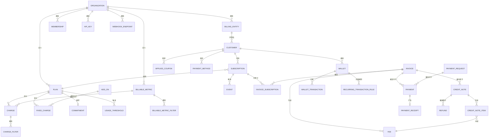
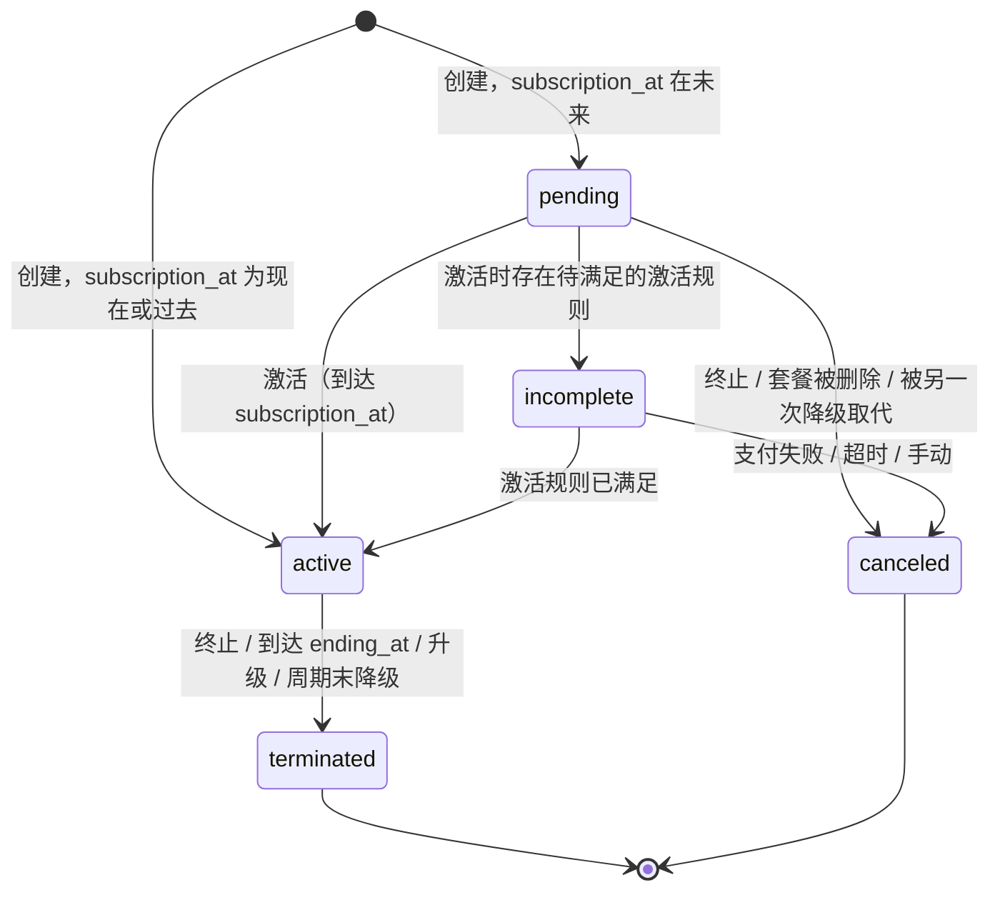

# Tanvo 领域模型

> [English](domain.md) | 简体中文

> 相关文档：[架构](architecture.zh-CN.md) · [功能对齐](parity.zh-CN.md) · [开发指南](development.zh-CN.md) · [测试策略](testing.zh-CN.md) · [路线图](roadmap.zh-CN.md) · [AGENTS.zh-CN.md](../AGENTS.zh-CN.md)

---

本文档定义 Tanvo 的业务实体、字段、不变式、枚举与生命周期，以及把它们串联起来的计费规则。`libs/core`（实体与仓储端口）和 `libs/billing`（计费引擎）依据本文档构建。行为以 lago-api 为准，标注 **[变更]** 的规则除外；Tanvo 不实现的遗留变体以 **[舍弃]** 列出。字段类型使用 §2.2 的记法。

## 目录

1. [概览](#1-概览)
2. [标识符与约定](#2-标识符与约定)
3. [枚举](#3-枚举)
4. [组织与计费主体](#4-组织与计费主体)
5. [访问控制：用户、成员、角色、API 密钥](#5-访问控制用户成员角色api-密钥)
6. [客户](#6-客户)
7. [目录](#7-目录)
8. [优惠券](#8-优惠券)
9. [订阅](#9-订阅)
10. [事件与用量](#10-事件与用量)
11. [发票](#11-发票)
12. [费用](#12-费用)
13. [贷项通知单](#13-贷项通知单)
14. [钱包](#14-钱包)
15. [支付](#15-支付)
16. [催收](#16-催收)
17. [集成](#17-集成)
18. [Webhook](#18-webhook)
19. [告警](#19-告警)
20. [数据导出](#20-数据导出)
21. [报价单、订购单、订单与合同](#21-报价单订购单订单与合同)
22. [计费规则](#22-计费规则)
23. [相对 Lago 的有意变更](#23-相对-lago-的有意变更)
24. [待定设计问题](#24-待定设计问题)

---

## 1. 概览

| 聚合 | 根 | 包含 | 章节 |
| :--- | :--- | :--- | :--- |
| 组织 | `Organization` | 设置、认证方式 | §4.1 |
| 计费主体 | `BillingEntity` | 编号、开票默认值、税务设置 | §4.2 |
| 访问控制 | `User`、`Membership`、`Role`、`Invite`、`APIKey` | 权限 | §5 |
| 客户 | `Customer` | 地址、元数据、计费设置 | §6 |
| 计费指标 | `BillableMetric` | 过滤器 | §7.1 |
| 套餐 | `Plan` | 计费项、固定计费项、承诺消费、用量阈值、权益 | §7.2–§7.10 |
| 附加项 | `AddOn` | 税 | §7.5 |
| 定价单位 | `PricingUnit` | — | §7.6 |
| 税 | `Tax` | — | §7.7 |
| 功能 | `Feature` | 特权项 | §7.10 |
| 优惠券 | `Coupon` | 适用对象；每个客户一个 `AppliedCoupon` | §8 |
| 订阅 | `Subscription` | 覆盖、激活规则、已触达阈值、权益覆盖 | §9 |
| 事件 | `Event` | —（只追加） | §10 |
| 发票 | `Invoice` | 发票订阅、费用、已应用税、元数据、结清记录 | §11、§12 |
| 贷项通知单 | `CreditNote` | 明细、已应用税、退款 | §13 |
| 钱包 | `Wallet` | 交易、周期充值规则、消耗记录 | §14 |
| 支付 | `Payment` | 收据 | §15 |
| 付款请求 | `PaymentRequest` | 发票关联 | §15.4 |
| 催收活动 | `DunningCampaign` | 阈值 | §16 |
| 集成 | `Integration` | 客户、映射、集合映射、条目 | §17 |
| Webhook 端点 | `WebhookEndpoint` | 投递记录 | §18 |
| 告警 | `Alert` | 阈值、已触发告警 | §19 |
| 数据导出 | `DataExport` | 分片 | §20 |
| 报价单、订购单、订单 | `Quote`、`OrderForm`、`Order` | 版本 | §21 |

全文使用的标记：

* **[变更]** Tanvo 有意与 lago-api 行为不同。每项变更也列在 §23。
* **[舍弃]** Tanvo 不实现的 Lago 遗留或已弃用变体。
* **[修复]** Tanvo 不复现的 lago-api 缺陷。

---

## 2. 标识符与约定

### 2.1 标识符
* 每一行都有服务端生成的 `id`（UUIDv7）和 `organization_id`；每个查询都按 `organization_id` 过滤（[架构 §5.4](architecture.zh-CN.md#54-租户隔离)）。
* 面向客户的标识符在组织内唯一：客户、订阅和钱包使用 `external_id`；计费指标、套餐、附加项、优惠券、税、功能、计费主体、定价单位、催收活动、集成、告警和钱包使用 `code`。
* API 通过 `id` 或带前缀的标识符 `external_id:<value>` / `code:<value>` 定位资源（[架构 §4.2](architecture.zh-CN.md#42-经由-vanguard-的-rest)）。
* 除另有说明外，`code` 长度为 1–255 个字符；资源被引用后 `code` 即不可变，具体见各实体。
* **[变更]** `code` 与 `external_id` 的唯一性只在存活的行（未终止、未归档、未删除）之间成立；资源消失后其 code 可以复用。这由部分唯一索引而非应用层检查保证。

### 2.2 类型

| 记法 | 含义 | 存储 |
| :--- | :--- | :--- |
| `ID` | UUIDv7 | `uuid` |
| `string(n)` | 至多 n 个字符的 UTF-8 文本，去除首尾空白 | 带 `CHECK` 的 `text` |
| `Money` | 以币种最小单位表示的金额 | `bigint` |
| `Decimal` | `money.Decimal`（精度 40） | `numeric` |
| `Currency` | ISO 4217 代码 | `text` |
| `Time` | 时刻，UTC | `timestamptz` |
| `Date` | 日历日期，在指定时区中解释 | `date` |
| `Zone` | IANA 时区名 | `text` |
| `Enum{…}` | 封闭的字符串集合 | 带 `CHECK` 的 `text`，Go 字符串类型 |
| `Metadata` | 有序键值列表，每个实体有各自的限制 | 子表 |
| `T?` | 可选（可为空） | — |

### 2.3 通用规则
* **金额**：最终金额以 `Money`（最小单位）存储；仍作为后续计算输入的值（取整前的费用金额、单价、额度）以 `Decimal`（“精确值”）存储。取整规则见 §22.9。绝不使用 `float64`。
* **时间**：时刻以 UTC 存储；日期和周期边界在适用时区（§22.1）中计算，并以本地午夜对应的 UTC 时刻存储。
* **周期**为左闭右开区间 `[from, to)`。**[变更]** Lago 以 23:59:59.999999 存储闭区间终点；Tanvo 存储下一个本地午夜。
* **删除**：有生命周期的资源带有状态（`terminated`、`archived`、`voided`、`deleted`）；无引用的行直接物理删除。**[变更]** 没有全局的 `deleted_at` 软删除。
* **元数据**在更新时整体替换（传入的列表替换已存储的列表）。
* **审计**：本文档中提到的每次状态变更都在同一事务中产生领域事件；Webhook（§18）和活动日志由其派生。
* **锁**：读写客户余额的操作（优惠券、贷项通知单、预付额度、钱包）获取各章节指明的客户咨询锁；计费运行锁定订阅。

---

## 3. 枚举

| 枚举 | 取值 | 使用者 |
| :--- | :--- | :--- |
| `AuthenticationMethod` | `email_password`、`google_oauth`、`okta`、`entra_id` | Organization |
| `DocumentNumbering` | `per_customer`、`per_billing_entity` | BillingEntity |
| `IssuingDateAnchor` | `current_period_end`、`next_period_start` | BillingEntity、Customer |
| `IssuingDateAdjustment` | `keep_anchor`、`align_with_finalization_date` | BillingEntity、Customer |
| `EmailSetting` | `invoice.finalized`、`credit_note.created`、`payment_receipt.created` | BillingEntity |
| `EInvoicingCountry` | `FR`、`DE` | BillingEntity |
| `MembershipStatus` | `active`、`revoked` | Membership |
| `InviteStatus` | `pending`、`accepted`、`revoked` | Invite |
| `PermissionLevel` | `read`、`write` | APIKey |
| `CustomerType` | `company`、`individual` | Customer |
| `AccountType` | `customer`、`partner` | Customer |
| `ZeroAmountFinalization` | `inherit`、`skip`、`finalize` | Customer |
| `AggregationType` | `count`、`sum`、`max`、`unique_count`、`weighted_sum`、`latest`、`custom` | BillableMetric |
| `WeightedInterval` | `seconds` | BillableMetric |
| `RoundingFunction` | `round`、`floor`、`ceil` | BillableMetric |
| `Interval` | `weekly`、`monthly`、`quarterly`、`semiannual`、`yearly` | Plan、RecurringTransactionRule |
| `ChargeModel` | `standard`、`graduated`、`graduated_percentage`、`package`、`percentage`、`volume`、`custom`、`dynamic` | Charge |
| `FixedChargeModel` | `standard`、`graduated`、`volume` | FixedCharge |
| `RegroupPaidFees` | `invoice` | Charge |
| `CommitmentType` | `minimum_commitment` | Commitment |
| `PrivilegeValueType` | `integer`、`string`、`boolean`、`select` | Privilege |
| `CouponType` | `fixed_amount`、`percentage` | Coupon |
| `CouponFrequency` | `once`、`recurring`、`forever` | Coupon |
| `CouponExpiration` | `no_expiration`、`time_limit` | Coupon |
| `CouponStatus` | `active`、`terminated` | Coupon、AppliedCoupon |
| `BillingTime` | `calendar`、`anniversary` | Subscription、Contract |
| `SubscriptionStatus` | `pending`、`incomplete`、`active`、`terminated`、`canceled` | Subscription |
| `CancellationReason` | `payment_failed`、`timeout`、`manual` | Subscription |
| `TerminationCreditNote` | `credit`、`refund`、`offset`、`skip` | Subscription |
| `TerminationInvoice` | `generate`、`skip` | Subscription |
| `PaymentMethodType` | `provider`、`manual` | Subscription、Wallet、Invoice |
| `ActivationRuleType` | `payment` | SubscriptionActivationRule |
| `ActivationRuleStatus` | `inactive`、`pending`、`satisfied`、`not_applicable`、`declined`、`failed`、`expired` | SubscriptionActivationRule |
| `OperationType` | `add`、`remove` | Event（去重计数） |
| `InvoiceType` | `subscription`、`credit`、`one_off`、`advance_charges`、`progressive_billing` | Invoice |
| `InvoiceStatus` | `generating`、`draft`、`open`、`finalized`、`closed`、`voided`、`failed` | Invoice |
| `PaymentStatus` | `pending`、`succeeded`、`failed` | Invoice、PaymentRequest |
| `TaxStatus` | `pending`、`succeeded`、`failed` | Invoice |
| `InvoicingReason` | `subscription_starting`、`subscription_periodic`、`subscription_terminating`、`in_advance_charge`、`in_advance_charge_periodic`、`progressive_billing` | InvoiceSubscription |
| `FeeType` | `subscription`、`charge`、`fixed_charge`、`add_on`、`credit`、`commitment`、`product` | Fee |
| `FeePaymentStatus` | `pending`、`succeeded`、`failed`、`refunded` | Fee |
| `CreditNoteStatus` | `draft`、`finalized` | CreditNote |
| `CreditStatus` | `available`、`consumed`、`voided` | CreditNote |
| `RefundStatus` | `pending`、`succeeded`、`failed` | CreditNote、Refund |
| `CreditNoteReason` | `duplicated_charge`、`product_unsatisfactory`、`order_change`、`order_cancellation`、`fraudulent_charge`、`other` | CreditNote |
| `WalletStatus` | `active`、`terminated` | Wallet |
| `TransactionType` | `inbound`、`outbound` | WalletTransaction |
| `TransactionStatus` | `purchased`、`granted`、`voided`、`invoiced` | WalletTransaction |
| `WalletTransactionStatus` | `pending`、`settled`、`failed` | WalletTransaction |
| `WalletTransactionSource` | `manual`、`interval`、`threshold` | WalletTransaction |
| `RecurringMethod` | `fixed`、`target` | RecurringTransactionRule |
| `RecurringTrigger` | `interval`、`threshold` | RecurringTransactionRule |
| `RuleStatus` | `active`、`terminated` | RecurringTransactionRule |
| `PaymentKind` | `provider`、`manual` | Payment |
| `PaymentState` | `pending`、`processing`、`succeeded`、`failed` | Payment |
| `IntegrationCategory` | `payment`、`accounting`、`tax`、`crm`、`auth` | Integration |
| `IntegrationProvider` | `stripe`、`adyen`、`gocardless`、`cashfree`、`moneyhash`、`flutterwave`、`netsuite`、`xero`、`anrok`、`avalara`、`hubspot`、`salesforce`、`okta`、`entra_id` | Integration |
| `MappableType` | `add_on`、`billable_metric` | IntegrationMapping |
| `CollectionMappingType` | `fallback_item`、`coupon`、`subscription_fee`、`minimum_commitment`、`tax`、`prepaid_credit`、`credit_note`、`account`、`currencies` | IntegrationCollectionMapping |
| `IntegrationResourceType` | `invoice`、`payment`、`credit_note`、`subscription` | IntegrationResource |
| `WebhookStatus` | `pending`、`retrying`、`succeeded`、`failed` | Webhook |
| `AlertType` | 见 §19 | Alert |
| `AlertDirection` | `increasing`、`decreasing` | Alert |
| `DataExportFormat` | `csv` | DataExport |
| `DataExportStatus` | `pending`、`processing`、`completed`、`failed` | DataExport |
| `DataExportResource` | `invoices`、`invoice_fees`、`credit_notes`、`credit_note_items` | DataExport |

只属于某一功能的枚举（入站 Webhook 状态、报价单状态、合同状态等）在各自章节中定义。

**[舍弃]** 作为存储状态的发票状态 `deleted`（删除的草稿直接移除，§11.7）；发票类型 `add_on`（由 `one_off` 取代）；一次性发票之外的 `add_on` 类型费用发票；覆盖套餐的 `overriden` 别名；`group`/`group_properties`（由计费项过滤器取代）；计费项属性别名 `grouped_by`（由 `pricing_group_keys` 取代）；`recurring_count_agg`；集成资源类型 `sales_order_deprecated`。

---

## 4. 组织与计费主体

### 4.1 组织

租户。其他所有实体都恰好属于一个组织。

| 字段 | 类型 | 规则 |
| :--- | :--- | :--- |
| `name` | `string(255)` | 必填 |
| `slug` | `string(63)` | 唯一，小写，由名称派生；用于客户门户 URL |
| `email` | `string(255)?` | 有效邮箱 |
| `logo` | blob 引用? | |
| `address` | Address | |
| `authentication_methods` | `[]AuthenticationMethod` | 至少一个 |
| `audit_logs_retention_days` | `int` | 默认 30 |
| `max_wallets_per_customer` | `int` | 默认 6 |
| `created_at` | `Time` | |

Address（共享值对象）：`line1`、`line2`、`city`、`state`、`zipcode`、`country`（ISO 3166-1 alpha-2）。全部可选；`country` 会被校验。

**[变更]** 组织不承载计费设置。Lago 在组织和计费主体上重复存储时区、币种、宽限期、净付款期限、单据编号方式、前缀、发票页脚、单据语言、税号、欧盟税务管理和邮件设置；在 Tanvo 中计费主体是唯一权威来源，组织只保留身份与访问设置。每个组织至少有一个计费主体，随组织一起创建。

**[变更]** 核心中没有高级版门槛：本文档中的每个功能对每个组织都可用。分析与助手位于 `ee/`（[架构 §14](architecture.zh-CN.md#14-企业版ee)）。

**[舍弃]** `organizations.webhook_url`、`api_key`、`hmac_key`（由 Webhook 端点和 API 密钥取代）、上述组织级重复设置，以及已弃用的公钥接口。

### 4.2 计费主体

单据的法定开具方。客户恰好属于一个计费主体；订阅可以覆盖它。

| 字段 | 类型 | 规则 |
| :--- | :--- | :--- |
| `code` | `string(255)` | 在未归档的主体中唯一；不可变 |
| `name` | `string(255)` | 必填 |
| `legal_name`、`legal_number`、`tax_id` | `string(255)?` | 打印在单据上 |
| `email`、`phone` | `string?` | |
| `address` | Address | |
| `logo` | blob 引用? | |
| `timezone` | `Zone` | 默认 `UTC` |
| `default_currency` | `Currency` | 默认 `USD` |
| `document_locale` | `string` | BCP 47 语言；默认 `en` |
| `document_numbering` | `DocumentNumbering` | 默认 `per_customer` |
| `document_number_prefix` | `string(10)` | 1–10 个字符，转为大写；默认取名称前 3 个字母（大写，A–Z）+ `-` + id 的后 4 个字符 |
| `invoice_footer` | `string(600)?` | |
| `invoice_grace_period_days` | `int` | ≥ 0；默认 0 |
| `net_payment_term_days` | `int` | ≥ 0；默认 0 |
| `finalize_zero_amount_invoice` | `bool` | 默认 true |
| `issuing_date_anchor` | `IssuingDateAnchor` | 默认 `next_period_start` |
| `issuing_date_adjustment` | `IssuingDateAdjustment` | 默认 `align_with_finalization_date` |
| `email_settings` | `[]EmailSetting` | 子集；默认为空 |
| `eu_tax_management` | `bool` | 要求地址的 `country` 位于欧盟 |
| `einvoicing` | `bool` | 仅当 `country` ∈ `EInvoicingCountry` 时允许 |
| `applied_dunning_campaign_id` | `ID?` | §16 |
| `invoice_sequence`、`invoice_sequence_month` | 内部计数器 | §22.11 |
| `archived_at` | `Time?` | |

规则：
* 计费主体从不删除，只归档。已归档的主体不能接收新客户或新订阅；已有单据继续引用它。
* 一个组织至多有一个默认计费主体（`is_default`），用于未指定主体时创建的客户。
* 修改 `document_numbering` 对之后定稿的单据生效；已有编号永不改变。
* 已应用税：计费主体有一组默认税（`billing_entity_taxes`），在税的解析中作为最后的兜底（§22.10）。
* 发票自定义区块（§11.9）可按计费主体选择。

---

## 5. 访问控制：用户、成员、角色、API 密钥

### 5.1 用户
登录的人。字段：`email`（唯一，不区分大小写）、`password_hash`（argon2id，仅 SSO 用户没有）、`name?`、`created_at`、`last_sign_in_at?`。一个用户可以属于多个组织。

### 5.2 成员
以某个角色把用户关联到组织。

| 字段 | 类型 | 规则 |
| :--- | :--- | :--- |
| `user_id`、`organization_id` | `ID` | 在有效成员中唯一 |
| `role_id` | `ID` | 组织的内置或自定义角色 |
| `status` | `MembershipStatus` | `active` → `revoked`（终态） |
| `revoked_at` | `Time?` | |

规则：
* 组织的最后一个有效管理员不能被撤销或降级。
* 用户不能撤销自己的成员资格。
* 只有管理员可以授予 `admin` 角色。

### 5.3 角色与权限
* 权限是形如 `<resource>:<action>` 的字符串（`customers:read`、`invoices:void` 等）。完整列表定义在 `libs/core/permission`，并记录在 API 参考中。
* 内置角色：`admin`（全部权限）、`finance`、`manager`。内置角色不可修改。
* 自定义角色：`code`（`string(100)`，唯一，不得为内置名称）、`name`、`description?`、`permissions []string`。被成员使用的自定义角色不能删除。
* SSO（Okta、Entra ID、OIDC）按集成上配置的角色把身份映射为成员。**[修复]** Lago 在 Okta/Entra 注册时不论配置都分配固定角色。

### 5.4 邀请
`email`、`role_id`、`token`（随机生成，存储哈希）、`status`（`pending` → `accepted` | `revoked`）、`expires_at`。接受邀请会创建（或复用）用户并建立有效成员资格。若某邮箱已有有效成员资格，则拒绝为其创建待处理邀请。

密码重置令牌 30 分钟后过期，且只能使用一次。

### 5.5 API 密钥

| 字段 | 类型 | 规则 |
| :--- | :--- | :--- |
| `name` | `string(255)?` | |
| `token_hash` | `bytes` | 密钥的 SHA-256；密钥只显示一次 |
| `prefix` | `string` | 密钥的前几个字符，用于展示 |
| `permissions` | 资源 → `PermissionLevel` 的映射 | 空映射 = 完全访问 |
| `expires_at` | `Time?` | |
| `last_used_at` | `Time?` | |

规则：
* 组织至少保留一个不过期的密钥；最后一个不能被删除或设置过期时间。
* 轮换会创建新密钥，并设置旧密钥的 `expires_at`（立即或在选定时刻）。

### 5.6 客户门户令牌
限定于单个客户的无状态签名令牌，有效期 12 小时，可读取该客户的发票、用量和钱包，并可修改其自身的账单信息。

---

## 6. 客户

被开票的一方。

| 字段 | 类型 | 规则 |
| :--- | :--- | :--- |
| `external_id` | `string(255)` | 必填；在未删除的客户中唯一 |
| `billing_entity_id` | `ID` | 必填；默认取组织的默认主体 |
| `customer_type` | `CustomerType?` | |
| `account_type` | `AccountType` | 默认 `customer` |
| `name` | `string(255)?` | |
| `firstname`、`lastname` | `string(255)?` | |
| `legal_name`、`legal_number` | `string(255)?` | |
| `tax_identification_number` | `string(255)?` | |
| `email` | `string?` | 逗号分隔的有效邮箱列表 |
| `phone`、`url`、`logo_url` | `string?` | |
| `billing_address` | Address | |
| `shipping_address` | Address | 打印时每个空字段回退到账单地址的对应字段 |
| `currency` | `Currency?` | 只设置一次；见规则 |
| `timezone` | `Zone?` | |
| `document_locale` | `string?` | |
| `invoice_grace_period_days` | `int?` | ≥ 0 |
| `net_payment_term_days` | `int?` | ≥ 0 |
| `finalize_zero_amount_invoice` | `ZeroAmountFinalization` | 默认 `inherit` |
| `issuing_date_anchor`、`issuing_date_adjustment` | 枚举? | `null` = 继承 |
| `skip_invoice_custom_sections` | `bool` | |
| `applied_dunning_campaign_id` | `ID?` | |
| `exclude_from_dunning_campaign` | `bool` | |
| `last_dunning_campaign_attempt`、`last_dunning_campaign_attempt_at` | `int`、`Time?` | |
| `sequential_id` | `int` | 创建时按计费主体分配 |
| `slug` | `string` | `<prefix>-<sequential_id %03d>` |
| `payment_receipt_counter` | `int` | §22.11 |
| `metadata` | Metadata | ≤ 5 项；键 ≤ 20，值 ≤ 100；`display_in_invoice bool` |
| `deleted_at` | `Time?` | 有单据的客户只归档，不物理删除 |

规则：
* 设置按 客户 → 计费主体（时区再 → UTC）解析。**[变更]** Lago 在部分代码路径回退到组织，在另一些路径回退到计费主体；Tanvo 处处使用计费主体。
* `currency` 为空时可以设置；只有当客户没有使用其他币种的订阅、发票、已应用优惠券或钱包时才能修改。客户的每个订阅、钱包、已应用优惠券和一次性发票都使用该币种；币种为空时由第一个这样的对象设置。
* 客户在没有订阅、发票、已应用优惠券和钱包时是**可编辑**的。只有可编辑的客户才能修改 `external_id` 或 `account_type`。
* `account_type = partner`：开给该客户的发票为自开票（§11.1）。
* 删除客户会终止其订阅（生成终止发票）、终止其钱包和已应用优惠券并将其归档；其发票保留。
* 每个客户的咨询锁：`coupons`、`credit_notes`、`prepaid_credits`、`billing_schedule`。
* 欧盟税务管理：当计费主体启用 `eu_tax_management` 时，在创建客户以及地址或税号变更时运行 VIES 校验，并为客户分配欧盟税（§22.10）；结果以 `customer.vies_check` 发出。
* 支付与集成连接：见 §15.5 和 §17.2。**[变更]** 没有单一的 `payment_provider` 列；客户可以连接多个服务商，每个类别一个默认连接。

---

## 7. 目录

### 7.1 计费指标

计量的对象。

| 字段 | 类型 | 规则 |
| :--- | :--- | :--- |
| `code` | `string(255)` | 唯一 |
| `name` | `string(255)` | 必填 |
| `description` | `string?` | |
| `aggregation_type` | `AggregationType` | 必填 |
| `field_name` | `string?` | 被聚合的事件属性；`count` 和 `custom` 以外必填 |
| `weighted_interval` | `WeightedInterval?` | `weighted_sum` 必填（= `seconds`），其他类型禁止 |
| `recurring` | `bool` | `count`、`max`、`latest` 禁止 |
| `expression` | `string?` | lago-expression；其结果在聚合前写入 `field_name` |
| `custom_aggregator` | `string?` | `custom` 必填（§24，问题 1） |
| `rounding_function` | `RoundingFunction?` | |
| `rounding_precision` | `int?` | 设置取整函数时默认 0；可以为负 |
| `filters` | `[]BillableMetricFilter` | |

`BillableMetricFilter`：`key string(255)`（事件属性）、`values []string`（非空、不重复）。每个计费指标内键唯一。

规则：
* 计费指标一旦被计费项使用，`code`、`aggregation_type`、`weighted_interval`、`field_name`、`recurring`、`rounding_function`、`rounding_precision` 和 `expression` 即被锁定。
* 删除过滤器的某个值会删除使用该值的计费项过滤器取值；删除过滤器的键会删除引用该键的计费项过滤器。
* 删除计费指标会从所有套餐中删除其计费项（及其过滤器），并重新计算草稿发票。
* 可预付：只有 `count`、`sum`、`unique_count` 和 `custom` 计费指标可以支撑预付计费项。

聚合语义（在 `libs/metering` 中实现）：

| 类型 | 周期内的值 | 周期性行为 |
| :--- | :--- | :--- |
| `count` | 事件数 | — |
| `sum` | Σ `field_name` | 跨周期累计运行总和 |
| `max` | `field_name` 最大值 | — |
| `unique_count` | `field_name` 不同取值的个数；`operation_type=remove` 移除一个取值 | 取值持续存在直到被移除；按存在天数折算 |
| `weighted_sum` | Σ 值 × 持有秒数 / 周期秒数 | 最后一个值作为下一周期的初始值 |
| `latest` | 最新事件的 `field_name` | — |
| `custom` | 自定义聚合器的结果 | 由聚合器决定 |

取整作用于聚合值（不是单个事件），使用计费指标的函数和精度，在定价之前进行。

**[舍弃]** 遗留的计费指标属性、`recurring_count_agg`、分组（groups）。

### 7.2 套餐

带价格的报价方案。

| 字段 | 类型 | 规则 |
| :--- | :--- | :--- |
| `code` | `string(255)` | 在非子套餐中唯一 |
| `name` | `string(255)` | 必填 |
| `invoice_display_name` | `string?` | |
| `description` | `string?` | |
| `interval` | `Interval` | 必填 |
| `amount` | `Money` | ≥ 0；每周期的订阅（基础）费 |
| `currency` | `Currency` | 必填 |
| `pay_in_advance` | `bool` | 基础费在周期开始（true）或结束（false）时计费 |
| `trial_period_days` | `int` | ≥ 0 |
| `bill_charges_monthly` | `bool?` | 仅用于 `yearly` 和 `semiannual` 套餐 |
| `bill_fixed_charges_monthly` | `bool?` | 仅用于 `yearly` 和 `semiannual` 套餐 |
| `parent_id` | `ID?` | 覆盖套餐（§7.2.1）才设置 |
| `taxes` | `[]Tax` | |
| `metadata` | Metadata | |
| `status` | Enum{`active`、`pending_deletion`} | |

规则：
* 套餐一旦有订阅，`code`、`interval`、`pay_in_advance`、`currency`、`trial_period_days`、`bill_charges_monthly` 和 `bill_fixed_charges_monthly` 即被锁定。
* 删除套餐会将其置为 `pending_deletion`，终止其有效订阅（生成终止发票），取消其待生效订阅，然后在任务中删除套餐。
* `yearly_amount` = `amount` × 每年周期数（52、12、4、2、1）；它决定升级还是降级（§22.13）。
* **[变更]** 试用期为整数天（`int`）；Lago 存储浮点数。

#### 7.2.1 覆盖套餐
创建订阅时可以覆盖套餐的金额、名称、描述、试用期、税、计费项、固定计费项、承诺消费和用量阈值。Tanvo 将其物化为只供该订阅使用的子套餐（`parent_id` = 原套餐）。
* 子套餐继承所有未覆盖的内容；`code` 与父套餐相同。
* 以 `cascade_updates = true` 编辑父套餐时，变更的字段会传播到那些取值仍等于父套餐原值的子套餐。
* 删除父套餐会删除其子套餐。

### 7.3 计费项

在套餐上为计费指标定价。

| 字段 | 类型 | 规则 |
| :--- | :--- | :--- |
| `code` | `string(255)` | 套餐内唯一；默认 `<计费指标 code>`，然后是 `<计费指标 code>_2`、`_3`…… |
| `billable_metric_id` | `ID` | |
| `charge_model` | `ChargeModel` | |
| `properties` | `ChargeProperties` | 按计费模型，见下 |
| `filters` | `[]ChargeFilter` | §7.4 |
| `pay_in_advance` | `bool` | |
| `invoiceable` | `bool` | 默认 true |
| `regroup_paid_fees` | `RegroupPaidFees?` | |
| `prorated` | `bool` | |
| `min_amount` | `Money` | ≥ 0；每周期最低金额 |
| `invoice_display_name` | `string?` | |
| `applied_pricing_unit` | `{pricing_unit_id, conversion_rate Decimal}?` | §7.6 |
| `taxes` | `[]Tax` | |

校验矩阵：

| 规则 | 条件 |
| :--- | :--- |
| `dynamic` | 计费指标 `aggregation_type = sum` |
| `custom` | 计费指标 `aggregation_type = custom` |
| `pay_in_advance = true` | 计费模型 ≠ `volume`；计费指标可预付（§7.1） |
| `invoiceable = false` | `pay_in_advance = true` |
| `regroup_paid_fees = invoice` | `pay_in_advance = true` 且 `invoiceable = false` |
| `min_amount > 0` | `pay_in_advance = false` |
| `prorated = true` | 计费指标为 `recurring`；计费指标 ≠ `weighted_sum`；预付时计费模型 = `standard`；后付时计费模型 ∈ {`standard`、`volume`、`graduated`} |
| `percentage`、`graduated_percentage` | 计费指标 ≠ `latest` |

各计费模型的属性（除另有说明外为 `Decimal`）：

| 计费模型 | 属性 | 规则 |
| :--- | :--- | :--- |
| `standard` | `amount` | ≥ 0 |
| `package` | `amount`、`package_size int`、`free_units int` | 包大小 > 0；免费量 ≥ 0 |
| `percentage` | `rate`、`fixed_amount?`、`free_units_per_events int?`、`free_units_per_total_aggregation?`、`per_transaction_min_amount?`、`per_transaction_max_amount?` | 费率 ≥ 0；免费事件数 > 0；最小值 ≤ 最大值 |
| `graduated` | `ranges []{to?, per_unit_amount, flat_amount}` | 见阶梯 |
| `volume` | `ranges []{to?, per_unit_amount, flat_amount}` | 见阶梯 |
| `graduated_percentage` | `ranges []{to?, rate, flat_amount}` | 见阶梯 |
| `custom` | `custom_properties`（JSON 对象） | 传给自定义聚合器 |
| `dynamic` | — | 价格来自事件 |

每个计费模型还接受 `pricing_group_keys []string`（这些事件属性的每种不同组合产生一笔费用）和 `presentation_group_keys []{key, display_in_invoice bool}`（至多 2 个；在发票上拆分展示一笔费用，不改变价格）。

**阶梯 [变更]**：阶梯以相邻的左开右闭区间存储。输入是有序的上界列表；在累进计数中第 *i* 档覆盖 `(to[i-1], to[i]]`，第一档从 0 开始，最后一档没有上界（`to = null`）。校验：至少一档；上界严格递增；只有最后一档无上界；金额和费率 ≥ 0。不接受 Lago 带 `+1` 间隙的闭区间 `from`/`to` 输入（libs/pricing 保留一个适配器用于移植测试用例）。

计费模型计算（`u` = 计费指标取整后的用量）：
* `standard`：`u × amount`。
* `package`：`ceil(max(u − free_units, 0) / package_size) × amount`。
* `graduated`：对各档求和（落在该档的用量 × `per_unit_amount` + 若该档有用量则加 `flat_amount`）。
* `volume`：取包含 `u` 的那一档：`u × per_unit_amount + flat_amount`；`u = 0` 时为 0。
* `percentage`：`max(u − free_units_per_total_aggregation, 0) × rate / 100` + `max(events − free_units_per_events, 0) × fixed_amount`；设置了单笔上下限时，每个事件的金额（`value × rate / 100 + fixed_amount`）先被限制在 `[min, max]` 内，再对限制后的金额求和。
* `graduated_percentage`：对各档求和（落在该档的金额 × `rate` / 100 + 若该档有金额则加 `flat_amount`）。
* `dynamic`：事件 `precise_total_amount` 之和，以币种单位计。
* `custom`：由自定义聚合器返回金额。
* 预付费用：单个事件的费用为当前周期内 `amount(含该事件的总量) − amount(不含该事件的总量)`。
* 费用上展示的单价在用量 > 0 时为 `amount / units`。

### 7.4 计费项过滤器

以独立属性为计费项的一部分事件定价。

| 字段 | 类型 | 规则 |
| :--- | :--- | :--- |
| `charge_id` | `ID` | |
| `values` | 计费指标过滤器键 → `[]string` 的映射 | 每个键都是该计费指标的过滤器；取值 ⊆ 过滤器的取值，或为唯一的哨兵值 `__ALL_FILTER_VALUES__` |
| `properties` | `ChargeProperties` | 与计费项相同的计费模型 |
| `invoice_display_name` | `string?` | |

规则：
* 当过滤器的每个键上，事件属性都等于其中一个取值（哨兵值则任意取值）时，事件匹配该过滤器。
* 多个过滤器匹配时，最具体的胜出：先比键的数量（多者胜），再比允许的取值数（少者胜），再比 `created_at`（早者胜）。
* 不匹配任何过滤器的事件按计费项自身的属性定价（默认桶）。
* 每个过滤器有稳定的代码：其键值对的 slug 加 8 位十六进制 SHA-256 后缀，≤ 200 个字符；富化时写入富化后的事件。

### 7.5 固定计费项与附加项

**附加项**：可复用的带价格条目。

| 字段 | 类型 | 规则 |
| :--- | :--- | :--- |
| `code` | `string(255)` | 唯一 |
| `name` | `string(255)` | |
| `invoice_display_name`、`description` | `string?` | |
| `amount` | `Money` | > 0 |
| `currency` | `Currency` | |
| `taxes` | `[]Tax` | |

附加项用于一次性发票（§11.6）和固定计费项。

**固定计费项**：套餐上按数量计费的周期性计费项，以附加项定价。

| 字段 | 类型 | 规则 |
| :--- | :--- | :--- |
| `code` | `string(255)` | 套餐内唯一 |
| `add_on_id` | `ID` | |
| `charge_model` | `FixedChargeModel` | |
| `properties` | `ChargeProperties` | `standard`、`graduated` 或 `volume` |
| `units` | `Decimal` | ≥ 0；订阅的默认数量 |
| `pay_in_advance` | `bool` | 不能与 `volume` 同用 |
| `prorated` | `bool` | 不能与 `graduated` + `pay_in_advance` 同用 |
| `invoice_display_name` | `string?` | |
| `taxes` | `[]Tax` | |

按订阅的数量：订阅可以覆盖固定计费项的数量。数量变更是一个**固定计费项事件** `{subscription_id, fixed_charge_id, units, timestamp}`：
* `apply_units_immediately = true` 时在变更时刻生效（固定计费项可折算时按比例折算；预付时立即对差额计费）。
* 否则在下一个计费周期开始时生效。
* 每个订阅、固定计费项和日期至多保留一个事件（同一天较晚的事件替换较早的）。

固定计费项在一个周期内的数量：可折算时为各时刻生效数量按时间加权，否则为计费时刻生效的数量。

### 7.6 定价单位

计费项可以使用的自定义单位（例如积分或 token）。

| 字段 | 类型 | 规则 |
| :--- | :--- | :--- |
| `code` | `string(255)` | 唯一；不可变 |
| `name` | `string(255)` | |
| `short_name` | `string(3)` | |
| `description` | `string(600)?` | |
| `exponent` | `int` | 2 |

以定价单位定价的计费项带有 `conversion_rate > 0`（每个定价单位对应的法币金额）。费用同时记录定价单位金额（`pricing_unit_usage`：金额、单价、换算率）和币种金额：`fiat = round_half_up(amount × conversion_rate, 币种指数)`。税、优惠券和额度作用于法币金额。

### 7.7 税

| 字段 | 类型 | 规则 |
| :--- | :--- | :--- |
| `code` | `string(255)` | 唯一 |
| `name` | `string(255)` | |
| `rate` | `Decimal` | 0 ≤ rate ≤ 100（百分比） |
| `description` | `string?` | |
| `auto_generated` | `bool` | 由欧盟税务管理创建；只读 |

税挂接在计费主体、客户、套餐、计费项、固定计费项、附加项和承诺消费上；解析规则见 §22.10。修改税率会刷新使用该税的草稿发票。删除税会在各处解除挂接；已开具的单据保留其已应用税快照（代码、名称、税率、金额）。

**[舍弃]** `vat_rate` 列。

### 7.8 承诺消费

每个计费周期的最低消费。

| 字段 | 类型 | 规则 |
| :--- | :--- | :--- |
| `plan_id` | `ID` | 每个套餐每种类型至多一个 |
| `commitment_type` | `CommitmentType` | `minimum_commitment` |
| `amount` | `Money` | > 0 |
| `invoice_display_name` | `string?` | |
| `taxes` | `[]Tax` | |

补差规则见 §22.15。

### 7.9 用量阈值

当当前周期的用量金额达到某个金额时触发一张渐进式计费发票。

| 字段 | 类型 | 规则 |
| :--- | :--- | :--- |
| `plan_id` 或 `subscription_id` 二选一 | `ID` | 恰好一个 |
| `amount` | `Money` | > 0 |
| `recurring` | `bool` | 每个所有者至多一个周期性阈值 |
| `threshold_display_name` | `string?` | |

规则：
* 非周期性阈值的金额在同一所有者内唯一；周期性阈值的金额是最大非周期性阈值之后的步长。
* 订阅自己的阈值取代套餐的阈值。
* 订阅上的 `progressive_billing_disabled` 同时停用两者。
* 每个已触达的阈值记录为 `AppliedUsageThreshold` {threshold, invoice, lifetime_usage_amount}。渐进式计费见 §22.16。

### 7.10 功能与权益

**功能**：`code string(255)` 唯一、`name?`、`description?`、`privileges []Privilege`。

**特权项**：`code string(255)` 在功能内唯一、`name?`、`value_type PrivilegeValueType`、`select_options []string`（`select` 类型必填且非空）。

**权益**：把功能授予套餐或订阅，带有 `values`（特权项代码 → 值的映射）。值按特权项类型校验（`integer` 为 64 位整数、`boolean`、`select` 的值须在选项内）。

订阅的有效权益 = 套餐的权益 − 订阅的移除项（`subscription_feature_removals`）+ 订阅自己的权益（逐个特权项覆盖套餐的值）。删除功能会移除其权益。

---

## 8. 优惠券

### 8.1 优惠券

| 字段 | 类型 | 规则 |
| :--- | :--- | :--- |
| `code` | `string(255)` | 唯一 |
| `name` | `string(255)` | |
| `description` | `string?` | |
| `coupon_type` | `CouponType` | |
| `amount` | `Money?` + `currency` | `fixed_amount` 必填 |
| `percentage_rate` | `Decimal?` | `percentage` 必填；0 < rate ≤ 100 |
| `frequency` | `CouponFrequency` | |
| `frequency_duration` | `int?` | 计费周期数；`recurring` 必填（> 0） |
| `reusable` | `bool` | 默认 true |
| `expiration` | `CouponExpiration` | |
| `expiration_at` | `Time?` | `time_limit` 必填；须在未来 |
| `limited_plans` | `[]PlanID` | |
| `limited_billable_metrics` | `[]MetricID` | 适用对象为套餐**或**计费指标，不能同时 |
| `status` | `CouponStatus` | `active` → `terminated` |

规则：
* 一旦被应用，只能修改 `name`、`description` 和过期设置。
* 超过 `expiration_at` 的优惠券由周期任务终止；终止优惠券不影响已应用的优惠券。
* 删除优惠券会终止它及其已应用优惠券。

### 8.2 已应用优惠券

| 字段 | 类型 | 规则 |
| :--- | :--- | :--- |
| `coupon_id`、`customer_id` | `ID` | |
| `amount`、`percentage_rate`、`frequency`、`frequency_duration` | 同优惠券 | 应用时记录的覆盖值 |
| `amount_currency` | `Currency` | = 客户币种 |
| `frequency_duration_remaining` | `int?` | |
| `remaining_amount` | `Money?` | 用于 `once` + `fixed_amount` |
| `status` | `CouponStatus` | |
| `terminated_at` | `Time?` | |

规则：
* 不可复用的优惠券对一个客户只能应用一次（错误 `coupon_is_not_reusable`）。
* 若客户已有一个有效的已应用优惠券针对相同套餐，则不能再应用限定套餐的优惠券（错误 `plan_overlapping`）。
* `fixed_amount` 优惠券的币种必须等于客户币种。
* 在发票上的应用见 §22.7。

---

## 9. 订阅

### 9.1 字段

| 字段 | 类型 | 规则 |
| :--- | :--- | :--- |
| `external_id` | `string(255)` | 在 `pending`、`incomplete` 和 `active` 订阅中唯一 |
| `customer_id` | `ID` | |
| `plan_id` | `ID` | |
| `name` | `string(255)?` | |
| `billing_time` | `BillingTime` | 默认 `calendar` |
| `status` | `SubscriptionStatus` | §9.2 |
| `subscription_at` | `Time` | 请求的开始时间；默认为当前时刻 |
| `started_at` | `Time?` | 实际激活时间 |
| `ending_at` | `Time?` | 计划的自动终止时间；> `subscription_at` |
| `terminated_at`、`canceled_at` | `Time?` | |
| `trial_ended_at` | `Time?` | |
| `cancellation_reason` | `CancellationReason?` | |
| `previous_subscription_id` | `ID?` | 本订阅所升级或降级的订阅 |
| `on_termination_credit_note` | `TerminationCreditNote?` | 仅用于预付套餐；默认 `credit` |
| `on_termination_invoice` | `TerminationInvoice` | 默认 `generate` |
| `payment_method_type` | `PaymentMethodType` | 默认 `provider` |
| `payment_method_id` | `ID?` | |
| `progressive_billing_disabled` | `bool` | |
| `consolidate_invoice` | `bool` | 默认 true；false = 本订阅从不与其他订阅合并开票 |
| `purchase_order_number` | `string(255)?` | `pending` 或 `active` 时可编辑 |
| `billing_entity_id` | `ID?` | 覆盖客户的计费主体 |
| `skip_invoice_custom_sections` + 选定的区块 | | §11.9 |
| `next_billing_at` | `Time?` | **[变更]** 调度时刻（§22.17） |

订阅自有的实体：固定计费项数量覆盖（§7.5）、用量阈值（§7.9）、权益与移除项（§7.10）、激活规则（§9.3）、已触达用量阈值。

### 9.2 生命周期

* `subscription_at` ≤ 当前时刻的创建会立即激活（`started_at = subscription_at`，可以是过去）；更晚的日期得到 `pending`，由其调度任务在 `subscription_at` 激活。
* `incomplete` 订阅不接收事件（§10.2），也不参与周期计费。
* 在相应的状态转换时发出 `subscription.started`、`subscription.incomplete`、`subscription.canceled`、`subscription.terminated`、`subscription.updated`。
* 在 `ending_at` 之前 15 天和 45 天发出 `subscription.termination_alert`。

### 9.3 激活规则

订阅可以要求首张发票支付成功后才变为有效。

| 字段 | 类型 | 规则 |
| :--- | :--- | :--- |
| `rule_type` | `ActivationRuleType` | `payment` |
| `timeout_hours` | `int` | ≥ 0；0 = 不超时 |
| `status` | `ActivationRuleStatus` | |
| `expires_at` | `Time?` | 激活时间 + 超时 |

* 当激活会产生需要立即支付的发票时，规则**适用**：套餐为预付且订阅不在试用期，或套餐有预付固定计费项。否则规则变为 `not_applicable`，订阅直接激活。
* 适用的规则：状态 `pending`，订阅 `incomplete`，开始发票被门控（保持 `open`，在规则有结果之前不编号）。
* 支付成功 → 规则 `satisfied`，订阅 `active`，发票定稿。
* 支付失败 → `failed`，订阅 `canceled`（`payment_failed`），门控发票变为 `closed`，其消耗的内容（优惠券、贷项通知单、钱包额度）被恢复。
* 超时 → `expired`，`canceled`（`timeout`）；终止 `incomplete` 订阅 → `declined`，`canceled`（`manual`）。两者都会关闭门控发票并取消服务商侧的支付。
* 规则只能在订阅为 `pending` 时修改。`payment` 规则要求一个服务商支付方式（显式指定或客户默认）。

### 9.4 试用期
* 试用期从订阅链的起点开始（升级链中第一个订阅的 `started_at`），因此在升级和降级后延续：试用期结束 = 链起点 + `trial_period_days` 天（按客户时区）。
* 试用期内的天数不收基础费（§22.5）；用量计费项照常计费。
* 试用期结束时：设置 `trial_ended_at`，发出 `subscription.trial_ended`；对预付套餐，为该周期剩余部分的基础费开票。

### 9.5 更新
* 可编辑：`name`、`ending_at`、`subscription_at`（仅 `pending` 时）、`purchase_order_number`、`payment_method`、`progressive_billing_disabled`、`consolidate_invoice`、终止选项、发票自定义区块和套餐覆盖（会创建或更新子套餐）。
* 修改套餐即为升级或降级（§22.13）。

### 9.6 发票合并
同一客户在同一时刻计费的订阅，若支付方式、币种、计费主体和采购订单号相同且都为 `consolidate_invoice = true`，则共用一张发票。

---

## 10. 事件与用量

### 10.1 事件

| 字段 | 类型 | 规则 |
| :--- | :--- | :--- |
| `transaction_id` | `string(255)` | 必填 |
| `code` | `string(255)` | 计费指标代码 |
| `external_subscription_id` | `string(255)` | 必填 |
| `timestamp` | `Time` | 默认为接收时刻；接受 RFC 3339 或带小数的 Unix 秒 |
| `properties` | string → string 的映射 | 数字以字符串或 JSON 数字发送，规范化为十进制字符串 |
| `precise_total_amount` | `Decimal?` | 用于 `dynamic` 计费项 |
| `ingested_at` | `Time` | |

规则：
* 每批至多 100 个事件；每个事件独立校验。
* **去重 [变更]**：键为（组织，`transaction_id`）。Lago 使用（组织，外部订阅，事务 ID）。以相同时间戳重发已知的 `transaction_id` 会替换已存储的事件（更正）；时间戳不同则作为重复事件拒绝。见 §24，问题 11。

### 10.2 富化与校验
* 事件的订阅是满足 `external_id = external_subscription_id`、状态为 `active` 或 `terminated`、且 `started_at ≤ timestamp < terminated_at` 的订阅。`pending`、`incomplete` 和 `canceled` 订阅永不匹配。对周期性计费指标，没有匹配周期的事件回退到有效订阅。
* 若计费指标有 `expression`，则对其求值并把结果存入 `properties[field_name]`。
* 后置校验错误被记录，并在 `events.errors` Webhook 中（批量）报告：`invalid_code`（没有该代码的计费指标）、`missing_aggregation_property`（缺少 `field_name`）、`invalid_filter_values`（过滤器属性的取值不在过滤器取值内）。
* 每个（事件，匹配的计费项过滤器或默认桶）写入一行富化记录（[架构 §7.2](architecture.zh-CN.md#72-富化)）。
* 预付计费项为每个事件产生一笔费用（§22.4）。

**[舍弃]** 已弃用的 `event.error` Webhook。

### 10.3 用量
* **当前用量**：订阅当前周期截至此刻计算出的费用，含税，不持久化。
* **预测用量**：当前用量除以周期已过比例（`已过天数 / 周期天数`），用量四舍五入到 2 位小数，再定价。周期性计费指标不做预测。
* **历史用量**：已开票周期的费用，从发票读取。
* **生命周期用量**：按订阅链计算，`historical_usage`（导入）+ `invoiced_usage` + `current_usage`；在事件到达和开票后刷新；驱动用量阈值（§22.16）和生命周期告警（§19）。
* 每日用量时间序列是 `ee/` 中的分析功能。

---
